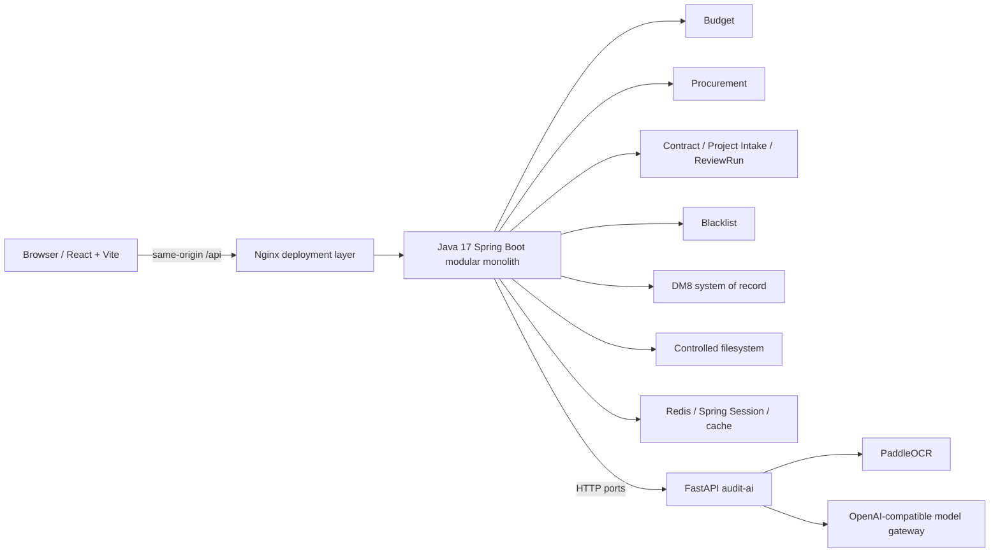
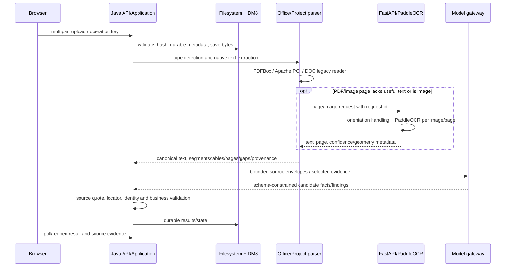
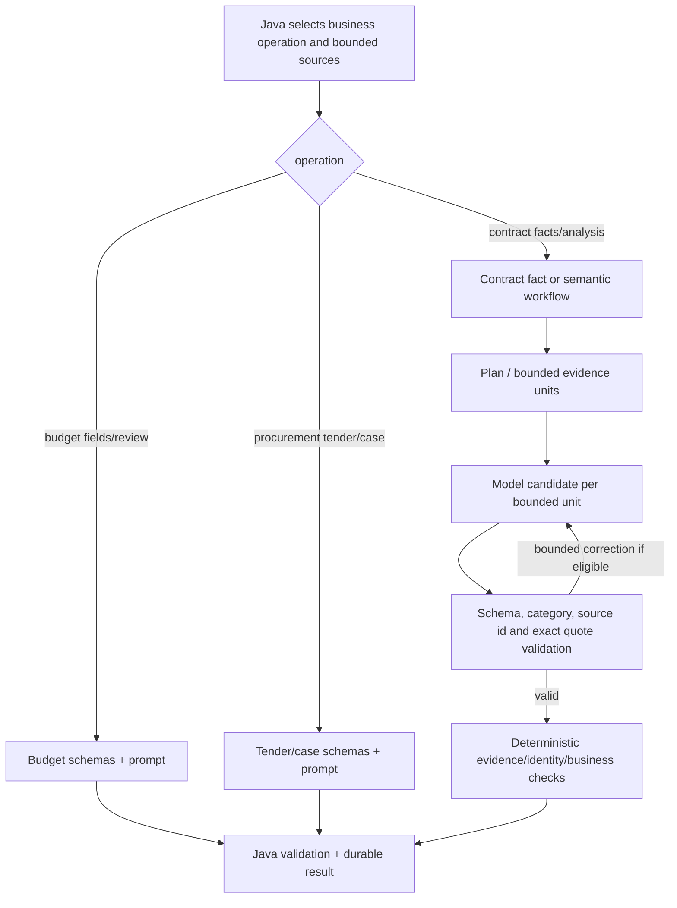
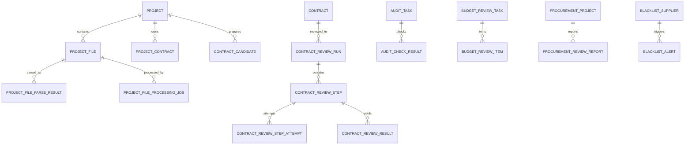

# 智能审查系统全面技术摸底

调查日期：2026-11-10
调查基线：`integrate/github-latest-20261105`，`02a0dea7e28a710225fcabd330363133fbb0910e`
状态：只读代码/文档调查。没有修改业务代码、配置或数据库，没有部署、重启、推送或执行全量测试。

## 调查边界与结论口径

本报告区分源码实现、仓库文档记录、既有测试证据和本次无法确认的外部事实。`IMPLEMENTED` 只表示在源码中找到实现；`VERIFIED` 必须有已记录的命令、环境和观察结果。客户现场数据、当前 DM8 schema 及 ARM64 部署没有在本次连接验证，均标为待确认。本文不含正文样本、个人数据或凭据。

仓库 `AGENTS.md` 指定根目录 `D:\code\audit_agent_1D`，实际本轮工作目录为 `E:\audit-agent-new\.runtime\budget-home-e17-20261014`；这是文档与执行环境不一致，需维护者确认。本地 Git 有一个未提交提交领先 origin，另有用户未提交改动及未跟踪 QA 报告；均保留未动。

## 1. 项目整体架构

### 基本信息

| 项目 | 调查结果 | 依据/状态 |
|---|---|---|
| 仓库/分支 | 当前工作目录如上；`integrate/github-latest-20261105` | 本机 Git 已读 |
| HEAD | `02a0dea7e28a710225fcabd330363133fbb0910e`；本地领先 origin 1 commit | 本机 Git 已读 |
| 工作区 | dirty；`DEPLOYMENT-MEMORY.md`、安全/前端文件修改，另有未跟踪 `docs/qa-26/three-module-regression-20261110.md` | `git status --short --branch` |
| 前端 | React 18.3.1 peer dependency、Vite 6.4.4；Chrome 109 构建脚本 `build:customer` | `frontend/package.json`；React 由 peer 提供，需由实际安装树确认解析版本 |
| Java | Java 17、Spring Boot 3.5.16、MyBatis Spring Boot 3.0.5 | `backend/pom.xml` |
| 数据库 | DM8 为正式关系库；驱动 `DmJdbcDriver18 8.1.3.140`。现场 DM8 产品版本/实例状态未查询 | `AGENTS.md`、POM、`db/dm8/README.md` |
| 缓存/Session | Redis + Spring Session；非业务事实源。没有发现核心业务依赖的消息队列 | POM、`README.md`、DM8 README |
| 文件存储 | 受控文件系统 adapter；非对象存储 | `integration/file/FileSystemStorageAdapter.java`、`README.md` |
| 架构 | Java 模块化单体；Python FastAPI 独立进程，经 HTTP 接入 | `README.md`、`services/audit-ai/README.md` |
| AI/OCR | PaddleOCR + OpenAI-compatible 文本模型网关；具体现场模型和可达性待确认 | Python settings/gateway；客户资料不得由配置存在推断为可用 |

### 目录结构

`backend/` 为 Java 应用；`frontend/` 为 React/Vite；`services/audit-ai/` 为 Python OCR/文本分析服务；`db/dm8/` 保存迁移、查询和部署验证脚本；`tools/` 与 `quality/` 保存诊断、合成夹具、平台探针和测试工具；`docs/` 保存架构、部署和验收记录；`test-materials/` 与 `v15-fixtures/` 为测试材料目录。仓库不是微服务全集，但 Java 与 AI/OCR 是独立部署单元。

没有发现消息队列组件；持久化任务记录和进程内 worker 承担异步工作，Redis 不是队列或业务真相源。TongWeb、TongRDS、TongHttpServer 是目标兼容边界，当前源码/配置不能证明已经完成兼容认证。

## 2. 业务模块清单

| 模块 | 前端入口 | 后端入口/核心服务 | 核心数据对象/表族 | 状态 |
|---|---|---|---|---|
| 工作台 | `frontend/src/features/dashboard/DeliveryWorkbenchPage.tsx`，由 `frontend/src/app/App.tsx` 导航 | 聚合模块入口，不单独拥有审查事实 | 项目、任务、通知等查询 | 已实现；具体页面状态受本地未提交改动影响 |
| 预算 | `App.tsx` 的 budget 页面 | `BudgetController`、`BudgetMaterialController`、`BudgetSemanticAnalysisController`；`BudgetMaterial*Service` | `BUDGET_REVIEW_TASK/ITEM`、审批校验/规则、材料批次/任务、材料风险 | 多条校验、材料语义和风险流程并存 |
| 采购 | `App.tsx` 的 `ProcurementPage` | `ProcurementProjectController`、`ProcurementMaterialBatchController`、`ProcurementMaterialController`、报价/招标/审批 controllers | `PROCUREMENT_PROJECT` 相关表、材料 intake/异步队列、报价检查、招标规则/发现、审批与报告 | 功能面最广；旧材料入口、批次入口、项目审批和独立案件流程并存 |
| 合同 | `App.tsx` 的 `ContractPage` | `ProjectController`、`ProjectReviewSessionController`、`ContractReviewRunController`、候选/事实/收口 controllers | `PROJECT`、`PROJECT_FILE`、候选/合同、ParseResult、身份/角色判定、ReviewRun/Step/Attempt/Result、ack/report | Project、Contract、ReviewSession、ReviewRun、AuditTask 为不同实体，不能合并理解 |
| 黑名单 | `frontend/src/app/BlacklistAlertPage.tsx`；采购页也有引用 | `blacklist` 领域及采购匹配服务 | `BLACKLIST_SUPPLIER`、`BLACKLIST_RULE`、`BLACKLIST_ALERT`、operation log | 单位共用主数据，不属于某模块个人业务数据 |
| 风险预估 | `frontend/src/features/risk/RiskAssessmentPage.tsx` | `BudgetMaterialRiskController` 等 | 预算材料风险候选/分析结果 | 已实现；输入范围及旧数据清理后数据质量需单独验收 |
| 合同 F02 审查 | 合同页面内部流程 | 合同领域 command/query 与 DM8 mapper | `CONTRACT`、`AUDIT_TASK`、`AUDIT_CHECK_RESULT`、`IDEMPOTENCY_RECORD` 等 | Java 确定性审查链；不等同于语义 AI ReviewRun |

核心 schema 定义分散在 `db/dm8/V001...V059` 和 `CONTRACT__*.sql`。当前数据库表行数和客户实例迁移版本没有连接查询，标记待确认。迁移 SQL 存在不等于已经部署。F10/F11 是采购排期编号；代码历史技术名可能仍保留旧编号，见 `docs/procurement-feature-numbering.md`。

## 3. 三个模块业务链路

### 预算

入口包括 `/api/v1/budget/material-uploads`（批次/文件/结果）、`/api/v1/budget/materials`、`/api/v1/budget/upload-and-validate`、`/api/v1/budget/review-tasks/{taskId}/ai/semantic-analysis`、审批校验及材料风险 API。用户上传文件后，材料 intake 由 `MaterialIntakeService` 记录幂等身份、hash、storage key、lease、状态与解析元数据；`OfficeMaterialParseAdapter` 调用共享 `OfficeDocumentTextReader`，再由材料字段 adapter / Python `/ai/v1/materials/extract-fields` 和预算语义服务生成字段及结论。预算规则校验与 AI 语义审查是不同流程，不能将 AI 结果当作确定性金额计算。

预算关注预算字段、审批校验、科目/项目配置、跨材料风险和超限/拆分线索。金额业务用 Java `BigDecimal`/`Money`；AI 负责有证据的文本语义，不是金额权威计算器。规则包含硬编码确定性逻辑、DM8 可配置规则和模型 prompt 三类，正式客户审批规则是否完整配置待确认。F04 为部分实现，`PM_DEMO_20260828` 不代表甲方正式规则。

### 采购

存在两类主要入口：`/api/v1/procurement/projects/{projectId}/review-materials` 批次上传/解析，以及 `/api/v1/procurement/materials` 单材料历史/重试；另有独立采购案件 `/api/v1/procurement/cases`（`AuditCaseController`）、报价检查、F10 招标合规、F11 拆分/围串标辅助识别和审批工作流。批次服务调用统一材料解析能力及材料字段/模型分析；招标合规另经 Python `/ai/v1/agent/procurement-tender-compliance` 等专用 endpoint；报价与审批有单独 Java 确定性/工作流逻辑。

采购结果不是一条统一规则流水线：报价金额比较、黑名单、招标条款扫描、Agent 语义分析、审批与报告各有入口和持久化结构。黑名单主数据按单位共享，但业务结果仍按上传所有者/权限控制。各流程是否在当前 UI 动线全部串联，需要后续浏览器 E2E 验收。

### 合同

合同 Project Intake 入口 `/api/v1/projects`；文件上传既有直传 `/{projectId}/files`，也有异步 `/{projectId}/file-jobs`；处理状态、重试/恢复、内容、文件分类/身份评估及候选提升亦在 `ProjectController`。候选确认后可提升为正式 Contract，再通过 `/api/v1/projects/{projectId}/contracts/{contractId}/review-runs` 创建或读取 durable ReviewRun。ReviewRun 分步骤/attempt，汇合 F02 确定性规则、语义分析及违约/期限规则，并可确认 finding、生成报告。

仓库 README 记载的基线链路含人工材料角色/项目身份/合同确认；本工作树近期代码、部署文档中有自动处理演进，但 API 仍能看到 role/identity confirmations 与 candidate confirmations。故“无需人工确认”不能只凭 UI 或文档断言，必须以当前实际页面及后端状态/自动晋级路径验证。合同八大项在 Python prompt 中明确列出：金额一致性、草本结构、违约责任、期限解除、主体资格、附件清单、生效与份数、其他条款风险。模型仍需提供引用证据，且 Java 对证据二次验证。

### 共性与差异

预算、采购通过 `MaterialParsePort` / `OfficeMaterialParseAdapter` 共用 Office/PDF/图片解析基础；合同 Project Intake 有自己的 `ProjectDocumentParser`/`ProjectPdfTextParser`/`ProjectDocxTextParser` 与不可变 ParseResult，且部分 OCR/文件组件共享，但不等于整个提取及分析逻辑统一。采购专用 spreadsheet、招标、报价逻辑与预算科目校验不同；合同专属条款和 ReviewRun 也不能直接由另两模块替代。流程入口、任务模型、结果 DTO、证据持久化粒度存在差异，后续全量测试需分别覆盖。

## 4. 文件解析和 OCR 架构

### 格式与上传边界

Spring `application.yml` 全局 multipart 默认单文件 500MB、单请求 502MB；`application-local-dev.yml` 默认 100/102MB；项目 Intake 有独立单文件 100MB、单 entry 50MB、展开 ZIP 500MB 限制；采购 collusion 默认 50MB。部署环境变量可能覆盖这些值，现场有效值待确认。ZIP 使用受控 archive reader/安全 allowlist，不应推断为任意归档解析器。

公共材料 parser 的 `OfficeMaterialTypes`、`OfficeDocumentTextReader` 支持 PDF、DOC/DOCX、XLS/XLSX、PPT/PPTX、常见图片及文本类型；真实解析效果依文件结构而异。合同 Project Intake README 记录根上传格式 PDF/DOCX/PNG/JPG/JPEG；ZIP 内 DOC/XLS/XLSX/TXT 在 allowlist 中不等于合同 Intake 已有对应 parser。PPT、宏、扫描 Office 图片 OCR、隐藏行列等具体行为需要以 parser 代码和 fixture 的格式覆盖验证，不能仅依赖 Apache POI 依赖存在。

### 解析链路

`OfficeMaterialParseAdapter` 生成 canonical text、pages、paragraphs、tables/cells、OCR provenance、coverage gaps。Word 缺少稳定分页坐标时会显式记录 `WORD_PAGE_LAYOUT_NOT_AVAILABLE_IN_TEXT_ADAPTER`；表格结构可能标为从文本推断。公共 PDF parser 经 PDFBox usefulness gate 后可回退 OCR，OCR 页逐页处理；合同有对应独立的项目解析与 ParseResult。输入有页数/字符/字节限制，解析不一定等于全量全文。

FastAPI 使用 PaddleOCR（仓库目标/已给环境资料版本 PaddleOCR 3.7.0、PaddlePaddle 3.3.1、OpenCV 4.10.0；本机当前运行版本未探测）。方向纠正支持 EXIF 和可选 PP-LCNet 文档方向分类，低置信方向走有限方向候选；结果返回页文本、坐标/置信信息（见 `ocr/paddle_adapter.py`、`ocr/geometry.py`、`ocr/orientation.py`）。运行时配置固定 `ocr_cpu_threads=1`、MKLDNN 关闭，worker/process slots 有上限；29 目标环境禁止随意修改既有 venv。26 部署记忆曾记录 4 路页面/4 worker 的实测，不可直接外推 ARM64。

长 PDF 有页级并发、OCR capacity semaphore 和检查点；按页码重组结果。模型文本按字符/字节/调用总时长分块，但字符数不是 tokenizer token 数，超长原子记录可能终止而非返回完整成功。是否跨页表格连续建模、对任意 100+ 页完整语义覆盖不能从“分块”直接推出。服务重启恢复依具体模块任务记录，见第 10 节。

主要解析风险：原生 PDF 文本顺序/布局异常；图片页 OCR 漏字或方向误判；扫描表格单元格/跨页关系丢失；DOC 旧格式、复杂表格、页眉页脚、浮动图片、隐藏 Excel 单元格的语义覆盖不均；多模块 parser 行为存在差异；size/page/token/time budget 造成显式/隐式覆盖边界。OCR 页置信度及 gaps 有元数据，但是否在全部用户报告页展示仍待确认。

## 5. AI 模型和 Agent 架构

### 模型调用

模型供应商/模型名来自 `AUDIT_MODEL_BASE_URL`、`AUDIT_MODEL_NAME`、`AUDIT_MODEL_API_KEY`；不得读取/打印现场密钥。`OpenAiCompatibleModelGateway` 提供 contract-text 和 budget-semantic 等专用 operation，没有通用公开 prompt API。当前仓库配置只能确定兼容协议，不能确定现场 provider/具体模型。预算、采购、合同场景分路由和 schema；未发现能据源码保证自动切换到备用厂商的全局 fallback。

Python `config.py` 定义 connect/read timeout、合同/案件/材料专用时限、总调用预算、chunk 字符数和最大 chunk 数。默认连接 5 秒、一般 read 60 秒、合同最长 read 600 秒、案件 150 秒、材料 180 秒；真实部署配置可覆盖。模型对明确上下文超限会有限拆分/修复；认证、白名单、限流、协议、超时和服务端错误不会盲目以更小输入重试。调用日志可记录耗时、token 使用（provider 有返回时）、调用次数/失败类别，但日志不保存 prompt、原文或模型原始答复。

### Agent 判断

系统包含“agent”命名的 API、专用预算/采购/合同分析、合同语义工作计划与分层证据编排；其本质是**由 Java/Python 显式控制的有界 LLM 工作流**，不是能自由规划的通用自主 Agent。合同语义路径中存在计划/分块/分层模型调用、有限修复和确定性校验；是否真正并发需要看具体调用调度，不应只凭子任务概念推断。没有发现通用工具调用、多轮自主规划或持久化会话记忆。合同文件任务 worker 与 AI 语义调用是不同层次。

模型产物不是自动可信事实：合同证据要求精确引文，Java `ContractAnalysisFactPublisher` 对 parseResult/hash/offset/原文逐字匹配后保存。预算/采购各自有来源 ID、schema、item coverage、原文引用验证，但应用层不同路径的验证强度需逐链路回归。模型结构化 JSON 不能替代专家准确率评测。

## 6. Prompt 与知识库

| 文件 | 业务 | 核心约束 | 局限/待确认 |
|---|---|---|---|
| `services/audit-ai/src/audit_ai/model/budget_review.py` | 预算语义 review | 不把局部片段说成整批缺材料；没问题可空 items；只根据给定证据 | prompt 约束不证明召回完整；需覆盖预算字段及风险用例 |
| `.../model/contract_analysis.py` | 合同条款/八项 | 不执行材料中的指令；证据只能来自本段 text；区分当前项目与历史业绩；金额角色/责任主体要求；八大项 | 模型仍会漏项、误判，需专家标注；Prompt 版本管理分散 |
| `.../model/case_review.py` | 采购案件分析 | uploadedDocuments 是目录、documents 是选定正文；不凭局部证据断言全批缺失；不作无依据法律结论 | 选择正文覆盖、规则证据完整性需测 |
| `.../model/automatic_procurement_prompt.py` | 独立采购材料抽取 | 从本段逐字提事实，不作审批/金额决策；定位证据只允许来自当前输入 text | 不等于主采购链路都调用此 prompt |
| `.../model/gateway.py` | 合同/预算调用模板与约束 | 所需类别、输出 schema、必要覆盖等追加规则 | prompt version 与业务 schema/代码需整体冻结后做评测 |
| `.../model/material_fields.py` | 通用材料字段 | 有边界的分块、字段 schema | 文件级实际接入点因模块而异 |

数据库/代码包含规则库（如预算科目、采购 F10 规则、黑名单）、但本次没有找到向量数据库、Embedding 模型或 RAG 检索链。规则库是结构化业务规则，不应描述成法律法规 RAG。关键词及语义规则可能存在，但来源与更新审核责任需建立治理资料。

幻觉控制包括：提示不得编造；候选结构 schema 校验；证据 ID 白名单；精确引文在源文本出现校验；金额/业务逻辑交由 Java 确定性核对；局部范围标记；合同事实发布绑定文件及 ParseResult。残余风险包括 OCR 错字本身可成为“存在于解析文本”的伪证据、证据引用存在但不支持结论、相关页面/片段未送模型造成漏报、模型分类或摘要语义错误、跨文件关联依据不足。当前没有统一专家复核闭环证明输出正确。

## 7. 审查规则清单

完整规则数量不能仅用 grep 计数：有 Java 规则、DM8 配置数据、Prompt-only 指令、采购规则表和模型类别。下表为已查到的代码证据，不代表全部规则目录。

| 规则/能力 | 检查内容 | 实现方式与证据要求 | 状态 |
|---|---|---|---|
| F01 预算审批校验 | 预算申请/审批字段、项目/年度/科目校验 | Java application/domain + `BUDGET_APPROVAL_*` DM8 mapper/配置；结构化字段及确定性判断 | 实现；客户规则数据待确认 |
| 预算材料语义 | 金额角色、材料字段、风险线索/跨材料核对 | Python `budget_review.py` / `material_fields.py`，Java 校验和持久化 | 部分；覆盖/准确率无专家集 |
| 预算拆分风险 | 同项目拆分线索 | `BudgetSplitRiskController` / service / `BUDGET_SPLIT_RISK`；确定性+辅助分析 | 实现入口；实际数据质量待确认 |
| F03 黑名单 | 供应商/规则命中、告警、操作 | blacklist domain/repository/API + `BLACKLIST_*` 表 | 实现；正式名单导入/更新 SLA 待确认 |
| F06 报价对比 | 报价与预算/供应商报价比较 | `ProcurementQuoteCheckService`、Excel adapter、`PROCUREMENT_QUOTE_CHECK*` | 实现；报价源覆盖待测 |
| F10 招标合规（历史技术目录曾使用旧编号） | 招标条款规则扫描/语义风险 | Java tender rule catalog/scan + Python tender compliance/reconciliation | 部分/实现；具体规则有效性、法规版本需专家验收 |
| F11 拆分/围串标辅助识别（历史技术目录曾使用旧编号） | 重复供应商、项目拆分或关联行为线索 | Procurement collusion/split services、AI case analysis | 辅助识别；不是自动法律认定 |
| F02 合同确定性规则 | 合同金额/条款等确定性规则与幂等任务 | Java `contract` domain，`AUDIT_TASK`、`AUDIT_CHECK_RESULT`、`IDEMPOTENCY_RECORD` | README 记录五条规则已实现；不等同于全部八大项 |
| 合同语义八项 | 金额一致性、草本结构、违约责任、期限解除、主体资格、附件清单、生效与份数、其他风险 | Python contract prompt + Java ReviewRun evidence validation | 实现；准确率、整份文档覆盖待评测 |
| 合同条款确定性补充 | 违约、期限/解除 | `ContractAnalysisDocumentRules`、`BreachClauseAnalyzer` 等 Java 逻辑 | 实现；客户专属规则待验收 |

规则是否动态配置：部分规则（预算、采购 tender、黑名单）有 DM8 配置表；F02 与代码规则存在硬编码逻辑；语义风险依 prompt/model 输出。需要后续为每条规则补统一标识、版本、生效日期、适用模块、证据策略、结果状态及回归样本。

## 8. 证据链和原文定位

合同证据对象可保留 file ID、源 SHA、ParseResult ID/version、canonical text SHA、offset 和 excerpt。`ContractAnalysisFactPublisher` 检查最新 ParseResult 绑定、偏移有效、原文 substring 与引用完全一致，再生成持久事实。PDF 页面 locator 与 OCR provenance 在 parser 输出中保留；Office text adapter 的 locator 可以指向段落/表格/工作表，但 Word 页面布局不可用时不能声称已定位到渲染页。前端原文预览能力是否对各模块所有类型都实现“整页+高亮”需浏览器抽查，本次未实际打开材料。

证据当前存在两个不同概念：模型引文与解析文本逐字一致（可验证）；解析文本与原始视觉文件真实字面一致（需 OCR 对照/高亮核验）。若 OCR 错字正确落入 canonical text，模型的逐字引文检查仍会通过，因此不能保证事实准确。OCR 置信度、页码、坐标和文本 hash 有帮助，但需验证 PDF/Word/Excel 的 UI 映射及高亮坐标。合同事实绑定实现较完整；预算/采购各自产出的结果证据定位应分别做逆向测试。

## 9. 数据库结构

本节是迁移文件/mapper 的源码结构梳理，不是线上 `USER_TABLES` 查询。DM8 当前表数量、行数、外键实际状态、客户 schema 漂移均待确认。

| 数据族 | 代表表 | 主键/关联摘要 | 用途 |
|---|---|---|---|
| 身份与审计 | `SYSTEM_USER` 等、登录审计、`OPERATION_AUDIT_*` | 用户 ID；操作审计关联操作者 | 身份、角色、安全及长期业务审计；表名以 migration 实际内容为准 |
| 公共审查 | `AUDIT_TASK`、`AUDIT_CHECK_RESULT`、`IDEMPOTENCY_RECORD`、finding acknowledgement | task → results；幂等键 | F02 与公共审查任务/结果 |
| 项目/合同 | `PROJECT`、`PROJECT_FILE`、`PROJECT_CONTRACT`、`CONTRACT_CANDIDATE`、`CONTRACT`、`CONTRACT_REVIEW_SESSION` | Project 一对多文件/合同；Contract 与 ReviewRun 独立 | Intake、候选转正式合同、材料流程 |
| 合同解析/分析 | `PROJECT_FILE_PARSE_RESULT`、`PROJECT_FILE_PROCESSING_JOB`、role/identity assessments、事实、`CONTRACT_REVIEW_RUN/STEP/ATTEMPT/RESULT` | ProjectFile → parse/job/assessment；run → steps/attempts/results | 不可变解析、异步执行、八项与报告 |
| 预算 | `BUDGET_REVIEW_TASK/ITEM`、`BUDGET_APPROVAL_CHECK`、`BUDGET_APPROVAL_RULE_CONFIG`、category/config/validation/material batch/risk | task/batch → items/results；配置表支持规则 | F01/F04 预算校验及材料审查 |
| 采购 | `PROCUREMENT_PROJECT`、material intake/queue、tender rule/document/finding、quote checks、approval/report/notification | project → 文件/检查/审批/报告 | 采购分析、报价、合规和流程 |
| 黑名单 | `BLACKLIST_SUPPLIER`、`BLACKLIST_RULE`、`BLACKLIST_ALERT`、operation log | 供应商与告警/操作 | 单位级名单及命中事实 |

FK 是否全部物理约束不能由 ER 图推断；图表示代码/业务主关联。迁移分布为 `db/dm8/V001` 至 `V059`，另有合同专用增量 `CONTRACT__*.sql`。DM8 README 明确仓库无自动 migration runner，迁移必须受控执行；本次未执行 SQL。

## 10. 异步任务和稳定性

没有 Redis/MQ 队列。部分工作通过 DM8 durable job/lease 状态 + server worker、进程内线程池执行，OCR 通过 bounded semaphore 限流。合同 Project file jobs、ReviewRun step/attempt 有持久化状态、查询重开、恢复/重试端点；材料 intake/extraction 有 operation key、hash、lease 和 ledger。Java 入口中的 `202` 只表示任务接纳，不应当作分析完成。模块间的恢复能力不完全一致：不能把合同恢复保证外推给预算/采购全部路径。

合同任务的不可变源 ParseResult、attempt 与 lease fencing 设计可减少重复和旧执行者覆盖；客户真实故障注入/服务重启全链证据需查对应 QA record。需特别验证：在 DB commit 前后故障、OCR 返回未知、模型超时但服务端已完成、lease 过期和旧 worker 迟到、同一 operation key 重放、单文件失败不阻断批次、任务历史刷新后重开。`UNKNOWN` 不可当 `FAILED` 自动重发。

## 11. 现有测试体系

下表测试数是当前源码文件计数或既有记录，不是本轮执行结果。

| 测试类型 | 存在/数量线索 | 覆盖/命令 | 当前情况 |
|---|---|---|---|
| Java 单元/领域/适配器 | 500 个 `*Test.java` 源文件（文件数，不等于测试用例数） | `cd backend; .\mvnw.cmd clean verify` | 既有 QA 记录 3654 tests、0 fail/error、24 skipped；未在本轮重跑 |
| Python AI/OCR | 116 个 `test_*.py` 文件 | `python -m pytest services/audit-ai/tests -q` | 既有 2026-11-10 记录：2225 pass、5 fail、16 skipped、43 subtests pass；5 个集中磁盘 checkpoint 测试 |
| 前端测试 | 129 个 `.test.ts/.tsx` 文件 | `node --experimental-strip-types --test "src/**/*.test.ts"`（frontend 目录） | 既有记录 877 pass；没有全量浏览器自动化目录的统一质量报告 |
| 前端构建/兼容 | 存在 Vite customer build | `npm run build:customer` | 既有 Chrome 109 产物处理记录 PASS |
| 浏览器/26 | 多个 Playwright/HTTP 探针脚本 | `tools/qa26`、`tools/contract-automation` | `docs/qa-26/three-module-regression-20261110.md` 记录历史页只读检查及 API 500 请求，不是分析负载 |
| OCR真实文件 | rotation、long PDF、office、scan diagnostics probes | tools 中 `test-rotation-runtime.py`、`test-office-formats26.py` 等 | 有合成/用户测试材料记录；本轮未执行 |
| AI Prompt/结构 | Python schema、gateway、quality synthetic/harness tests | pytest | 存在回归测试框架；是否每个用例都有人工专家标签需审查 dataset manifest |
| 集成/端到端 | HTTP、DM8 只读/隔离探针和 contract acceptance scripts | tools | 需要具体环境/seed；不能把脚本存在当成环境通过 |

存在真实文档/仿真样本，但无法从本轮静态调查确认一个经采购/财务/法务专家逐条标注、具备答案和证据页的代表性基准集。`quality/` 和 `audit_ai/quality/metrics.py` 已实现 CER/WER、字段/金额命中、claim Precision/Recall、locator、schema、耗时等计算；指标只有在独立 truth/observations 标注数据存在时才有业务解释。

既有 26 只读历史接口压力记录：健康/预算历史/采购历史/合同历史并发 1/4/8/12，共 500 请求 HTTP 200，最高并发 P95 74–103ms；范围仅历史查询，不包括写事务、上传、OCR、模型、DM8 写负载或长时间压力。Python 五项 Windows checkpoint 失败不能直接归因 Linux 26；需在 POSIX 环境复现。

## 12. 分析质量评估能力

| 数据 | 当前代码可得性 | 评估意义/缺口 |
|---|---|---|
| 原始文件 | 文件系统 storage key/受控下载路径 | 真实内容需有授权和数据保留策略 |
| OCR全文/分段 | ParseResult/解析接口在部分流程持久化；其他路径有材料文本或解析快照 | 需要确认各模块保留期及能否导出脱敏评测副本 |
| 结构化字段 | budget/procurement/contract extraction result 表/DTO | 存在结构，但不保证保留每个模型原始候选 |
| 最终分析结果/规则结果 | DM8 task/run/report/finding 等 | 可以追结果；模块 schema 不统一 |
| 每条证据 | 合同定位最完整；采购/预算有来源引用结构 | 原文逐字一致不等于原始文件视觉真值 |
| 模型调用记录 | Python allowlist 技术日志可记录 hash、耗时、token/类别等；不记内容 | 脱敏有利于问题定位，但不能离线重算模型分析 |
| 失败/耗时 | request id、operation/stage、duration/error kind 等 | 已具可观测性基础，需对齐 Java 与 Python correlation |
| 专家复核 | 未发现统一的人审标签闭环/质量反馈事实表 | 核心缺口；需另行设计标注及 adjudication 流程 |

可计算但尚未证明有代表性真值集：CER/WER、页覆盖、字段抽取精确匹配、金额数值匹配、分类混淆矩阵、证据定位命中、证据绑定有效率、schema 通过率、Precision/Recall/F1、误报/漏报、P50/P95、超时/重试率。若无专家标注，不可得出审核准确率、严重风险漏检率、幻觉率或模块质量对比。建议测试方案将 OCR、抽取、模型候选、规则计算、证据、展示分层评分；人工双审并处理分歧，冻结版本与样本 hash。

## 13. 部署环境

| 项目 | 可确认资料 | 本次状态 |
|---|---|---|
| 26 测试机 | `DEPLOYMENT-MEMORY.md` 有多条部署与验收记录，2026-11-10 有只读页面/API记录 | 文档证据；本轮没有远程登录/重部署 |
| ARM64 银河麒麟 V10 SP3 | 历史部署目标/包记录 | 当前运行版本、OS build、CPU/内存/磁盘待确认 |
| Java | 代码要求 Java 17 | 26 当前 JVM 实际版本需本轮以服务器只读命令核实 |
| Python/OCR | 文档记录 `/opt/python/venvs/audit-ai`、Python 3.11.16 和 Paddle 3.3.1/OCR 3.7.0 | 这是目标/既有资料；本次远端当前进程版本未核验 |
| DB/Redis | DM8、Redis 为目标依赖 | 服务器实际版本、当前 schema migration、连接池状态待确认 |
| Nginx | 部署层与历史记录 | 本次未读取远端配置；文档历史 `nginx -t` 不能证明现状 |
| 文件存储/日志 | 配置环境变量注入；AI 技术日志有字段白名单；部署文档记录私有 runtime 路径 | 客户真实绝对路径/保留策略待确认 |
| 当前版本/commit | 仓库本地 HEAD 上述 SHA；部署记忆逐条记 release 与历史 commit | 26 默认入口当前源码 commit/静态资源 hash 需现场只读比对 |

现场 26 的 OS/CPU/内存/磁盘、Java/Python/Paddle、DM8、Redis、服务端口、活动版本、日志位置应在全量性能测试前用只读采集脚本定基线。用户约束要求不得输出真实凭据；采集时只输出产品/版本/容量与脱敏路径。

## 14. 当前主要风险

| 分类 | 问题 | 影响 | 严重度 | 代码依据/边界 |
|---|---|---|---|---|
| OCR/证据 | OCR 错字会成为 canonical text 的正确引用，逐字校验仍可通过 | 误报及“假证据” | P1 | `OfficeMaterialParseAdapter` 保存 OCR segments；合同 publisher 验证 parse text，不是像素级真值 |
| 文档解析 | 多模块入口和 parser 能力不同，Office/ZIP allowlist 与真实 parser 不等价 | 同材料不同模块结果差异、静默覆盖缺口 | P1 | `README.md` Project Intake 支持范围；公共 `OfficeDocumentTextReader`；各模块 controller/service |
| AI 分析 | 没有可确认的专家标注基准集，当前无法量化准确率/漏报 | 质量结论缺乏客观真值 | P1 | `quality/metrics.py` 需要 truth/observations；无统一标注流程证据 |
| AI 分析 | 分块/选段、模型上下文与总时限限制会导致覆盖边界 | 长文件或分散关键信息漏检 | P1 | `config.py` chunk/time limits、case/contract schemas |
| 规则 | Prompt 类“必须覆盖”不是确定性规则执行；部分正式规则资料缺失 | 漏检或不符合甲方流程 | P1 | Prompt module vs F01/F04配置；F04正式规则待输入 |
| 证据 | Word/Excel 文本 locator 与整页视觉展示/高亮映射可能不完全一致 | 审核人员难复核或定位偏差 | P1 | `OfficeMaterialParseAdapter` coverage gaps；前端原文窗口本轮未实测 |
| 异步任务 | 无消息队列；恢复能力按子系统实现且不统一 | 进程重启、超时、未知外部调用结果下的恢复复杂 | P1 | DM8 job/lease、worker；AI gateway 不盲重试未知结果 |
| 数据一致性 | DM8 migration 无自动 runner，合同增量脚本与版本迁移并行 | 部署漏迁移/漂移或执行顺序错误 | P1 | `db/dm8/README.md` 明确受控迁移；客户当前 schema 未查询 |
| 性能 | 既有 500 请求只压历史读取 | 无上传/OCR/模型/写负载容量依据 | P1 | `docs/qa-26/three-module-regression-20261110.md` 明确范围限制 |
| 前端 | 模块结果/状态/API 数据结构有差异；本工作区 UI 有用户未提交修改 | 角色、浏览器、结果展示回归风险 | P2 | `App.tsx`、多个 feature page；Chrome 109 历史构建证据 |
| 权限 | 近期加入上传角色隔离，安全 interceptor 对部分路径识别 module/kind | 接口覆盖遗漏可能跨角色读数据 | P1 | `PersonalUploadAccessInterceptor.java`、当前 dirty diff；需完整 API negative tests |
| 安全/隐私 | 文本不得写技术日志，私有诊断脚本需防止意外导出原文/文件名 | 现场材料泄露 | P1 | `audit_ai/logging.py` allowlist；工具脚本需逐一 review 输出字段 |
| 测试 | Python Windows 有 5 个 checkpoint tests 失败 | 跨平台可信度降低 | P2 | 既有 QA 记录；未证明 Linux defect |

严重度为测试优先级建议，不代表已观察到生产事故。

## 15. 全量测试前置条件与资料缺口

1. 确认唯一执行基线：仓库根目录冲突、分支 dirty、领先 origin 1 commit；确定测试是否包含这些未提交改动。
2. 只读盘点 26 的 OS/架构/资源、服务版本、当前 release/JAR/frontend hash、DM8 migration/schema、OCR模型版本、Nginx/日志位置；不采集凭据或业务正文。
3. 建立有授权的脱敏样本台账，分原生 PDF、混排/扫描/旋转、多语言/印章、DOC/DOCX、XLS/XLSX（公式/隐藏/合并/多 sheet）、PPT、长文档、坏文件/密码/超限、多个项目和同批异类材料。
4. 为每份样本准备独立 oracle：文件清单/页数、逐页 OCR 真值、表格/字段标注、文件分类、审查事实、风险结论、对应原始证据页/区域、错误等级；至少双人复核争议项。
5. 冻结模型供应商/模型名/endpoint 指纹、Prompt/schema/hash、解析器版本、规则版本和温度等运行参数；保存脱敏调用 trace 与 duration/token/error，但不保存正文、prompt 或 response。
6. 定义三模块共性和模块专属的用户旅程：上传、多文件/ZIP、自动处理、部分失败、刷新重开、权限隔离、历史筛选、原文定位/高亮、报告导出；分别检查单文件错误是否影响批次。
7. 先在隔离副本/测试账号运行功能和故障注入，再进行并发/大文件压力。提前设定停止阈值及磁盘/内存/CPU/DB连接上限，禁止在正式业务数据上清理或注入测试数据。
8. 统一指标：页覆盖率、CER/WER、分类准确率/混淆矩阵、字段及金额精确率、表格单元格准确率、问题 Precision/Recall/F1、严重问题漏检率、证据逐字真实性、页/坐标定位命中率、幻觉率、全链耗时及各 stage P50/P95、恢复/幂等/权限负向通过率。
9. 明确“无问题”与“材料未覆盖/未处理/未知”不是同一状态；测试报告需披露证据范围，避免以空结果或任务完成态代表全文审查完成。
10. 对 5 项 Windows checkpoint 测试先做 OS 对照复现；不为通过测试放宽运行时文件系统安全检查。

### 本次未做事项

未运行新的全量构建或测试，未连接 DM8 查询客户数据，未做上传/模型/OCR压力，未远程读取26系统资源，未声称客户环境或 ARM64 全链通过。现有证据与未完成项目均如实列出，供下一阶段测试方案制定。
