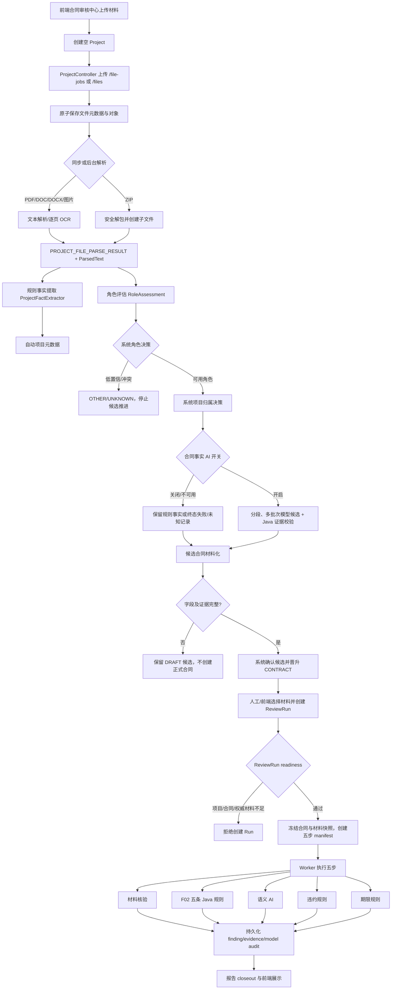
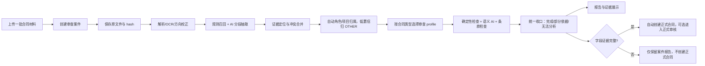

# 合同审查模块现状与自动化改造评估报告

调查日期：2026-10-27
调查范围：当前工作树中的合同、Project Intake、OCR/AI 适配、数据库迁移和合同前端。
调查方式：只读源码、迁移脚本、测试文件和配置检索。
限制：没有执行数据库写操作、正式部署、收费模型调用或生产环境测试。

## 结论先行

当前合同域实际存在三条能力线：

1. **旧 F02 直接审查入口**：读取已经存在的 `CONTRACT` 聚合，执行五条 Java 确定性规则，写入 `AUDIT_TASK` 和 `AUDIT_CHECK_RESULT`。
2. **旧 ReviewSession 材料会话**：围绕正式合同创建会话、上传固定材料槽位、人工确认材料后进入 `READY`；它本身不负责从文件自动生成合同事实。
3. **Project Intake + 新 ReviewRun**：上传项目材料后解析、提取规则候选和可选 AI 候选，自动尝试角色、项目归属和候选合同推进；只有证据完整才自动晋升正式合同。五步 ReviewRun 再基于冻结的正式合同和材料快照执行。

因此，当前系统**不是“用户上传文件后一定自动得到合同审查报告”**。上传链路可以自动保存、解析和产出候选，但正式审查仍被以下条件阻塞：项目元数据、正式合同、候选晋升、权威材料角色、项目归属和当前解析快照。缺少任一条件，结果通常停留在项目材料/候选层或被就绪检查拒绝。

这不是单纯的模型问题。最主要的结构性问题是：**非结构化 Intake、正式合同主数据、旧 F02 和五步 ReviewRun 之间存在多层权威门槛，且新自动决策没有完全贯通 ReviewRun 的就绪规则。**

## 1. 实际功能总览

| 能力 | 主要实现 | 当前状态 |
|---|---|---|
| 正式合同查询 | `ContractController`、`ContractQueryService` | 已接入旧合同任务列表和详情 |
| F02 确定性审查 | `ContractReviewService`、五个 `domain.rule` 实现 | 已实现，依赖完整结构化 `Contract` |
| 旧材料会话 | `ContractReviewSessionController`、`ContractReviewSessionService` | 已实现，要求正式合同，材料槽位和 READY 确认 |
| 项目材料上传 | `ProjectController`、`ProjectFileIngestionService` | 已实现，支持同步/异步文件接入 |
| 文档解析 | `ProjectPdfTextParser`、`ProjectDocxTextParser`、`ProjectDocTextParser`、图片/PDF OCR | 已实现；PDF 按页判断原生文字并可 OCR |
| 项目事实规则提取 | `ProjectFactExtractor` | 已实现；关键词/正则/表格规则为主 |
| 合同事实 AI 提取 | `ContractFactExtractionService`、`FastApiContractFactCandidateAdapter` | 已实现但受环境开关控制，默认关闭 |
| 材料角色识别 | `RoleAssessmentService`、`DocumentRoleSignalExtractor`，可选 AI 角色建议 | 已实现，自动决策服务可写系统决策 |
| 项目归属识别 | `DeterministicProjectIdentityResolver`、身份评估/确认服务 | 已实现；系统自动路径存在，但审查就绪检查仍偏人工权威 |
| 候选合同生成/晋升 | `ContractCandidateMaterializationService`、`ContractCandidatePromotionService` | 已实现；仅完整证据自动创建正式合同 |
| 五步审查 Run | `ContractReviewRunController`、`ContractReviewWorker` | 已实现；材料核验、F02、语义 AI、违约、期限五步 |
| 结果/证据/报告 | `CONTRACT_REVIEW_FINDING`、`CONTRACT_REVIEW_EVIDENCE`、closeout 服务 | 已实现；证据绑定冻结材料快照 |
| 脱敏诊断 | `SanitizedDebugBundleController`、debug bundle 服务、模型调用审计 | 已实现设计和接口；现场导出效果仍需环境验证 |

## 2. 当前真实任务流程

图中 `V`、材料选择、部分就绪门槛仍是用户动作；系统自动 Intake 只覆盖 `K` 到 `U` 的一部分路径。旧 ReviewSession 入口则是另一条“正式合同 → 创建会话 → 上传槽位材料 → confirm-materials → READY”流程。

## 3. 入口和新旧流程

### 3.1 前端入口

合同中心由 `ContractPortalHome` 展示“审核记录”和“待继续”，上传完成后进入项目材料工作区。证据：[ContractPortalHome.tsx:33-66](../frontend/src/features/contract/components/ContractPortalHome.tsx#L33)。上传操作创建 Project Intake operation，完成后打开对应项目：[ContractPortalHome.tsx:105-132](../frontend/src/features/contract/components/ContractPortalHome.tsx#L105)。

项目材料页面使用 `ProjectWorkspace` 和 `ProjectDetailPage`；当前页面仍显示“确认正式合同后发起审核”和“开始合同审核”，说明 UI 仍保留人工/半自动语义：[ProjectDetailPage.tsx:151-267](../frontend/src/features/project/components/ProjectDetailPage.tsx#L151)。

### 3.2 旧 ReviewSession

`POST /api/v1/contracts/{contractId}/review-sessions` 创建会话；上传接口是 `POST /api/v1/contract-review-sessions/{sessionId}/documents`；材料确认是 `POST /api/v1/contract-review-sessions/{sessionId}/confirm-materials`；接口位置见 [ContractReviewSessionController.java:61-172](../backend/src/main/java/com/fuquan/audit/contract/api/ContractReviewSessionController.java#L61)。

服务会拒绝已绑定 Project Contract 的旧入口，要求从 Project workflow 创建材料引用会话：[ContractReviewSessionService.java:109-116](../backend/src/main/java/com/fuquan/audit/contract/application/ContractReviewSessionService.java#L109)。旧会话只接受固定 `CONTRACT_BODY/BIDDING_DOCUMENT/TENDER_DOCUMENT/AWARD_NOTICE/OTHER` 槽位，状态只有 `PREPARING_MATERIALS` 和 `READY`，并不等同于新 ReviewRun。

### 3.3 新 Project Intake/ReviewRun

Project API 提供同步 `/projects/{projectId}/files`、异步 `/projects/{projectId}/file-jobs`、处理状态、恢复、角色评估/确认、身份评估/确认、候选查询、候选确认和晋升等接口：[ProjectController.java:202-509](../backend/src/main/java/com/fuquan/audit/contract/api/project/ProjectController.java#L202)。

ReviewRun API 提供创建、读取、执行单步：[ContractReviewRunController.java:47-145](../backend/src/main/java/com/fuquan/audit/contract/api/project/ContractReviewRunController.java#L47)。创建 Run 时会一次性冻结五步 manifest；`ReviewRunManifestFactory` 将 `MATERIAL_VALIDATION、F02_DETERMINISTIC、SEMANTIC_AI、BREACH、TERM` 全部设置为必需步骤：[ReviewRunManifestFactory.java:20-62](../backend/src/main/java/com/fuquan/audit/contract/application/reviewrun/ReviewRunManifestFactory.java#L20)。

## 4. 文件解析和保存

`ProjectFileIngestionService` 在上传阶段先流式暂存、计算 SHA-256、创建 `PROJECT_FILE`，再同步解析或把任务写入处理队列：[ProjectFileIngestionService.java:111-180](../backend/src/main/java/com/fuquan/audit/contract/application/project/ProjectFileIngestionService.java#L111)。同步处理时，文件会进入 `parse`；不支持的格式收口为 `UNSUPPORTED`，解析异常收口为 `FAILED`：[ProjectFileIngestionService.java:310-344](../backend/src/main/java/com/fuquan/audit/contract/application/project/ProjectFileIngestionService.java#L310)。

当前解析组件实际覆盖：

- PDF：PDFBox 原生文本逐页读取；某页文字不足时抽取单页 PDF 调 OCR，保留页号和 OCR provenance：[ProjectFileIngestionService.java:381-449](../backend/src/main/java/com/fuquan/audit/contract/application/project/ProjectFileIngestionService.java#L381)。
- DOCX：Apache POI `XWPFDocument`，读取正文段落、表格、页眉、页脚和嵌入图片；图片单独走 OCR：[ProjectDocxTextParser.java:34-88](../backend/src/main/java/com/fuquan/audit/contract/application/project/parse/ProjectDocxTextParser.java#L34)。
- DOC：Apache POI `HWPFDocument`，并有隔离的 DOC worker/parser 逻辑：[ProjectDocTextParser.java:21-75](../backend/src/main/java/com/fuquan/audit/contract/application/project/parse/ProjectDocTextParser.java#L21)。
- PNG/JPG/JPEG：直接走 OCR。
- ZIP：不是普通 `OTHER`，而是 Project Intake Package，由安全 archive reader 解包为子文件；当前产品约束要求复用 Project Intake 这套存储和幂等能力。

已确认的解析边界：

1. PDF 原生文字和扫描页混合时按页决定 OCR，单页 OCR 必须证明页覆盖；OCR 失败会使该文件解析失败，不会发布半份“已解析”正文。
2. DOCX 图片 OCR 失败会使解析流程失败；图片文字不会被拼进结构化表格单元格，避免伪造表格证据。
3. `PROJECT_FILE_PARSE_RESULT` 保存不可变解析版本、解析方法、引擎、页数、置信度、canonical text hash 和正文；表结构见 [CONTRACT__project_file_parse_result.sql:8-58](../db/dm8/CONTRACT__project_file_parse_result.sql#L8)。
4. 原文件和解析正文分开保存，DM8 保存元数据和正文，文件对象由 `FileStoragePort` 管理；没有发现合同域把文件内容写进合同主表的证据。

待验证：真实甲方 PDF 字体编码、复杂扫描版 PDF、旋转图片、超长 DOC/DOCX、含嵌套文本框和图形中的文字，尚未在本次只读调查中执行现场样本测试。

## 5. 字段提取机制

### 5.1 规则提取

`ProjectFactExtractor` 的规则集中在固定标签和边界正则，实际包含：

- 项目名称、项目编号、采购人、采购代理机构；
- 合同编号、合同名称、合同类型、甲方、乙方、乙方信用代码；
- 合同数字金额、中文大写金额；
- 中标/成交金额、供应商、供应商信用代码；
- 明细名称、数量、单价、申报金额；
- “预算金额/最高限价（包）”这一类金额。

规则和标签定义见 [ProjectFactExtractor.java:29-108](../backend/src/main/java/com/fuquan/audit/contract/application/project/extraction/ProjectFactExtractor.java#L29)。提取时按 segment、DOCX 表格和上下文守卫运行：[ProjectFactExtractor.java:124-169](../backend/src/main/java/com/fuquan/audit/contract/application/project/extraction/ProjectFactExtractor.java#L124)。

已确认缺陷/边界：

1. 规则对标签、冒号、行边界和特定词形有依赖；同义但无标签的自然语言字段不会稳定进入 `PROJECT_EXTRACTION_RESULT`。
2. 规则将“正式合同字段”限制在允许的角色/上下文，避免把招标材料中的数字误写成合同事实；这提高了安全性，但会让不规范材料缺字段。
3. 表格提取保留行/单元格定位，但规则字段和 AI 字段的类型集合是收敛的，并非任意合同字段抽取。
4. `ProjectFactExtractor` 是候选提取器，不是完整合同语义理解器；付款、验收、违约、解除、争议解决等条款不在这个规则集合中。

### 5.2 AI 结构化提取

`ContractFactCandidatePort` 允许的事实类型实际只有合同头、主体、金额、行项目和中标结果集合：[ContractFactCandidatePort.java:13-47](../backend/src/main/java/com/fuquan/audit/contract/application/project/factai/ContractFactCandidatePort.java#L13)。每个候选必须携带 segment、locator、excerpt、offset、contextCode 和 confidence；Java 侧再做证据/范围/身份校验。

`ContractFactExtractionService` 将请求按批次执行，使用总预算，遇到 `FAILED` 或 `UNKNOWN` 会持久化终态并停止后续批次；成功后才 complete：[ContractFactExtractionService.java:53-105](../backend/src/main/java/com/fuquan/audit/contract/application/project/factai/ContractFactExtractionService.java#L53)。日志只记录批次数、字符数、候选数、拒绝数、模型调用耗时和 token 统计，不应记录正文；该设计适合作为现场脱敏诊断。

但是 AI 提取默认关闭：后端读取 `AUDIT_AI_CONTRACT_FACT_EXTRACTION_ENABLED`，Python `Settings` 默认 `False`，关闭时接口返回 `CONTRACT_FACT_EXTRACTION_DISABLED`：[application.yml:65-69](../backend/src/main/resources/application.yml#L65)、[config.py:208-212](../services/audit-ai/src/audit_ai/config.py#L208)、[contract_fact.py:353-358](../services/audit-ai/src/audit_ai/model/contract_fact.py#L353)。

### 5.3 正式合同字段和数据库约束

`CONTRACT_CANDIDATE` 的字段包括合同编号、名称、类型、甲乙方、乙方信用代码、合同金额、大写金额、中标金额、中标供应商及信用代码；但多数列可以为空。正式 `CONTRACT` 聚合在 Java 领域构造时要求合同编号、名称、类型、甲乙方和合同金额非空：[Contract.java:19-58](../backend/src/main/java/com/fuquan/audit/contract/domain/Contract.java#L19)。

自动晋升只在 `autoPayload` 完整时执行。代码明确要求合同编号、名称、类型、甲乙方、合同金额和每条明细的名称/申报金额等，否则返回 `null`，保留 DRAFT 候选：[AutomaticProjectFileClassificationService.java:245-299](../backend/src/main/java/com/fuquan/audit/contract/application/project/AutomaticProjectFileClassificationService.java#L245)。因此“有部分事实也给结果”的目标目前只在候选/解析层成立，不能进入正式合同和五步报告。

## 6. 当前合同审查能力

### 6.1 F02 确定性规则

`ContractRuleConfigurationBeans` 注册五条 Java 规则：[ContractRuleConfigurationBeans.java:20-98](../backend/src/main/java/com/fuquan/audit/contract/application/ContractRuleConfigurationBeans.java#L20)。实际能力是：

| 规则 | 实际检查 |
|---|---|
| `F02_AMOUNT_WORDS_MATCH` | 数字合同金额和中文大写金额相等；缺失/不规范时 `NOT_EVALUATED` |
| `F02_LINE_ITEM_ARITHMETIC` | 数量 × 单价与明细申报金额 |
| `F02_LINE_SUM_MATCH` | 明细申报金额合计与合同总金额 |
| `F02_AWARD_AMOUNT_MATCH` | 合同金额与结构化中标金额 |
| `F02_AWARD_SUPPLIER_MATCH` | 合同乙方与中标供应商，信用代码优先、名称归一化回退 |

五条规则都不直接读取原始合同正文；它们只读取已经构造的 `ContractReviewContext`。`ContractReviewService` 先加载正式合同和启用配置，再在事务外执行规则：[ContractReviewService.java:98-171](../backend/src/main/java/com/fuquan/audit/contract/application/ContractReviewService.java#L98)。

规则缺少依据时输出 `NOT_EVALUATED`、黄色风险和阻断标记，而不是猜测通过；例如金额大写和中标规则的源码注释及实现都明确如此。[AmountWordsMatchRule.java:16-55](../backend/src/main/java/com/fuquan/audit/contract/domain/rule/AmountWordsMatchRule.java#L16)、[AwardAmountMatchRule.java:14-42](../backend/src/main/java/com/fuquan/audit/contract/domain/rule/AwardAmountMatchRule.java#L14)。

### 6.2 五步 ReviewRun

ReviewRun 的实际步骤是：

1. `MATERIAL_VALIDATION`：冻结并校验材料快照。
2. `F02_DETERMINISTIC`：执行上述五条确定性规则。
3. `SEMANTIC_AI`：把冻结材料文本发送到合同语义 AI，并对返回 evidence 做原文 grounding。
4. `BREACH`：使用 `BreachClauseAnalyzer` 和冻结材料。
5. `TERM`：使用 `ContractTermClauseAnalyzer` 和冻结材料。

`FrozenSemanticReviewStepExecutor` 会把模型 hint 映射为 finding，并逐条验证模型引用的文件和 excerpt；无法定位时保存 `LOCATOR_UNAVAILABLE`，不会假装成已验证证据。违约和期限步骤由 Java analyzer 读取冻结材料适配器；它们不依赖实时数据库当前状态。

### 6.3 模型实际参与程度

模型真正读取原文的路径只存在于：

- Project Intake 的角色 AI（如果启用）；
- 合同事实候选 AI（默认关闭）；
- ReviewRun 的 `SEMANTIC_AI` 步骤。

F02、违约和期限不是模型自由生成结论，而是确定性 Java 分析器。语义 AI 结果仍受严格 schema、文件身份、excerpt offset 和 evidence grounding 约束。因此当前系统不是“把整份合同交给模型直接生成完整报告”，而是“冻结材料后，模型只生成受限语义 finding，确定性规则另行生成结果”。

## 7. 材料关联能力

Project Intake 支持一次上传多个文件，也支持 ZIP 作为安全资料包；文件通过 `PROJECT_ID`、`PROJECT_FILE`、解析结果和角色/身份决策关联。候选合同通过 `SOURCE_CONTRACT_FILE_ID` 只绑定一个正文来源文件，辅助材料通过候选 support authority 和 ReviewRun material snapshot 参与。

已确认支持：

- 多文件同项目存储和解析；
- PDF/DOC/DOCX/图片混合上传；
- 合同正文、招标/投标、中标通知、补充材料角色；
- 同一文件的解析版本和 SHA 快照；
- ReviewRun 多材料冻结，避免执行中读取新文件。

当前未确认或能力不足：

- 没有看到成熟的“多份正文/补充协议版本优先级”模型；
- 候选合同主来源仍是一份 `SOURCE_CONTRACT_FILE_ID`，跨文件字段合成需要 support authority 通过；
- 不能把合同约定付款比例当作实际付款事实；当前代码没有把履约/付款事实自动混入正式合同字段的证据；
- 缺少材料时，系统应返回“未提供依据/无法评估”，而不是现实中不存在该事实；确定性规则目前用 `NOT_EVALUATED`，语义步骤取决于模型返回。

## 8. 数据库和历史人工耦合

主要表及职责：

| 表 | 职责 |
|---|---|
| `PROJECT` | Intake 上游项目，名称/编号可空；`VERSION_NO > 0` 被当作 metadata confirmed |
| `PROJECT_FILE` | 原文件元数据、类别、入库状态、解析状态、对象键、SHA、当前正文 |
| `PROJECT_FILE_PARSE_RESULT` | 不可变解析版本、正文 hash、页数、方法、引擎和置信度 |
| `PROJECT_EXTRACTION_RESULT` | 规则/候选事实及来源定位 |
| `CONTRACT_CANDIDATE` | 从项目材料形成的候选合同，字段可空，DRAFT/PROMOTED |
| `CONTRACT_CANDIDATE_LINE_ITEM` | 候选合同明细 |
| `PROJECT_CONTRACT` | 项目、正式合同和候选的关联 |
| `CONTRACT` / `CONTRACT_LINE_ITEM` / `CONTRACT_AWARD_NOTICE` | F02 正式合同主数据和中标依据 |
| `AUDIT_TASK` / `AUDIT_CHECK_RESULT` | 旧 F02 任务和五条规则结果 |
| `CONTRACT_REVIEW_SESSION` / `CONTRACT_REVIEW_DOCUMENT` / `CONTRACT_REVIEW_MATERIAL_BINDING` | 旧材料会话和固定槽位文档 |
| `CONTRACT_REVIEW_RUN` / `_MATERIAL` / `_STEP` / `_STEP_ATTEMPT` | 新冻结审查 Run、五步生命周期 |
| `CONTRACT_REVIEW_FINDING` / `_EVIDENCE` | 新审查 findings 和原文证据 |
| `PROJECT_FILE_ROLE_ASSESSMENT/DECISION` | 材料角色建议和最终角色决策 |
| `PROJECT_FILE_IDENTITY_ASSESSMENT/DECISION` | 文件是否属于项目的评估和决策 |
| `PROJECT_FACT_EXTRACTION_ATTEMPT/CANDIDATE` | AI 合同事实调用、候选、拒绝和状态 |

关键人工耦合点：

1. 新 ReviewRun readiness 明确要求 `project.metadataConfirmed()`、正式合同 `READY_FOR_REVIEW`、候选已 `PROMOTED`、材料已 PARSED、角色权威、身份为当前 human same decision：[ReviewRunReadinessResolver.java:91-163](../backend/src/main/java/com/fuquan/audit/contract/application/reviewrun/ReviewRunReadinessResolver.java#L91)。
2. 自动 Intake 写入的角色/身份来源是 `SYSTEM_AUTO_DECISION`，但 readiness 对非 legacy 材料路径要求“human confirmation”。这会造成自动上传链路可以推进到候选，而创建 ReviewRun 时被拒绝。该冲突是当前自动化的明确阻塞点。
3. `Project.metadataConfirmed()` 仅通过 `versionNo > 0` 判断；自动元数据服务会在没有唯一项目名称/编号时生成 `自动整理项目-xxxxxxxx`，这解决数据库字段空值，却不证明业务身份真实可靠：[AutomaticProjectMetadataService.java:34-75](../backend/src/main/java/com/fuquan/audit/contract/application/project/AutomaticProjectMetadataService.java#L34)。
4. 正式 `CONTRACT` Java 聚合字段多为非空，不能为了过数据库约束编造编号、金额、主体或日期。当前自动晋升因此把证据完整作为门槛，安全但降低“任何材料都出报告”的可用性。

## 9. Project Intake 专项评估

适合复用的能力：

- 原子文件接入、SHA 和幂等；
- Project File/Parse Result 的不可变解析版本；
- PDF 逐页原生/OCR 混合处理；
- DOC/DOCX/表格/图片的统一 canonical segment；
- 安全 ZIP reader 和子文件归属；
- 角色、项目归属和候选的证据 authority fence；
- 异步任务 lease、恢复和旧执行者不能覆盖新结果的机制；
- 脱敏 pipeline diagnostics 和模型调用计数。

不适合直接复用为“完整合同审查”的部分：

- `ProjectFactExtractor` 的固定标签规则只能作为召回层，不能作为全部合同字段模型；
- `CONTRACT_CANDIDATE` 是中间候选，不是审查案件；
- 角色/身份决策目前有人工来源和系统来源两套 authority，不能简单改名后绕过审查就绪门槛；
- 正式合同主数据要求字段齐全，而用户上传材料可能天然不完整，不能用默认值伪造；
- `PROJECT` metadata confirmed 不是法律意义上的项目确认。

## 10. 已确认问题

### P0：上传完成后并非必然得到审查报告

证据链：候选字段不完整时 `autoPayload` 返回 null，候选停留 DRAFT；ReviewRun 又必须有 PROMOTED 正式合同。见 [AutomaticProjectFileClassificationService.java:245-299](../backend/src/main/java/com/fuquan/audit/contract/application/project/AutomaticProjectFileClassificationService.java#L245) 和 [ReviewRunReadinessResolver.java:98-106](../backend/src/main/java/com/fuquan/audit/contract/application/reviewrun/ReviewRunReadinessResolver.java#L98)。

影响：不完整或格式不规范材料无法进入正式五步报告，用户看到的是材料处理结果/候选或阻塞，而不是“已有依据的部分结果”。

### P0：自动角色/归属决策与 ReviewRun 的 human-only readiness 不一致

自动分类服务会用系统原因写 role/identity decision：[AutomaticProjectFileClassificationService.java:133-170](../backend/src/main/java/com/fuquan/audit/contract/application/project/AutomaticProjectFileClassificationService.java#L133)。但 readiness 对非 legacy 决策要求 human confirmation：[ReviewRunReadinessResolver.java:136-155](../backend/src/main/java/com/fuquan/audit/contract/application/reviewrun/ReviewRunReadinessResolver.java#L136)。

影响：系统能自动分类，却不能自动启动五步审查，直接违反“上传后全自动”的产品目标。

### P1：合同事实 AI 默认关闭，现场若未显式开启，模型不会提取合同事实

Python 默认 `False`，关闭时返回 503 disabled；后端自动服务也读取同一环境开关。见 [config.py:208-212](../services/audit-ai/src/audit_ai/config.py#L208) 和 [contract_fact.py:353-358](../services/audit-ai/src/audit_ai/model/contract_fact.py#L353)。

影响：系统只剩规则提取，复杂自然语言材料的召回能力不足；这会被误认为“大模型什么都没解析”。

### P1：F02 规则只分析结构化合同，不读取完整原文

`ContractReviewService` 将 `Contract` 映射为 `ContractReviewContext` 执行规则；规则集合只有金额、明细和中标主体/金额五类。见 [ContractReviewService.java:98-171](../backend/src/main/java/com/fuquan/audit/contract/application/ContractReviewService.java#L98) 和 [ContractRuleConfigurationBeans.java:20-98](../backend/src/main/java/com/fuquan/audit/contract/application/ContractRuleConfigurationBeans.java#L20)。

影响：付款、交付、验收、违约、期限等自然语言条款只有进入 ReviewRun 的语义/条款步骤才会分析，不会由旧 F02 自动补齐。

### P1：材料缺失和字段缺失的用户结果语义容易混淆

确定性规则使用 `NOT_EVALUATED`，模型步骤可能失败或 evidence 不可定位；前端同时存在“待审核、审核中、材料处理、合同确认”等旧新状态。当前没有证据证明所有终态都在统一报告中转换为“大白话的已完成但依据不足”。

影响：用户可能看到“失败/待确认”而不知道是解析失败、字段缺失、模型不可用还是业务风险。

### P2：多入口和多套事实模型提高维护成本

旧 `CONTRACT_REVIEW_SESSION`、旧 F02、Project Intake、ReviewRun 同时存在；旧入口还会主动拒绝已绑定 Project Contract 的合同，要求走 Project workflow。功能不是完全重复，但产品入口和状态语义容易分叉。

## 11. 尚未验证的问题

以下不能仅凭源码下结论：

1. 甲方实际 PDF 是否存在字体编码、旋转扫描、图片文字或复杂文本框导致 OCR 丢字；需要样本和脱敏指标。
2. 甲方模型网关是否支持当前 `/chat/completions` 协议、JSON schema 和 `choices[0].message.content`；需要在现场白名单放行后用真实客户端验证。
3. 自动 Intake 在当前部署 profile 中是否启用；源码默认 `AUDIT_CONTRACT_AUTO_INTAKE_ENABLED=true`，但现场环境变量可能覆盖。
4. 甲方环境是否设置 `AUDIT_AI_CONTRACT_FACT_EXTRACTION_ENABLED=true`，以及模型请求是否超时/被网关拒绝。
5. ReviewRun worker 是否在甲方持续运行并能恢复 lease；需要健康检查、数据库任务状态和脱敏 worker 日志。
6. 复杂合同类型（采购、服务、租赁等）是否需要不同风险规则；当前源码没有足够类型化的规则 profile 证据，不能据此宣称已支持。
7. 报告是否总能在语义 AI 失败后完成；代码有步骤失败/未知收口，但需要对现场模型失败、证据为空和单步重启做真实端到端测试。

建议现场诊断只导出：文件数量/大小区间/hash、解析方法、页数、字符数、segment 数、OCR 页数、候选数、拒绝数、模型调用耗时/状态/安全 reasonCode、任务状态和 requestId。不要导出正文、excerpt、供应商、金额、合同编号或模型原文。

## 12. 推荐目标架构

### 12.1 业务目标

建立独立的 `ContractReviewCase`（审查案件）概念，保留 `Project` 和正式 `Contract` 的边界：

- 案件可以在没有正式合同编号、金额或主体时创建；
- 原文件、解析结果、候选事实和证据是案件输入；
- 正式合同只在证据完整时自动创建；
- 缺字段不阻塞案件报告，报告中只显示已经找到并验证的内容；
- 未提供材料显示“未提供依据”，不推断现实中不存在；
- 用户只上传和查看结果，人工复核/正式审批作为报告后的可选动作；
- 任何自动创建正式合同的字段必须有可追溯来源和证据。

### 12.2 推荐流水线

### 12.3 必须共享的基础设施

- `FileStoragePort`、原子落盘、SHA/幂等；
- `ProjectFileParseResult` 或抽取公共版本模型；
- PDF/DOC/DOCX/图片解析和 OCR orientation；
- bounded model gateway、分段、超时和脱敏调用审计；
- evidence grounding、文本 hash 和定位协议；
- durable task/lease/recovery；
- DM8 事实存储和报告快照。

必须保持合同独立的部分：

- 合同事实 schema；
- 合同类型 profile；
- 付款/交付/违约/期限条款模型；
- 合同报告和法律风险措辞；
- 正式合同自动创建和晋升规则。

## 13. 数据库建议（只建议，不实施）

建议保留：`PROJECT_FILE`、`PROJECT_FILE_PARSE_RESULT`、`PROJECT_EXTRACTION_RESULT`、角色/身份 assessment/decision、`CONTRACT_CANDIDATE`、新 ReviewRun 及 finding/evidence 表。它们已经提供文件版本和证据链，直接替换会破坏历史数据。

建议增加一个独立案件层，至少包含：

- `CASE_ID`、`PROJECT_ID` 可空、`CONTRACT_ID` 可空；
- 输入文件快照集合及 parse tuple；
- `CASE_STATUS`（PROCESSING、COMPLETED、COMPLETED_WITH_LIMITATIONS、FAILED、UNKNOWN）；
- 统一结果快照和报告版本；
- 每个字段的证据状态（FOUND、CONFLICT、NOT_FOUND、UNSUPPORTED）；
- `AUTO_DECISION_PROVENANCE`（规则/模型/系统分类/人工复核）和安全 reasonCode。

不建议把现有 `CONTRACT` 的必填业务字段全部改为可空。正式合同主数据和审查案件输入应分开，避免为了“每次有报告”而写入伪造的编号、金额或主体。

## 14. 改造路线比较

| 路线 | 做法 | 成本 | 风险 | 评价 |
|---|---|---:|---:|---|
| A. 继续现有合同架构 | 调整自动决策来源和 readiness，补报告兜底 | 中 | 中高，旧新入口继续耦合 | 适合快速修阻塞，不适合长期扩展 |
| B. 在 Intake 上增加自动案件入口 | 复用解析/证据/worker，新建案件结果，不立即创建正式合同 | 中高 | 中，保留旧正式合同流程 | 推荐作为第一阶段，最贴近用户“上传即出结果” |
| C. 抽取共享审查基础设施 | 文件、解析、OCR、模型、证据、任务统一；业务 profile 独立 | 高 | 中，边界设计和迁移复杂 | 推荐作为第二阶段演进目标 |
| D. 合同重新独立实现 | 新建一整套合同上传、解析、AI、报告 | 最高 | 高，重复存储和回归面大 | 不推荐，违反当前可复用边界 |

推荐 **B → C**：先建立案件报告，使不完整材料也有可读结果；再抽取公共基础设施，逐步收敛旧入口。不要先做数据库大迁移，也不要把采购字段或规则直接复用为合同事实。

## 15. 分阶段实施计划

### P0：打通自动案件报告

- 目标：上传任何可解析材料后创建案件；解析/AI终态统一收口；有依据显示内容，无依据留空并说明“未提供依据”。
- 代码：新增合同案件 application/domain/infra；复用 `ProjectFileIngestionService`、parse result、evidence grounding。
- 数据库：建议新增案件、案件材料、案件字段状态、报告快照表；不修改旧合同字段约束。
- 测试：空文件、只有合同标题、只有金额、扫描 PDF、旋转图片、混合 PDF/DOCX、模型 disabled、模型 timeout、OCR 不可用、跨项目材料。
- 验收：每个终态都有报告；FAILED/UNKNOWN 不伪装为成功；正式合同仍只在证据完整时创建。
- 回退：案件入口 feature flag 关闭；旧 F02/ReviewRun 数据和接口不动。

### P1：消除自动决策与 readiness 冲突

- 目标：系统自动角色/归属可以进入案件审查；低置信自动归 OTHER，不硬判；正式 ReviewRun 仅在有足够证据时创建。
- 代码：`ReviewRunReadinessResolver` 增加明确的 system-auto authority policy；禁止把系统 decision 伪装成 human decision。
- 数据库：保留来源字段，必要时增加系统自动决策 provenance。
- 测试：system-auto 同项目、冲突项目、UNKNOWN、迟到旧 worker、decision 版本变化。
- 验收：不需要用户确认材料类型/项目归属；风险场景仍 fail closed。

### P2：扩大合同事实和类型化审查

- 目标：模型分段提取付款、交付、验收、违约、期限等结构化候选；按采购/服务/租赁选择 profile。
- 代码：扩展合同 AI schema、证据定位、条款 analyzer 和报告映射；不污染采购事实类型。
- 数据库：扩展案件字段/证据，不直接把未经证据校验的值写入 `CONTRACT`。
- 测试：多合同类型、补充协议覆盖、条款冲突、同名不同版本、金额大写和中文数字。
- 验收：模型输出必须有原文证据；冲突/缺失明确标识；审查结论不等同法律效力结论。

## 16. 当前调查未执行的验证

本次没有运行 `mvn clean verify`、前端构建、Python 测试、真实 DM8、真实 OCR、真实模型或 26 服务器操作，因为任务明确禁止实施和外部写操作。报告中的“已确认”来自静态代码/SQL证据；现场环境和模型协议部分必须标记 `NOT VERIFIED`，不能以本报告替代部署验收。

## 17. 最终回答

1. **当前具备的能力**：文件保存、PDF/DOC/DOCX/图片解析和 OCR、规则事实提取、候选合同、五条 F02 规则、语义 AI、违约/期限分析、冻结材料、证据和报告持久化。
2. **最大技术问题**：多入口、多层权威门槛导致“上传材料 → 报告”不连续；自动 Intake 决策与 ReviewRun readiness 的人工权威要求不一致。
3. **是否过度依赖人工字段**：是。正式 `Contract` 和 ReviewRun 仍要求完整字段/确认；自动候选字段不足就不晋升。
4. **是否需要重新设计提取**：需要。保留规则召回，但将 AI 分段抽取、字段状态和案件报告从正式合同主数据中分离。
5. **采购新架构可复用什么**：文件接入、解析/OCR、模型网关、分段、证据、任务状态、DM8 持久化和脱敏日志；不能直接复用采购业务事实和规则。
6. **是否需要独立合同案件**：需要。单份合同、不完整材料和多材料联合分析都应有案件结果，不应强制先创建正式合同。
7. **数据库是否局部重构**：值得，但先增量增加案件/字段状态/报告快照，不先改旧 `CONTRACT` 必填约束。
8. **推荐路线**：B → C；先自动案件报告，再抽取公共基础设施。
9. **最适合的自动化试点**：采购合同正文 + 中标通知书 + 招标文件三件材料，验证项目/主体/金额/明细、合同金额与中标金额、供应商一致性以及缺材料时的部分报告。
