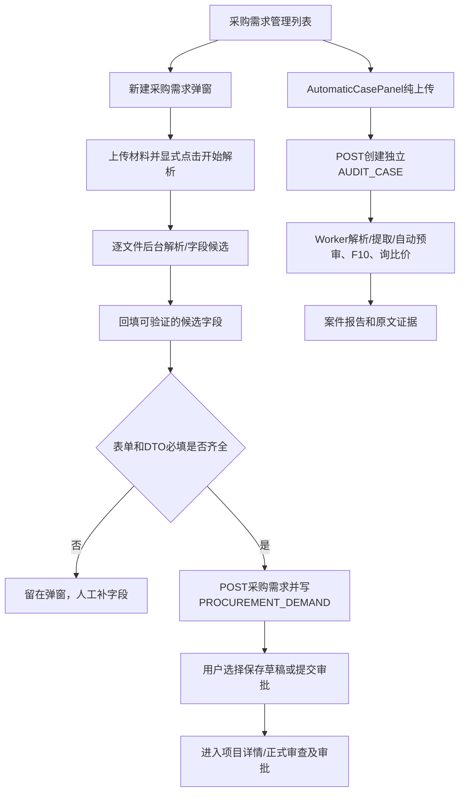
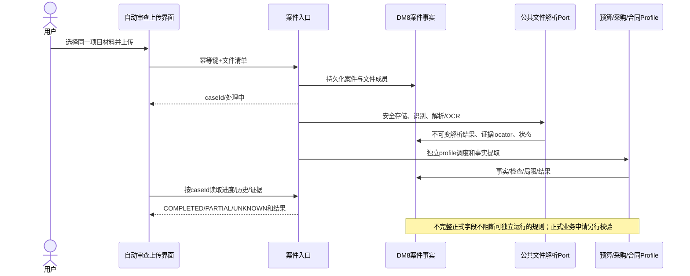

# 预算、采购、合同统一文件解析与采购零表单改造评估报告

调查日期：2026-10-28  
调查范围：只读源码、DM8迁移脚本、既有验收报告、部署记录和采购测试材料目录。  
状态：调查报告；没有修改业务代码、数据库、正式配置或测试服务器。

## 一、结论

1. 截图里的“新建采购需求”是采购正式业务流程，不是自动审查案件流程。`App.tsx` 的采购列表打开 `NewProcurementDialog`；同一列表区域还独立挂载 `AutomaticCasePanel`，所以两种入口当前同时存在。前者落正式 `PROCUREMENT_DEMAND` 并可后续发起审批，后者创建 `AUDIT_CASE` 并独立生成自动案件报告。
2. “本批6份成功6份”表示材料逐份完成解析/候选字段提取，不表示表单字段齐备，不表示正式采购需求已保存，也不表示已经运行自动审查。材料成功状态和字段是否存在是两类状态。
3. 五个未自动填出的字段仍被要求填写，是因为旧表单把采购正式主数据字段直接作为表单必填：HTML `required`、`handleCreateSubmit` 的缺失字段清单、`CreateProjectRequest @Valid` 三重拦截。字段提取结果只会回填来源材料中可定位、通过字段角色校验的候选值；提取为空不会改变表单必填策略。
4. 最稳妥路线是方案B并向方案C演进：保留正式采购需求/审批流程；把采购自动审查明确做成纯上传案件入口；在后台沿用 `AuditCase` 的独立案件、持久化、恢复和证据机制。成熟后再让预算、采购、合同共享文件接入、解析/OCR、安全、标准化内容和证据接口。不要把正式采购创建作为自动审查前置条件，也不要把正式字段统一改为可空。
5. 预算、采购已经部分共享 `DocumentTextPort`/`OfficeDocumentTextReader`、OCR Port和材料安全能力；合同Project Intake拥有更强的持久化解析结果、页段/表格证据、ZIP安全读取与恢复路径。但合同 Intake 服务还耦合 Project、合同分类、事实提取、候选合同和合同存储，不能让预算/采购直接调用整个 `ProjectFileIngestionService`。
6. 分类要分层：不可识别的业务角色可以是 `OTHER`，解析是否完成另用解析状态表达。文件格式不支持是 `UNSUPPORTED`，解析故障是 `PARSE_FAILED`，无法证明处理结果是 `UNKNOWN`，来源冲突是 `CONFLICT`。现有采购枚举没有通用 `OTHER/UNKNOWN` 取值证明；不要用“其他采购方式”伪装“未知”。
7. 26目前能由历史记录确认的最新部署是独立QA实例 `18082`（r5/第三阶段），旧80入口没有切换；但本轮没有SSH核实当前活动release。GitHub远程分支查询因连接中断失败。两者均为 `NOT VERIFIED` 的当前实时状态。
8. 最大风险不是解析器共用本身，而是把案件事实错误提升为正式业务事实：错误合并多个项目、把OTHER当已确认角色、把UNKNOWN当失败或缺失、重复存全文/事实、削弱原审批约束、或在DM8模式未知时迁移旧表。

### 当前采购流程

## 二、工程与部署基线

### Git及工作区

- 外层 `E:\audit-agent-new` 不是Git根；本次检查的实际Git根为 `E:\audit-agent-new\.runtime\budget-home-e17-20261014`。本报告存放在这棵树内。
- 当前分支：`feat/contract-auto-delivery-20261027`；HEAD：`a0a9cce974027810e44002dd1d316892ef0f0897`；本地相对已缓存的 `origin/feat/contract-auto-delivery-20261027` 显示 ahead 3。
- 远程地址为 `https://github.com/ztysew2/audit-agent.git`。执行 `git ls-remote --heads origin` 的结果为 `Recv failure: Connection was aborted`，因此远程HEAD没有实时核实。未执行fetch、push或任何写远程操作。
- 工作区原本已有多项修改和未跟踪文件，包括采购上传、合同分析展示、部署记忆、采购三期证据等。报告不把这些原有差异当作本次工作，不覆盖或清理它们。
- 旧采购一期/二期报告列在外层路径，当前仓库内对应的可追溯新证据主要在 `docs/automatic-procurement-phase2-20261027/ACCEPTANCE_REPORT.md`、`docs/automatic-procurement-phase3-20261027/IMPLEMENTATION_REPORT.md`。本报告以当前源码和仓库内证据为主。

### 26测试服务器

`docs/qa-26/DEPLOYMENT_LOG.md`记录：原80应用未切换；采购三期和后续三模块验收运行在独立18082，自动案件/合同/预算数据及配置隔离。`DEPLOYMENT-MEMORY.md`记录 `auto-intake-20261026`、独立QA与随后静态UIFix包；其记录说明 2026-10-28 的UIFix_v3c没有部署到26，现场待核验。故当前可陈述的历史基线是“原80保留旧版本，18082独立QA有较新候选”，不能把它说成实时状态。实时release、前后端SHA、feature flag和服务状态：`NOT VERIFIED`。

## 三、采购表单阻塞的代码证据

### 前端与字段回填

- `frontend/src/app/App.tsx:907-1010` 定义 `NewProcurementDialog`。新建时显示材料上传器（962-963）；项目名、申请部门、预算科目编码、预算科目名称、申请人由文本字段数组渲染并加 `required`（944-969）；采购类型、采购方式、预算金额也各自加 `required`（970-985）。需求说明没有 `required`（986-989）。
- `frontend/src/app/App.tsx:1695-1709` 的 `handleCreate` 先清空表单、打开正式表单，再查询可用的已解析来源项目；这不是创建自动审查案件。
- `frontend/src/features/procurement/materials/ProcurementMaterialUpload.tsx:36-42,62-72` 要求用户先点“开始解析并填充”。成功统计来自逐文件状态 `PARSED`（19-22、70-72）。组件将已有 `result.fields` 回调到父表单（23-35）；即使“6成功”也只代表材料处理完成。
- `frontend/src/features/procurement/materials/procurementMaterialForm.ts:14-27` 将 `projectName`、`departmentName`、`procurementType`、`budgetAmount`、`subjectCode`、`subjectName`、`procurementMethod`、`applicantName`、`requirementDescription` 各自按解析字段候选映射；字段无候选就映射空字符串。冲突项目名被显式留空，字段冲突不会自动用其中一个值覆盖。
- `frontend/src/app/App.tsx:1780-1810` 保存前构造正式采购DTO，并调用 `createProcurementProject`。`1811-1820` 在创建成功后才可能启动已有项目的采购审查操作、清空材料批次和导航到项目详情。
- `frontend/src/app/App.tsx:1834-1860` 的 `handleCreateSubmit` 再独立检查 sourceProjectId、项目名、申请部门、采购类型、预算金额、科目编码、科目名称、采购方式、申请人；首次缺项即停止提交。由此可直接解释截图中的字段阻塞。
- `frontend/src/app/App.tsx:2171-2177` 中“新建采购需求”按钮调用 `handleCreate`，同级另行渲染 `<AutomaticCasePanel ownerId={...}/>`。这是旧正式需求表单和新自动案件入口并存，而不是一个页面上传后自动转成同一流程。

### 后端及数据库约束

- `backend/src/main/java/com/fuquan/audit/procurement/api/ProcurementProjectController.java:77-95` 正式创建入口带 `@Valid`。Controller从已解析的 `sourceProjectId` 取正式项目来源，构造正式 `CreateCommand` 并写审计；系统只生成 `PR-yyyy-随机串` 的正式需求编号（81-87）。该编号不能被当成采购文件里的正式项目编号。
- 同文件 `280-298` 的 `CreateProjectRequest` 对 `sourceProjectId` 用 `@NotNull`；对申请部门、采购类型、预算科目编码、预算科目名称、采购方式、申请人用 `@NotBlank`；预算金额要求非空且至少0.01；项目名称可空但长度最多200，服务端再从来源回填。更新DTO在300-310对正式主数据同样有必填约束。
- `ProcurementProjectCommandService.java:58-83` 再验证来源必须已解析/可用、材料数1-100、来源项目须属于同一集合，并要求最终项目名非空且不超过200。正式需求创建还会被 `ProcurementApprovalWorkflowService` 的正式审批用途继续读取字段；审批流程根据预算金额确定节点（约118行）并把科目、方式、部门、申请人纳入快照（357-363）。
- `db/dm8/V006__f01_budget_approval.sql:6-18` 的早期 `PROCUREMENT_DEMAND` 已要求采购名、预算审批ID、科目编码/名称、金额、状态等列NOT NULL。`V024__procurement_project_creation.sql:6-18` 增加部门、类型、方式、需求说明、申请人，但这些增列未标NOT NULL。当前创建DTO和应用校验比后加列数据库约束更严；不能只看schema就认为字段可选。完整正式业务表随后被审批、报告、询比价、采购风险模块以外键关联，不能为了案件入口删字段或拆掉旧表。
- 采购预审本身读取项目名、预算金额、科目编码/名称、申请部门和申请人：`ProcurementAgentReviewService.java:57-81`，AI请求还读取采购类型、采购方式等（121-125）。这些值对“正式项目资料合理性预审”有用；不构成新独立案件文件语义审查的先决条件。科目编码还被围串标历史询价检索用作维度（`ProcurementCollusionReviewService.java:285-292`），只应在该正式模块适用且事实充分时使用。

### 自动审查不依赖正式需求

- `frontend/src/features/procurement/AutomaticCasePanel.tsx:29-30,82-100,127-145` 明确为独立上传路径：一次选择多份文件即POST，不填预算、项目编号或供应商；页面轮询持久案件、支持历史/刷新恢复、展示解析状态、模块结果和原文证据。
- `backend/src/main/java/com/fuquan/audit/procurement/autocase/AuditCaseController.java:17,27-42` 的API是 `/api/v1/procurement/cases`；上传仅需幂等键和多文件，另有历史、案件、原件、证据读取。它不接收 `CreateProjectRequest`。
- `AuditCaseService.java:17-87,114-160` 对文件接收、持久幂等、owner、storage staging/promote和状态分别负责；Worker按已保存案件状态执行文件解析和事实抽取，unknown outcome不盲重放（详见二期/三期报告）。
- 三期报告明确：独立案件保存 `AUDIT_CASE`、`AUDIT_CASE_FILE`、`AUDIT_FACT`、`AUDIT_QUOTE_LINE`；0个新DDL进入原业务库、0个旧采购表变更；新Controller和Worker受 `audit.procurement.auto-case.enabled` 控制，默认未开启原环境入口。12文件案件真实模型+隔离DM8验证成功并重启复开一致，但生产没有部署。

## 四、采购字段阻塞矩阵

| 业务字段 | UI/DTO/数据库 | 当前来源与使用 | 缺失造成的阻塞 | 对文件自动审查是否必要 | 建议阶段 |
|---|---|---|---|---|---|
| 项目名称 `projectName` | UI必填；DTO允许空/限200，服务从来源取名；`PROCUREMENT_DEMAND`早期有采购名NOT NULL | 文档候选回填；正式列表/正式预审展示使用 | 阻断正式需求保存 | 非必要；文件可建立案件，名称可显示“未识别项目”并保留原文件 | 自动审查案件系统生成内部caseNumber；项目名仅证据充分时提取，否则未知 |
| 申请部门 `departmentName` | UI必填；DTO `@NotBlank`；V024增列可空 | 可能从申请书提取；正式预审/审批快照读取 | 阻断正式需求保存/进入审批 | 非必要 | 留作正式申请字段；独立审查允许未知 |
| 预算科目编码 `subjectCode` | UI必填；DTO `@NotBlank`；V006 NOT NULL | 从预算/申请材料中提取需逐字证据；预算科目合理性、历史询价维度读取 | 阻断正式需求保存；部分正式审查/统计无该维度 | 不是通用材料审查前置条件；仅适用预算科目/历史价格审查 | 审查事实可空并标 `NOT_FOUND/CONFLICT`，不虚构编码 |
| 预算科目名称 `subjectName` | UI必填；DTO `@NotBlank`；V006 NOT NULL | 文件候选或预算映射；正式项目描述/科目合理性使用 | 阻断正式需求保存 | 非必要 | 按证据提取；可与编码分别未知 |
| 申请人 `applicantName` | UI必填；DTO `@NotBlank`；V024增列可空 | 申请书可能给姓名；正式预审与审批审计快照读取 | 阻断正式需求保存/审批 | 非必要；案件owner是登录身份，不能伪称文件申请人 | 自动审查使用当前用户作为案件owner；文件申请人只记抽取事实，未知可空 |
| 采购类型 `procurementType` | UI必选货物/服务/工程；DTO `@NotBlank`；V024可空 | 文件分类候选；预审AI输入和业务流程使用 | 阻断正式需求保存；错误类型可影响正式业务 | 一般语义审查可先跑；类型敏感规则必须显示未执行/范围缺口 | 不设假“其他”绕过；业务归类不确定时类型UNKNOWN，待正式申请确认 |
| 采购方式 `procurementMethod` | UI必选当前有限选项；DTO `@NotBlank`；V024可空 | 文件如招标/邀请/磋商文件提取；正式预审/审批读取 | 阻断正式需求保存；可能改变适用程序/规则 | 适用招标合规审查的重要上下文，但可先作文件分析，规则未知时标PARTIAL | 未确认不得默认“公开招标”或“其他”；案件保存候选及证据状态 |
| 预算金额 `budgetAmount` | UI必填正数；DTO `@NotNull @DecimalMin(0.01)`；V006 AMOUNT NOT NULL | 文件提取；采购预审、超预算/报价核验和正式审批节点读取 | 阻断正式需求保存；没有预算不能执行预算上限比较 | 不是全部通用审查必要；预算/报价比较规则缺数应 `NOT_EVALUATED`，其余文档审查可继续 | 以BigDecimal证据提取；未知保持null，不用0代替 |
| 需求说明 `requirementDescription` | UI可选；DTO可空；V024可空 | 可由文件原文提取；正式项目显示/AI概述使用 | 不单独阻断保存；但需其他必填字段 | 无需作为前置字段，原文可作输入 | 作为案件原文/证据，不重复强制用户粘贴 |
| 内部需求编号 `projectCode` | UI不填；Controller系统生成 `PR-*`；表字段随正式采购 | 正式业务主键展示/管理 | 正式创建时系统生成 | 自动审查只需caseNumber/UUID，不应伪造正式采购编号 | 两类ID明确命名，案件号与正式业务编号不互换 |
| `sourceProjectId/materialIds` | UI来自解析完成的材料项目；DTO `@NotNull`/集合上限；Service验证所有材料及主来源 | 将旧材料 intake 项目关联到正式采购项目 | 阻断正式需求创建 | 独立案件不需要旧项目容器 | 案件持久化自己的file membership；不创建伪Project |

采购枚举现状：`NewProcurementDialog` 只列货物/服务/工程及若干采购方式，没有OTHER/UNKNOWN选项。应把“可选审查上下文状态”和“正式业务枚举”分开，不把文件角色OTHER写到采购方式字段。

## 五、三模块真实文件链路与能力对比

### 预算（F01及材料批次）

用户入口为 `frontend/src/app/BudgetCheckPage.tsx`（上传页和预算年度/部门筛选约233、359、542-586）。API为 `frontend/src/api/audit.ts:89-172`；`BudgetMaterialController.java:17-50` 提供注册批次、上传、操作恢复、任务/批次读取。`BudgetMaterialService.java:28-60,75-123` 负责文件校验、存储、任务与worker；`BudgetUploadedMaterialReader.java:38-43` 调用共享 `DocumentTextPort`，上限100页/192000字符后解析结构化预算事实；`BudgetMaterialBatchService.java:27-45,47-101,108-134` 固定批次成员、按成员任务聚合并持久化同批引用结果。

当前支持面由 `OfficeDocumentTextReader.java:40-90` 的实际分派确定：DOC/DOCX、XLS/XLSX、PPT/PPTX、PDF、TXT/CSV/RTF、常见栅格图片；有字节上限和签名校验。PDF使用PDFBox，Office由Apache POI，OCR经 `OcrPort`。Excel由Office reader输出按sheet/row/cell定位的文本段，预算reader识别表头和列/单位，保留单元格定位；解析输出不是原始工作簿对象，合并单元格、公式/格式等是否全部保真不能由“支持Excel”推断。混合PDF OCR策略在共享reader的PDF分支，按页收集原生文本和扫描识别，空的必需扫描页失败关闭；需以该类完整测试作为具体版本行为证据。

上传文件和逐项抽取有可恢复任务/幂等与批次事实；批次结果等待所有成员达到终态，再允许合并分析，失败项形成部分状态。仍是预算特定模型与F01业务事实，不是公共通用案件。`BUDGET_REVIEW_TASK`、`BUDGET_REVIEW_ITEM`、`BUDGET_MATERIAL_JOB`、`BUDGET_MATERIAL_BATCH`、`BUDGET_MATERIAL_SOURCE`保存任务、结果和批次；预算审批/正式采购需求另在其正式表中。预算F01读取金额/科目/供应商等业务语义，不应由公共解析器内置。

### 采购

有两条采购材料链路：旧正式采购材料 intake/项目关联链路，以及独立AutoCase链路。旧链路通过 `ProcurementMaterialBatchController` 的 `/uploads`、`/analyze` 等端点接入，在 `ProcurementMaterialBatchService.java` 保存全文/段落/字段候选与来源；采购招标解析复用 `ProjectDocumentParser`、OCR Port和 `DocumentTextPort` 部分能力。用户在旧弹窗必须额外点击“开始解析”，随后还必须点击“保存并查看结果”。这解释“解析不是自动启动正式分析”。

新入口：`AutomaticCasePanel.tsx:82-100` → `POST /api/v1/procurement/cases` → `AuditCaseController` → `AuditCaseService` → 公共 `FileStoragePort` 与 `DocumentTextPort` → `AuditCaseWorker/CaseReviewEngine` → `AUDIT_CASE`/`AUDIT_CASE_FILE`/`AUDIT_FACT`/`AUDIT_QUOTE_LINE` →预审、排期编号F10的招标文件合规和询比价报告。F10为规范业务编号；代码/历史迁移中可能保留的旧技术名必须按编号对照文档说明。

AutoCase页面接受当前office材料扩展（`officeMaterialTypes.ts:2-3`，DOC/DOCX/XLS/XLSX/PDF/PPT/PPTX/TXT/CSV/RTF/PNG/JPG/BMP/TIFF），但ZIP不在该入口能力范围内。抽取用共享Office解析器和OCR，结果按文件状态持久化；允许部分文件或模块不完整并显示coverage gap。采购专用 `AuditCase` schema、案件scope和规则仍独立。

### 合同

当前合同自动分析前端为 `frontend/src/features/contract/components/ContractAnalysisWorkspace.tsx:64-89`；`ContractAnalysisController.java:13-34` 暴露 `/api/v1/contract-analysis-cases` intake/查询，另有正式 `ProjectController` 的Project文件接口。合同既有Project Intake统一使用 `ProjectFileIngestionService.java:118-182` 异步接收，记录SHA、存储键、幂等及job；解析主流程位于314-370，PDF混合页面和逐页OCR在384-500。`ProjectPdfTextParser`按页切段，`ProjectDocxTextParser`保留段落/表格/单元格locator且提取内嵌图片OCR，`ProjectDocTextParser`在受限独立进程解析老DOC并抽取表格。ZIP作为Project Intake Package，由 `ProjectArchiveProcessingService`/`SelectedProjectArchiveReader` 安全解包，不把ZIP伪装成普通文档OTHER；大小、entry数、路径深度、压缩比、加密/不支持内容等都有边界。

`ProjectFileParseResult`保存不可变parseVersion、parse status、canonicalText、canonicalText SHA及引擎/来源等provenance；表结构见 `db/dm8/CONTRACT__project_file_parse_result.sql`。文件内容经 `FileStoragePort` 存储并以SHA核验，任务和progression recovery可重新发现/恢复。合同自动分析的案件结果与正式 `Contract`、`ReviewSession`、`AuditTask`分离；合同事实AI仍可由配置关闭，正式合同晋升仍需要正式字段完整，不完整材料只产生分析案件/候选和局限报告。

### 能力比较

| 能力 | 预算 | 采购AutoCase/旧采购 | 合同Project Intake/Analysis | 判断 |
|---|---|---|---|---|
| 共用文本/OCR适配器 | 是，`DocumentTextPort`/`OfficeDocumentTextReader` | 新AutoCase直接用；旧招标解析部分复用 | 使用自身解析器和OCR Port，部分采购旧链路复用parser | 三者已有横向复用，但结果模型不统一 |
| PDF/Word/Excel/PPT/图片 | 共享Office reader支持列出的格式；预算抽取重点是表格/预算字段 | AutoCase支持Office格式集合；老业务还含询价/招标专用入口 | 当前Project parser主要PDF/DOCX/DOC；不是覆盖Excel/PPT的通用替代 | Office reader格式面广；合同parser在段落/表格/页段语义上更丰富 |
| 原文位置 | 通用Segment locator；预算表格按sheet/row/col | AutoCase保存段落/文件证据locator | ProjectParseResult含canonical text；页、段落、表格/cell locator更明确 | 合同的持久证据版本模型更完整，不表示各格式都更广 |
| ZIP | 无通用ZIP入口 | AutoCase当前accept不含ZIP | 有安全Project Intake Package reader、解包子文件与恢复 | 仅合同真正具备ZIP资料包路径 |
| 解析结果持久化 | 任务/事实快照，批次引用 | 原文/事实/报告存案件表，真DM8隔离验收 | 每次不可变parse result，DM8事实/来源与原件可重开 | 合同的通用解析资产复用成熟；采购案件有成熟案件结果，不等于同一解析缓存 |
| 异步/恢复 | worker/lease、逐文件任务和batch | 幂等案件接收、worker、lease、状态/重开 | durable job、异步处理、progression recovery、版本校验 | 三者都有异步，恢复语义与表模型不同；合同路径最丰富 |
| AI/业务事实 | 预算审批事实/预算材料语义 | 采购事实、预审、F10、报价 | 合同主体/金额/条款与F02 | 必须分域，不合并成一个通用审查Agent |

## 六、字段/解析状态语义与OTHER

建议引入公共文件解析状态而非业务枚举兜底：

| 状态 | 含义 | 继续策略 |
|---|---|---|
| `PARSED` | 文件类型可支持，原文读取达到声明覆盖 | 进入业务分类/事实提取 |
| `OTHER` | 原文已读，但业务角色证据不足 | 保存原件/全文/证据；继续适用的通用审查 |
| `UNKNOWN` | 解析、分类、存储或外部操作结果目前无法证明 | 不宣称失败/缺失，不盲重放；可重开核对 |
| `UNSUPPORTED` | 文件格式不支持或被安全策略明确拒绝 | 保留拒绝原因，其他文件继续 |
| `PARSE_FAILED` | 支持格式但解析/OCR发生确定失败 | 单文件失败，其他文件继续并报告部分完成 |
| `CONFLICT` | 候选/来源/关联之间不一致 | 保留候选及来源，不能静默择一或升级身份 |

业务字段状态建议独立使用 `FOUND/NOT_FOUND/CONFLICT/UNSUPPORTED/UNKNOWN` 加证据来源；采购类型/采购方式的正式枚举不能写入上述解析状态。文件角色OTHER不等于采购方式“其他”。涉及多项目、多合同、供应商归属、预算/中标/付款金额的跨文件判断，必须建立明确关联键或唯一候选约束，不能只靠“同一批上传”。

## 七、推荐公共解析架构

### 边界

建议在 `common.material` 或 `integration.material` 逐步形成版本化 `DocumentParsePort`（目前 `DocumentTextPort` 可作为最小文本能力的兼容Adapter），并将解析结果契约放在公共材料领域。公共能力只处理原件、格式、安全、文本/表格/OCR、locator、状态和可恢复任务，不读取预算/采购/合同规则或Prompt。

建议结果至少含：

- `documentId`、owner/tenant授权范围、原始存储键、原文件SHA256、大小、声明MIME和签名识别格式；
- `parseStatus`及安全reasonCode；`canonicalText`或有界内容引用、内容SHA、段落/page/sheet/row/cell locator；
- typed table：table/sheet、row index、cell index、raw value、display value、formula/value provenance（解析器实际能提供时）；
- OCR引擎/模型/页码/文本来源、parse engine与解析版本、选项摘要；
- 版本化、不可变的parse result ID，创建时间，源文件ID及完整性校验；
- 失败、覆盖缺口、UNKNOWN和恢复所需job/checkpoint，绝不将UNKNOWN压为FAILED或空文本。

统一门面流程：先安全接收/哈希，再格式识别和安全校验，再使用adapter解析；保存不可变的公共结果；每业务各自做文档角色分类、事实schema/证据提取和风险规则。ZIP仍应委托合同现有安全archive reader并在公共层抽取其纯安全通用边界；不得新建第二套存储或弱化路径/大小/压缩炸弹限制。

### 一次解析，多处安全复用

首期采用持久结果按 `fileId + parseVersion + parserBuild + OCR engine/model + canonical options` 找回；文件SHA作为完整性与缓存候选键，不应单独充当跨租户授权键。复用时先验证owner/tenant有权读取原件，且结果记录仍指向相同SHA、parseVersion和内容SHA。相同内容跨用户是否共享底层解析字节，需另做保密评估；第一阶段按租户/owner隔离索引，避免侧信道与越权。DB作为事实源，Redis仅可做可丢失缓存。

### 解耦路线比较

| 路线 | 成本/风险 | 结论 |
|---|---|---|
| A 直接让所有模块调用合同 `ProjectFileIngestionService` | 快，但引入Project权限、合同role/candidate、合同DB写和事务依赖 | 不推荐，越过bounded context |
| B 从Project Intake抽取公共格式解析/证据组件 | 中高；可复用真实OCR、表格/locator、安全和解析版本能力，需保留兼容Adapter | 长期目标，先抽pure parser/port/immutable result，不搬业务协调器 |
| C 从当前 `DocumentTextPort` 扩展 | 中；预算/采购变化少，但需要补合同表格和版本/恢复强项 | 可做兼容门面及文本Adapter，不作为唯一结果模型 |
| D 建统一门面和模块适配器，按链路逐步迁移 | 分阶段；旧链路保留双读/比对测试，部署不必同步切换 | **推荐**，先稳定契约，再按模块替换实现 |

建议目标：D，使用B抽取的合同解析优势并保留C的兼容性。不是把合同整个服务变成共享服务。

## 八、流程和数据库建议

### 零表单自动审查流程

### DB对象责任

| 表/对象 | 责任 | 推荐动作 |
|---|---|---|
| `PROCUREMENT_DEMAND`及审批/报告/询价外键 | 正式采购需求和审批生命周期 | 保留旧表、NOT NULL和历史关系；不得用AutoCase伪造记录 |
| `AUDIT_CASE` | 独立自动审查案件、owner、幂等、状态、租约、结果快照 | 继续作为采购独立案件；未来可抽公共`DOCUMENT_CASE`前先另案建模 |
| `AUDIT_CASE_FILE` | 案件文件元数据与存储信息 | 保留文件成员与hash绑定；不把全文塞进重复快照 |
| `AUDIT_FACT` | 采购结构化候选/已验证事实的权威源 | 保留来源定位和验证状态；考虑统一的是证据封装而非业务字段schema |
| `AUDIT_QUOTE_LINE` | 采购报价行投影 | 采购专属，不能迁成公共表格事实 |
| `BUDGET_REVIEW_TASK/ITEM`、`BUDGET_MATERIAL_JOB/BATCH/SOURCE` | 预算任务、材料结果和批次事实 | 保留；先通过公共解析Adapter双跑验证，未来只增解析结果引用键 |
| `PROJECT`、`PROJECT_FILE`、`PROJECT_FILE_PARSE_RESULT` | Project Intake文件聚合和不可变解析原文 | 保留合同既有owner/ACL、版本与文件关联；不把Project冒充合同或审查案件 |
| `PROJECT_EXTRACTION_RESULT`/合同候选/合同事实/ReviewRun | 合同专属提取及正式审查来源 | 保留；字段缺失可留候选/分析案件，不自动晋升正式Contract |
| 未来 `DOCUMENT_PARSE_RESULT` | 公共、版本化解析文本/表格/locator | 可以新增；避免重复原文可存对象引用+canonical hash，按保留策略保存一份事实源 |

采购AutoCase已使用四表，二期报告记录为真实隔离DM8验证、未在原库迁移。跨Schema备份恢复权限问题未解决，所以不要迁移或删除正式采购/合同旧表。第一阶段的数据库影响应为0；后续如需共享解析表，仅追加新表、owner索引及现存case/file引用映射，先做精确DM8 Catalog检查、兼容读、重复执行及代码回退后schema复核。是否需要跨Schema grant取决于最终表owner和adapter边界；优先把新表放入单一授权应用schema，不新增旧主表跨schema外键。

## 九、分阶段实施计划

### P0：入口与产品语义拆分（无DDL）

- 入口标题、上传区、历史列表明确为“采购自动审查案件”；继续保留“新建采购需求”作正式申请；向用户说明上传后自动执行哪些模块及未覆盖模块。
- 路由/权限检查让允许自动审查的用户访问案件API；不要求先创建 `PROCUREMENT_DEMAND`。不以正式业务审批角色扩张或绕开鉴权。
- 改善任务和文件状态文案，区分已上传、已解析、抽取完成、模块执行、部分结果和UNKNOWN；自动入口文件选择范围与后端支持格式一致。
- 验收：无任何表单字段即可新案件；六文件进度后自动分析；刷新后案件可重开；原正式申请、审批、历史页面静态契约不变。
- 回退：只关闭/隐藏新入口，保留案件和数据库对象；不回滚DDL。

### P1：解析公共契约与兼容Adapter

- 定义公共 `DocumentParsePort`/版本化结果和typed locator；先用现有 `DocumentTextPort`/Office reader adapter承接预算和AutoCase；将合同纯parser、安全容器校验、ZIP reader与结果DTO拆分成可复用 `integration.material` adapter。
- 不抽 `ProjectFileIngestionService`、Project角色识别、合同FactExtractor、合同candidate和DM8合同仓储到公共服务。
- 验收：同一组文本和表格Golden产生等价内容、SHA、页/段/单元格locator；恶意ZIP/容器/伪装扩展名拒绝；不同owner不可读；OCR空页、混合PDF、UNKNOWN/任务重启有对抗测试。
- DB：可先0 DDL；如果必须持久化公共结果，单独追加表，不迁移已有全文。

### P2：采购零表单案件输出完善

- AutoCase每个业务事实使用候选值+验证状态+原文证据；规则读取可用事实，并把缺少必要操作数的检查标记 `NOT_EVALUATED`，其余模块继续。
- 分类不可靠时document role=OTHER并继续通用审查；unsupported、parse failed、unknown和conflict分别保留；单文档失败不拖垮全批。
- 把当前审查范围和未执行模块突出显示。上传相同项目批次联合分析，遇多个项目冲突时停止跨文件归并但继续文件内分析。
- 验收：齐全/缺失/冲突字段、扫描件、格式拒绝、部分失败、刷新恢复、操作结果未知、同一Idempotency-Key重试、不同case权限隔离。
- DB：复用AutoCase四表；不改 `PROCUREMENT_DEMAND`。

### P3：预算和合同逐链迁移

- 先为预算、采购、合同各自接统一Port adapter，保持各自事实Schema/Prompt/规则/报告。以Golden结果差异报告逐类验证PDF、DOCX/DOC、XLS/XLSX、PPT、图像、ZIP和混合PDF。
- 合同先双读校验ProjectFileParseResult与新公共解析版本，再让新案件消费公共结果；保留合同已有原件、Project关联、恢复和ReviewRun要求。
- 预算逐文件/批次结果按case划分，不合并金额角色和业务事实。
- 验收：三个模块可分别回退Adapter；新旧内容/locator SHA比对；合同F02、预算F01、采购三期预审/F10/询比价各自回归；隔离DM8重开一致。
- DB：只增映射/索引，迁移可重启并有检查器；正式老schema及历史数据不删不重写。

### P4：部署切换

- 先在独立QA 18082检查任务静默、四表/合同表Schema、storage、Session namespace和feature flag；再按正式发布流程单独审批切换，旧80暂不动。
- 验收证据分开记录DM8、Redis、AI/OCR、前端版本和HTTP；没有真实验证的部分标`NOT VERIFIED`。包校验、重复schema检查、回滚前后数据和服务健康均需留证。
- 回退代码不自动回退DDL；版本兼容期保留新增表和已写案件，避免删除数据。

## 十、测试材料与验证缺口

`D:\UserData\Desktop\审计结果测试材料_20261026\采购\批次01_完整项目多材料`存在12个测试文件，目录核对只读文件名/扩展名/大小，没有重新读取正文或重新调用模型。组成是9份PDF+3份DOCX；二期和三期证据记录过完整案件验收：预算批复222600元、三家报价和中标材料等，12个文件进入独立案件。三期记录真实模型、隔离DM8、浏览器上传和重启复开通过；第02份技术PDF提取结构化事实0条但原文参加F10审查；这说明“全文解析成功”不能等同“结构化字段完整”。这些测试证明同批多文件和DOCX/PDF/部分跨文件语义，不证明DOC、Excel、PPT、图像OCR、ZIP或全格式恢复。

已有26合成格式记录声称预算和采购分别跑过21个样本，覆盖DOC/DOCX、PDF、PPT/PPTX、XLS/XLSX、文本/CSV/RTF、PNG/JPG/BMP/TIFF和约250MB DOCX，另含拒绝/损坏样本；但这些不是本轮重新执行，且新AutoCase ZIP不支持。建议补充可版本控制的脱敏Golden：

- 每个格式一份含已知页/段/表格单元格坐标的最小文件；扫描PDF、原生+扫描混合PDF、旋转/空OCR页、DOCX嵌图、复杂合并单元格Excel、含公式/隐藏sheet工作簿、PPT表格及图片OCR。
- ZIP正常多文件、路径穿越、绝对路径、重复entry、加密、超压缩比、超展开大小、嵌套archive和格式伪装；验证解包原件hash和子文件关系。
- 业务语义：OTHER正常全文分析、UNKNOWN不误报、采购方式不确定、预算金额缺失、两个项目同批冲突、同一供应商多报价角色冲突、金额预算/中标/付款混淆。
- 状态和恢复：一个文件损坏而其他成功、OCR服务超时/结果未知、上传响应丢失后原key重试、刷新/进程重启、worker过期、owner权限变化、DM8提交后响应丢失。
- Golden断言不是模型全文相同，而是来源SHA、定位、必需事实、状态、coverage gap和关键业务语义；模型调用限于小规模离线/隔离环境，不作为本轮测试。

本轮不运行 `mvn clean verify`、前端构建、数据库连接、真实HTTP、模型/OCR或服务器命令，因为目标是静态调查并禁止执行外部写操作。此报告的现场部署状态和新旧代码E2E均不由静态调查升级为VERIFIED。

## 十一、风险与验证清单

| 风险 | 判断与验收要求 |
|---|---|
| 预算Excel处理回归 | 高。office text output与budget-specific header/unit/row logic共同决定结果；用单元格locator Golden与原 `BudgetUploadedMaterialReader` 做旧新对照。 |
| 合同OCR/页段退化 | 高。合同逐页OCR、混合PDF、ZIP和不可变parse version比采购新入口更成熟；不能只验证文本相等，还要页码、SHA、覆盖、重试和恢复。 |
| 采购现有模块回归 | 高。采购AutoCase三期当前覆盖Agent预审、F10和询比价，黑名单、围串标/拆分采购明确未迁移；改入口不得宣传为全项审查。采购正式审批和历史项目继续保持。 |
| 权限身份 | 高。case owner不等于文件申请人/正式项目申请人；历史案件、证据原文和跨租户解析缓存均需按owner验证。后台worker重新核验账号权限。 |
| 错误合并案件/项目 | 高。同批上传不是充分关联依据；项目号冲突、多项目或多合同应保留独立事实，阻止跨文件确定性结论。 |
| 解析结果丢失/重复解析 | 中高。结果不可变且以file SHA/解析版本核验；用operation key、DB唯一键、重启重开和未知outcome测试。不能让缓存成为唯一事实源。 |
| DB重复写/数据迁移 | 高。保留三套现有事实源；公共解析首期无迁移，后续仅增量表/映射，DM8真实catalog做首次、重复、代码回退和漂移fail-closed。 |
| 26现有服务 | 高。部署记录显示QA和正式80分离；未实时核实。不能在此调查中部署、更新、切flag或重启。 |
| 分类/枚举语义 | 高。OTHER是业务文档角色，UNKNOWN是结果未决；都不可映射成采购类型/方式的“其他”。 |
| 单个文件故障 | 中。模块需容忍逐文件失败并返回PARTIAL；整批上传成员快照固定、失败重试不能偷偷创建新幂等案件。 |

## 十二、最终技术建议

**先让现有 `AutomaticCasePanel` 成为明确、易发现的采购自动审查入口，完全绕过正式采购需求表单；保留原正式采购申请和审批。** 上传后直接创建持久案件，自动执行已实现且开启的模块，结果按批次和文件展示来源、状态、局限与未执行模块。项目/科目/申请人等字段只作为有证据的可选事实，缺失不阻断独立检查；需要这些字段的正式采购申请仍由原校验控制。

解析统一采取“统一接收与结果契约，分模块业务Profile”的方向。以 `DocumentTextPort` 做现有消费者的兼容面，以合同Project Intake已经验证的格式识别、安全归档、页段/表格定位、哈希、不可变parse result及恢复作为抽取来源；把纯解析/证据/任务Port抽到 `common.material`/`integration.material`。不得让预算或采购依赖合同Project/Contract Service，不合并三模块的事实Schema、提示词、风险规则和结果内容。

实施顺序建议：P0采购入口解耦（0 DDL）→ P1公共解析契约与合同parser adapter抽取 → P2采购缺字段/OTHER/PARTIAL完整体验 → P3预算和合同按Golden逐模块迁移 → P4独立QA验证后再讨论部署。正式业务表、合同Project关系、采购审批链和历史数据先保持兼容；凡涉及持久解析共享的DB调整另开设计与DM8验证任务。

## 附录：主要源码与证据索引

- 采购正式弹窗、打开、字段提交：`frontend/src/app/App.tsx:907-1010,1695-1855,2171-2177`。
- 采购材料上传与候选映射：`frontend/src/features/procurement/materials/ProcurementMaterialUpload.tsx:19-75`；`procurementMaterialForm.ts:14-80`。
- 自动案件UI/API：`frontend/src/features/procurement/AutomaticCasePanel.tsx:29-180`；`AuditCaseController.java:17-53`；`AuditCaseService.java:17-160`。
- 正式采购DTO/服务：`ProcurementProjectController.java:77-110,280-310`；`ProcurementProjectCommandService.java:42-84`。
- 采购业务读取字段：`ProcurementAgentReviewService.java:57-81,119-139`；`ProcurementApprovalWorkflowService.java:118,357-363`。
- 预算API/解析/批次：`BudgetMaterialController.java:17-50`；`BudgetMaterialService.java:28-123`；`BudgetUploadedMaterialReader.java:38-43`；`BudgetMaterialBatchService.java:27-101,108-134`；`DocumentTextPort.java:7-16`；`OfficeDocumentTextReader.java:31-90`。
- 合同文件入口/解析：`ContractAnalysisWorkspace.tsx:64-89`；`ContractAnalysisController.java:13-34`；`ProjectFileIngestionService.java:118-182,314-500`；`ProjectPdfTextParser.java`；`ProjectDocxTextParser.java`；`ProjectDocTextParser.java`；`ProjectFileParseResult.java:11-60`；`FileStoragePort.java`；`SelectedProjectArchiveReader.java:22-100`。
- DB：`V006__f01_budget_approval.sql`、`V024__procurement_project_creation.sql`、`V052__budget_uploaded_material_batch.sql`、`V053__budget_material_risk_results.sql`、`PROCUREMENT__automatic_case_v1.sql`、`CONTRACT__project_file_parse_result.sql`。
- 验收证据：`docs/automatic-procurement-phase2-20261027/ACCEPTANCE_REPORT.md`；`docs/automatic-procurement-phase3-20261027/IMPLEMENTATION_REPORT.md`、`EVIDENCE_INDEX.md`；`docs/contract-review-current-state-assessment-20261027.md`；`docs/contract-automation/ARCHITECTURE.md`、`IMPLEMENTATION_REPORT.md`；`docs/qa-26/DEPLOYMENT_LOG.md`；`DEPLOYMENT-MEMORY.md`。

报告完成后停止；待下一阶段开发指令。
