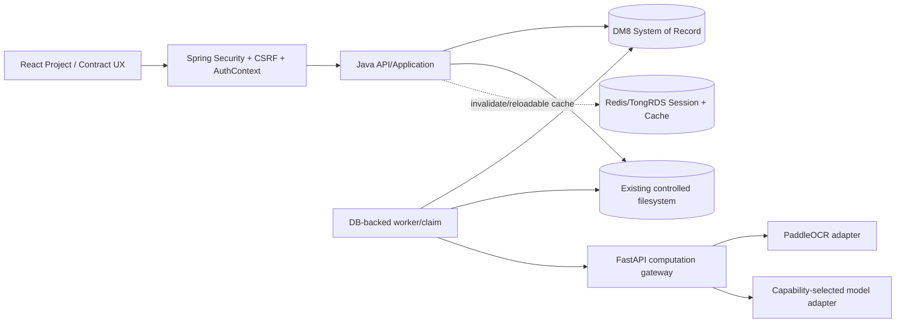
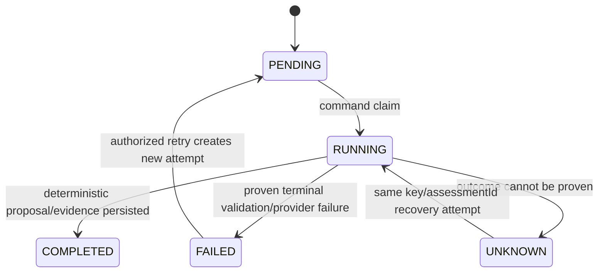
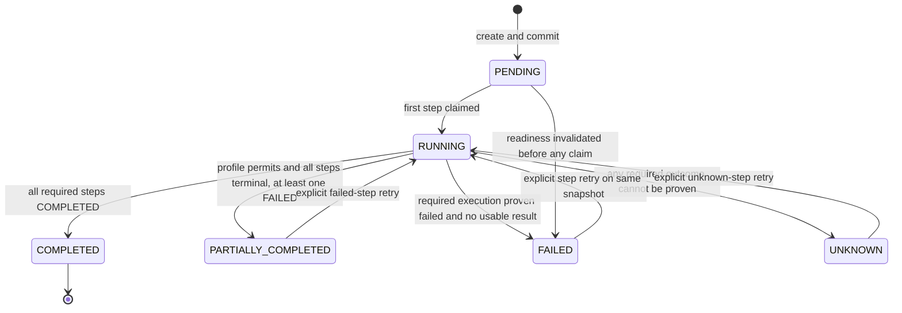
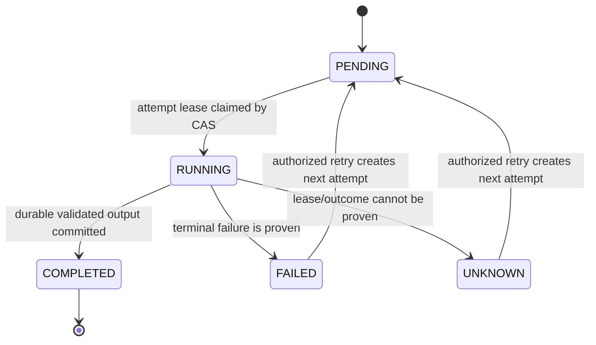

# 合同审查体系演进主设计

> 日期：2026-09-14
>
> 状态：MASTER DESIGN APPROVED；仅 Phase 1A/1B 已获 implementation 授权
>
> 基线：`origin/main@49aa638b2224a1c58f5959b2066c48f26f1c574d`
>
> 约束：本文仍是目标架构契约；2026-09-14 的 Phase 1A/1B 授权只允许 immutable ProjectFile Parse Result 与 deterministic Document Role Assessment/human confirmation。Identity、candidate lifecycle 扩展、AI role、ReviewRun 等仍未获本 slice 授权。

## 1. 设计结论

合同审查的目标事实链必须是：

```text
Project
  -> ProjectFile*
  -> immutable ParseResult*
  -> RoleAssessment/RoleEvidence*
  -> IdentityAssessment*
  -> ContractCandidate*
  -> Contract*
  -> ContractReviewRun*
       -> MaterialSnapshot*
       -> ReviewStep* / StepAttempt*
       -> Finding* / Evidence*
       -> Acknowledgement*
       -> FinalReport*
```

其中：

- DM8 是业务事实、状态、决策、幂等记录、审计和索引元数据的唯一 System of Record。
- 现有受控 filesystem 保存原件和不可变 artifact bytes；所有新 artifact 继续经现有 `FileStoragePort` 能力与同一个 storage root 管理，不建立第二套 upload/file storage subsystem。
- Redis/TongRDS 只用于 Session、Cache 与可丢弃临时状态，不保存 review run、step、finding、ack 或 report 的唯一事实。
- FastAPI 是 OCR 与模型计算网关；它不拥有 Project、File、Contract、Run 或 Finding 的业务身份，也不作最终业务决策。
- Java 从认证上下文和 DM8 读取权威身份与输入，验证模型 schema 和 evidence，控制事务、幂等、并发、状态机与持久化。
- F02 的 `AuditTask`、`AuditCheckResult` 和现有 acknowledgement 继续是 F02 durable truth；新 `ReviewStep` 只引用真实 `AuditTask.id`，不复制或改写 F02 结果。

## 2. 基线与审计方法

### 2.1 Git 事实基线

最初在 `D:\code\audit_agent_1D\.worktrees\main-next` 审计，Phase 1A/1B 从同一最新基线建立独立 `contract-evolution-phase1` worktree，并执行：

```text
git fetch origin --prune
git status --short                  # clean
git rev-parse HEAD                  # 49aa638b2224a1c58f5959b2066c48f26f1c574d
git rev-parse origin/main           # 49aa638b2224a1c58f5959b2066c48f26f1c574d
git log -1 --oneline origin/main    # 49aa638 Merge pull request #20 ...
```

工作树最初的 HEAD 落后于 `origin/main`，确认其为祖先且工作树 clean 后执行了 fast-forward。本文以更新后的 `49aa638` 为事实基线。`README.md`、`docs/source-baseline.md` 和部分子系统 README 中仍出现较早的 `dd0d02c` 验收引用；它们是历史证据，不覆盖本次对 `49aa638` 的源码审计，也不得被解释为本次重新验证了真实 DM8、PaddleOCR、Qwen 或 29 环境。

### 2.2 已审计范围

本文逐项读取了任务指定的架构、路线图、baseline、工程跟进、材料测试、AI/OCR 质量策略、DM8 说明，以及当前以下源码边界：

- `backend/.../contract/**`：Project intake、文件解析、候选合同、合同、F02、语义 AI、breach、term、ReviewSession。
- `backend/.../review/**`：`AuditTask`、`AuditCheckResult`、公共 review ports。
- `backend/.../common/**`：响应、错误、RequestId、配置与值对象。
- `backend/.../integration/**`：DM8 mapper/repository、幂等、受控 filesystem、OCR/AI HTTP adapter。
- `services/audit-ai/**`：FastAPI routes、PaddleOCR adapter、OpenAI-compatible gateway、chunk/retry/schema/evidence contract。
- `frontend/src/features/project/**`、`contract/**`、`app/**`：逐文件上传、候选确认、F02、语义/条款审核、ReviewSession 与运行态展示。
- `db/dm8/**`：共享数字基线 V001–V022 与 local-dev setup。合同演进不抢占下一共享数字，采用描述性 `CONTRACT__*.sql` namespace。

## 3. Current-state audit

### 3.1 已存在且可保留的能力

| 能力 | 当前源码事实 | 目标中的位置 |
|---|---|---|
| Project | `PROJECT` 与 `Project` 已独立于 Contract/ReviewSession；支持空项目后确认 metadata | 上游聚合，1:N 拥有文件和合同 |
| 单文件上传 | `POST /api/v1/projects/{projectId}/files`；前端多选也逐个调用，每个文件独立 Idempotency-Key | 唯一上传入口，原样复用 |
| ProjectFile | 保存原件 storageKey、SHA-256、大小、ingestion/parse 状态、parsed text 与 parse provenance | authoritative uploaded material |
| 解析/OCR | PDF text、DOCX text、图片/PDF OCR；OCR 经 FastAPI/PaddleOCR；parse failure 不等于原件 upload failure | 解析结果需版本化、可重开 |
| Typed facts | `PROJECT_EXTRACTION_RESULT` 保存事实、normalized value、`BigDecimal` amount 和有限 locator | role/identity/candidate 的确定性输入 |
| Candidate/Contract | `CONTRACT_CANDIDATE`、line item、`PROJECT_CONTRACT`、`CONTRACT` | 增补确认态与 readiness gate |
| F02 | 五条确定性规则；短 START tx、事务外执行、COMPLETE tx、`REQUIRES_NEW` FAILURE；DM8 幂等 | 保持不变，作为一种 ReviewStep |
| F02 acknowledgement | `REVIEW_FINDING_ACKNOWLEDGEMENT` 唯一关联 `AUDIT_CHECK_RESULT` | 最小兼容保留，查询层统一 |
| AI gateway | Java 选取 ProjectFile 文本后调用 FastAPI；FastAPI 有 bounded chunks、typed schema、retry、server evidence IDs | 新增 role capability，结果由 Java 验证和持久化 |
| 语义 evidence guard | Java 校验返回 fileId 属于选择集，并用 server-owned parsed text 唯一匹配 excerpt | 升级为 parse-version-bound locator |
| breach/term | Java 确定性 analyzer，读取所选 ProjectFile；已有真实 HTTP endpoint | 作为可持久化 steps |
| durable idempotency | `IDEMPOTENCY_RECORD` 以 `(operationScope, idempotencyKey)` 唯一，带 fingerprint/status/result identity/version | 优先扩展现有 `IdempotencyPort` |
| storage recovery | `FileStoragePort.inspect` 区分 PRESENT / DEFINITELY_MISSING / UNKNOWN；UNKNOWN fail closed | 所有 durable artifact 使用同一原则 |
| security | Spring Security Session Cookie、CSRF、RBAC、AuthContext、RequestId/TraceId、operation audit | 新 command 全部继承 |

### 3.2 当前实体与真实限制

- `Project` 有独立 id、name/projectNo/category、createdBy、versionNo 和 metadata confirmation 语义；它不是 Contract、ReviewSession 或 AuditTask。
- `ProjectFile.category` 的值来自 path/filename token classifier。通用文件名会得到 `UNKNOWN`；分类没有正文信号、版本、置信度、证据或人工确认历史。
- `ProjectFactContextGuard` 仅在 `category == CONTRACT_BODY` 时允许正式合同标量；`ProjectFileIngestionService` 也仅在该 category 下调用 `ContractCandidateAssembler`。因此存在真实循环：

  ```text
  filename/path -> ProjectFile.category
       -> gates formal ProjectFactExtractor
       -> gates ContractCandidate
  generic filename -> UNKNOWN -> contract body cannot produce candidate
  ```

- `PROJECT_FILE.PARSED_TEXT` 和 parse provenance 是当前 latest projection，没有不可变 `parseResultId/parseVersion`。parser/OCR 版本变化后，旧 locator 无法只靠现表被稳定证明。
- 当前 OCR route 是 `/ai/v1/ocr/extract`，Java 对 PDF 先尝试 PDFBox text usefulness，再按需调用 OCR；DOCX 使用 POI，图像直接走 OCR。FastAPI 的 Paddle adapter 是 lazy-loaded、受限输入、单执行锁的 computation adapter，不拥有业务状态。
- `ExtractionResult` 以 `extractionVersion` 保存 PROJECT_NO/PROJECT_NAME/PURCHASER/PROCUREMENT_AGENT、CONTRACT_NO/NAME、PARTY/SUPPLIER、award、amount 和 line-item typed facts；金额是 BigDecimal，但 locator 只有 source text/page/paragraph/string locator，没有 immutable parse result identity。
- `ContractCandidate` 只有 `DRAFT/PROMOTED`；前端“确认并生成正式合同”把人工校正和 promotion 合成一步，缺少独立、可审计的人工作业确认快照。
- `ProjectContract` 对 candidate/contract 建唯一关联；一个 Project 可有多个关联 Contract。正式 `Contract` 保留 F02 所需 parties、BigDecimal amounts、line items、award notice 和 versionNo。
- 当前 promotion 依靠 candidate version、DM8 unique/CAS 与幂等；没有 effective role 或 project identity readiness gate。
- 一个 Project 可拥有多个 candidate/contract，但当前 source-file 唯一 candidate 约束不足以表达同一文件的 reparse/extraction version 历史。
- F02 的真实 rule codes 是 `F02_AMOUNT_WORDS_MATCH`、`F02_LINE_ITEM_ARITHMETIC`、`F02_LINE_SUM_MATCH`、`F02_AWARD_AMOUNT_MATCH`、`F02_AWARD_SUPPLIER_MATCH`。`AuditTask` 状态持久化，结果在 `AuditCheckResult`；现有 `FindingAcknowledgement` 一对一关联 check result。
- F02 结果已持久化；semantic、breach、term 只返回 HTTP response。semantic Java adapter 调用 `/ai/v1/agent/contract-text-analysis`；breach/term 分别调用 Java `/clause-reviews/breach` 和 `/clause-reviews/term-termination`。前端 `Promise.allSettled` 发起分支并把结果放在 React state，刷新/重新登录无法恢复一次完整审核。
- AI 语义 acknowledgement 当前仅写浏览器 `sessionStorage`，不是业务事实。
- 当前 Contract Semantic AI 有九类 typed hints、INFO/REVIEW/INSUFFICIENT、bounded chunk/retry/schema guard和 model provenance；它禁止强合规/违法结论和绝对金额推理。当前 FastAPI 只有 OCR、contract text analysis、budget semantic routes；不存在 document-role route 或 capability router。`run_in_threadpool` 只是请求内执行，不是 durable async。
- 当前 breach/term analyzer 是 Java 确定性逻辑；当选择集中存在 `CONTRACT_BODY` 时会只把该 category 当作条款 authority，因此同样受错误 category 影响。
- FastAPI 的 evidence catalog 对单次请求生成 exact-text span 和 request-local evidence ID；Java 最终只得到 excerpt/locatorAvailable，尚未绑定持久 parse version。
- `ContractReviewSession` 只有 `PREPARING_MATERIALS -> READY`；其 `ReviewDocument/MaterialBinding` 通过同一 storage adapter 重新接收一套 session-owned 文件元数据和二进制，和 ProjectFile 构成两套材料 authority。
- 前端已经有 Project-backed material viewer，但 legacy ReviewSession workspace 仍支持另行上传、替换和移除 ReviewDocument。两者不是同一 durable input snapshot。
- `IdempotencyPort` 当前由 DM8 `IDEMPOTENCY_RECORD` 实现，支持 claim、success、failure、scope/key 及 result-resource rediscovery；F02/Project upload/promotion 的 durable identity 已是可复用基线。

### 3.3 Problem statement

当前系统能证明“某次 F02 对某个 Contract version 执行了哪些规则”，但不能完整证明：

1. 某份通用文件名的材料为什么被认定为何种业务角色；
2. 该文件为什么属于此 Project，冲突如何处理；
3. 合同候选经哪次人工确认成为 Contract；
4. 一次完整审核冻结了哪些文件、SHA、parse version 和 role decision；
5. semantic/breach/term 的结果和证据在刷新或进程重启后如何重开；
6. worker crash、lease expiry、外部调用不确定时为何不是简单标为 FAILED；
7. 报告基于哪一版 input/finding/ack snapshot。

## 4. Target architecture



权威关系：

- 浏览器只能提交用户意图、Idempotency-Key、expectedVersion 和选择的 server-issued IDs；不得提交可信 userId、projectId/fileId 所属关系或 model provenance。
- Java 用 path 参数、AuthContext 和 DM8 重新装载 ownership、版本、input snapshot；然后构造 FastAPI 请求。
- FastAPI 返回 computation proposal；Java 做 schema、allowlist、范围、证据、版本和 policy 校验后，才可形成 durable assessment/finding。
- filesystem 的字节存在不等于业务完成；DM8 COMPLETE tx 才使 artifact 可发现。DM8 指向 artifact 但 storage 状态为 UNKNOWN 时必须 fail closed。

## 5. Domain boundaries

### 5.1 `contract.project-intake`

拥有 `Project`、`ProjectFile`、immutable parse result、role/identity assessment、typed extraction、candidate 和 project-contract association。它是上传材料 authority，不依赖 ReviewSession。

### 5.2 `contract.contract-master`

拥有正式 `Contract`、line items、award basis 和 contract version。Project 是上游聚合；Contract 不能以 ReviewSession.name、合同编号或中标通知书编号冒充 Project。

### 5.3 `contract.review-run`

拥有 `ContractReviewRun`、material snapshot、step、attempt、非 F02 finding/evidence、AI finding acknowledgement 和 report。它引用 Project/Contract/File/parse/role decision 的冻结 identity，不拥有原件。

### 5.4 `review`

继续拥有公共 `AuditTask`、`AuditCheckResult`、check status/risk/evidence 的公共抽象。F02 从 contract application 映射到该公共模型；`review` 不反向依赖 contract。

### 5.5 `contract.review-session-legacy`

保留现有 `ContractReviewSession/ReviewDocument/MaterialBinding` 和历史 API/migrations。新建的 Project-backed ReviewSession 只能绑定 ProjectFile；legacy 数据不删除、不批量复制、不静默重解析。

### 5.6 `integration`

提供 DM8 repositories、existing filesystem adapter、Redis cache/session、FastAPI HTTP adapter。业务领域只依赖 ports，不感知 DM8 driver、Nginx/TongHttpServer、Redis/TongRDS 或具体模型产品。

## 6. Aggregate model and invariants

| Aggregate root | 内部/关联事实 | 不变量 |
|---|---|---|
| Project | ProjectFile、project metadata version | 每个上传 command 只产生一个独立 root file operation；后续文件不会回滚或覆盖前一文件 |
| ProjectFile | ParseResult、RoleAssessment/Evidence、IdentityAssessment | 原件 `storageKey + sha256 + size` 在 AVAILABLE 后不可变；assessment history append-only；不因 AI 失败改成 UPLOAD_FAILED |
| ContractCandidate | candidate facts、line items、Confirmation | 只由 effectiveRole=CONTRACT_BODY 的 immutable parse result 产生；promotion 必须引用一份有效 confirmation |
| Contract | structured F02 input、ProjectContract | 通过 ProjectContract 属于一个 Project；金额均为 BigDecimal/DECIMAL；promotion 后不被 role 变化静默回滚 |
| ContractReviewRun | contract snapshot、materials、steps | 创建即冻结 input；run 内不换文件、不跟随 latest parse/role/contract；重跑创建新 run |
| ContractReviewStep | attempts、finding/evidence | 一个逻辑 step type 在 run/profile 内唯一；COMPLETED 结果不可被 retry 覆盖；F02 step 的 output identity 必须是真实 AuditTask ID |
| ContractReviewReport | snapshot identities、artifact | 同一 run 的 reportVersion 单调递增；重新生成新增版本，永不覆盖旧报告或 artifact |

跨聚合硬门槛：

1. candidate assembly 前：source file AVAILABLE、parse COMPLETED、effectiveRole=CONTRACT_BODY、identity effective status=SAME_PROJECT。
2. candidate confirmation/promotion 前：上述条件仍成立，candidate source parse 未被更新版本 supersede，且无 unresolved role/identity conflict。
3. review run 前：Contract 通过 ProjectContract 属于 Project；全部选择材料可重开、SHA 相符、parse result immutable、role decision 可解析、identity=SAME_PROJECT；Project 内其他未选择文件不构成批次完成门槛。
4. report 前：run 没有 UNKNOWN step；profile 所有 required step 已完成，或 policy 明确允许 `PARTIALLY_COMPLETED` 且报告醒目标注失败 step。

### 6.1 State machines overview

| Machine | States / decision outcomes | History rule |
|---|---|---|
| File ingestion | UPLOAD_PENDING -> AVAILABLE / UPLOAD_FAILED；storage outcome unprovable remains recoverable/unknown | 原件 identity 不变，retry复用operation key |
| Parse | PENDING -> PARSED / UNSUPPORTED / FAILED；reparse creates next ParseResult | 旧 parse/result/locator 不覆盖 |
| Role assessment execution | PENDING -> RUNNING -> COMPLETED / FAILED / UNKNOWN | machine proposal/evidence append-only；execution status 不表示业务决策 |
| Role decision | PROPOSED -> NEEDS_CONFIRMATION -> CONFIRMED | 默认无 auto-accept；human decision 独立追加且不覆盖 assessment |
| Identity assessment | deterministic outcome SAME_PROJECT / LIKELY_SAME_PROJECT / CONFLICT / INSUFFICIENT；human resolution appends SAME/NOT_SAME | 新材料只追加新assessment，不改旧run |
| Candidate | 当前只允许 DRAFT -> PROMOTED | Phase 1A/1B 不改 constraint、不加任何 candidate state；独立确认与扩展 lifecycle 留给后续获批 slice |
| ReviewRun | PENDING -> RUNNING -> COMPLETED / PARTIALLY_COMPLETED / FAILED / UNKNOWN；显式retry可回RUNNING | input snapshot 永不改变 |
| ReviewStep | PENDING -> RUNNING -> COMPLETED / FAILED / UNKNOWN；显式retry追加attempt | COMPLETED不可覆盖，late worker被fence |
| Report | PENDING -> GENERATING -> AVAILABLE / FAILED / UNKNOWN | regenerate新增reportVersion/artifact |

## 7. Database master map, Data model and ER proposal

### 7.1 Relationship proposal

```mermaid
erDiagram
    PROJECT ||--o{ PROJECT_FILE : owns
    PROJECT_FILE ||--o{ PROJECT_FILE_PARSE_RESULT : parsed_as
    PROJECT_FILE_PARSE_RESULT ||--o{ PROJECT_EXTRACTION_RESULT : yields
    PROJECT_FILE ||--o{ PROJECT_FILE_ROLE_ASSESSMENT : assessed_by
    PROJECT_FILE_ROLE_ASSESSMENT ||--o{ PROJECT_FILE_ROLE_EVIDENCE : supported_by
    PROJECT_FILE_ROLE_ASSESSMENT ||--o{ PROJECT_FILE_ROLE_DECISION : decided_from
    PROJECT_FILE ||--o{ PROJECT_FILE_ROLE_DECISION : effective_history
    PROJECT_FILE ||--o{ PROJECT_FILE_IDENTITY_ASSESSMENT : compared_to_project
    PROJECT_FILE_IDENTITY_ASSESSMENT ||--o{ PROJECT_FILE_IDENTITY_EVIDENCE : supported_by
    PROJECT_FILE_PARSE_RESULT ||--o{ CONTRACT_CANDIDATE : yields
    CONTRACT_CANDIDATE ||--o{ CONTRACT_CANDIDATE_CONFIRMATION : confirmed_as
    CONTRACT_CANDIDATE ||--o{ CONTRACT_SOURCE_ROLE_DISPOSITION : role_divergence_resolved_by
    CONTRACT_CANDIDATE ||--o| PROJECT_CONTRACT : promoted_through
    PROJECT ||--o{ PROJECT_CONTRACT : owns
    CONTRACT ||--|| PROJECT_CONTRACT : associated_by

    PROJECT ||--o{ CONTRACT_REVIEW_RUN : scopes
    CONTRACT ||--o{ CONTRACT_REVIEW_RUN : reviewed_by
    CONTRACT_REVIEW_RUN ||--|{ CONTRACT_REVIEW_RUN_MATERIAL : freezes
    PROJECT_FILE ||--o{ CONTRACT_REVIEW_RUN_MATERIAL : snapshotted
    PROJECT_FILE_PARSE_RESULT ||--o{ CONTRACT_REVIEW_RUN_MATERIAL : binds
    CONTRACT_REVIEW_RUN ||--|{ CONTRACT_REVIEW_STEP : contains
    CONTRACT_REVIEW_STEP ||--o{ CONTRACT_REVIEW_STEP_ATTEMPT : attempts
    CONTRACT_REVIEW_STEP ||--o| AUDIT_TASK : f02_truth
    AUDIT_TASK ||--o{ AUDIT_CHECK_RESULT : produces
    CONTRACT_REVIEW_STEP ||--o{ CONTRACT_REVIEW_FINDING : produces
    CONTRACT_REVIEW_FINDING ||--|{ CONTRACT_REVIEW_EVIDENCE : grounded_by
    CONTRACT_REVIEW_FINDING ||--o{ CONTRACT_REVIEW_FINDING_ACKNOWLEDGEMENT : acknowledged_by
    AUDIT_CHECK_RESULT ||--o| REVIEW_FINDING_ACKNOWLEDGEMENT : f02_ack
    CONTRACT_REVIEW_RUN ||--o{ CONTRACT_REVIEW_REPORT : versions

    IDEMPOTENCY_RECORD }o--|| PROJECT : may_point_to
    IDEMPOTENCY_RECORD }o--|| PROJECT_FILE : may_point_to
    IDEMPOTENCY_RECORD }o--|| CONTRACT_REVIEW_RUN : may_point_to
    OPERATION_AUDIT }o--|| CONTRACT_REVIEW_RUN : records

    CONTRACT_REVIEW_SESSION ||--o{ CONTRACT_REVIEW_DOCUMENT : legacy_owns
    CONTRACT_REVIEW_SESSION ||--o{ CONTRACT_REVIEW_MATERIAL_BINDING : legacy_selects
    CONTRACT_REVIEW_SESSION ||--o{ REVIEW_SESSION_PROJECT_FILE_BINDING : project_backed_selects
    PROJECT_FILE ||--o{ REVIEW_SESSION_PROJECT_FILE_BINDING : referenced_not_copied
```



### 7.2 Table classification

| Logical entity/table | Classification | 说明 |
|---|---|---|
| `PROJECT` | existing | Project aggregate root |
| `PROJECT_FILE` | existing | authoritative original upload；`CATEGORY/PARSED_TEXT` 暂作 legacy/latest projection |
| `PROJECT_FILE_PARSE_RESULT` | new | append-only parse identity、canonical text hash、parse version/method/engine、page/segment manifest identity |
| `PROJECT_EXTRACTION_RESULT` | existing, evolve later | typed facts；未来每条必须引用 parseResultId，旧行按 legacy parse identity 读取 |
| `PROJECT_FILE_ROLE_ASSESSMENT` | new | machine proposal、deterministic/AI execution、version/provenance 与独立 execution status |
| `PROJECT_FILE_ROLE_EVIDENCE` | new | role signals 与 parse-bound evidence |
| `PROJECT_FILE_ROLE_DECISION` | new | append-only human confirmation；与 machine assessment 分表，保存业务 decision status/actor/supersession |
| `PROJECT_FILE_IDENTITY_ASSESSMENT` | new | file-to-project comparison、input fingerprint、status、human resolution |
| `PROJECT_FILE_IDENTITY_EVIDENCE` | new | 引用 typed fact/extraction 与 normalization/comparison outcome |
| `CONTRACT_CANDIDATE` / line item | existing, evolve later | 增加 parse/version linkage 与 lifecycle，不删除旧数据 |
| `CONTRACT_CANDIDATE_CONFIRMATION` | new | 人工确认 payload snapshot、fingerprint、actor/time；和 promotion 解耦 |
| `CONTRACT_SOURCE_ROLE_DISPOSITION` | new | promotion 后 source role divergence 的 retain/revoke-for-future-review 决策历史 |
| `PROJECT_CONTRACT` | existing | Project 1:N Contract association |
| `CONTRACT` / line item / award / rule config | existing | 正式合同与 F02 输入 |
| `CONTRACT_REVIEW_RUN` | new | 完整审核聚合、contract canonical snapshot/hash、policy versions |
| `CONTRACT_REVIEW_RUN_MATERIAL` | new | immutable material snapshot |
| `CONTRACT_REVIEW_STEP` | new | logical step、status、output type/id、version |
| `CONTRACT_REVIEW_STEP_ATTEMPT` | new | claim/lease/attempt/recovery history；防止在 step row 上抹掉历史 |
| `AUDIT_TASK` / `AUDIT_CHECK_RESULT` | existing | F02 durable truth，不复制到 new finding table |
| `CONTRACT_REVIEW_FINDING` | new | semantic/breach/term/future step 的 validated business finding |
| `CONTRACT_REVIEW_EVIDENCE` | new | 统一 EvidenceLocator 的持久化形式 |
| `REVIEW_FINDING_ACKNOWLEDGEMENT` | existing | 仅 F02 acknowledgement，保持物理表和 FK |
| `CONTRACT_REVIEW_FINDING_ACKNOWLEDGEMENT` | new | 非 F02 finding acknowledgement；逻辑查询层统一 |
| `CONTRACT_REVIEW_REPORT` | new | append-only report versions 与 artifact identity |
| `IDEMPOTENCY_RECORD` | existing, reuse | 新 operation scopes 优先复用现有 port 与 DM8 truth |
| `AUDIT_OPERATION_LOG` | existing, reuse | command、确认、retry、report/debug bundle 的长期业务审计 |
| `CONTRACT_REVIEW_SESSION` | existing/legacy compatible | 仅 PREPARING_MATERIALS -> READY；不新增公共 delete |
| `CONTRACT_REVIEW_DOCUMENT` / binding | legacy | 历史材料 authority，保留读取/恢复；新 Project-backed 流程不再写入 |
| `REVIEW_SESSION_PROJECT_FILE_BINDING` | new in authority-cleanup phase | session 只引用 ProjectFile/parse，不复制 bytes |
| `SANITIZED_DEBUG_BUNDLE` | future table | 经授权生成的 manifest/artifact identity 和审计状态 |
| F09–F15 rule/config tables | future | 仅在 customer rules 获批后定义，不在本设计猜 schema |

共享数字 migration 基线固定为 V001–V022。Phase 1A/1B 只增加 `CONTRACT__project_file_parse_result.sql` 与 `CONTRACT__project_file_role_assessment.sql`，其 header 声明 namespace、ID、依赖和 `CONTROLLED_MANUAL`；不新增 V023/V024/V025，不改 V001–V022。其他 new/future tables 仍须由各后续 phase 独立批准，不能由本 slice 顺带生成。

Phase 1A 的依赖顺序是 `V010__project_intake_core.sql,V017__project_file_parse_provenance.sql -> CONTRACT__project_file_parse_result.sql`；Phase 1B 是 `CONTRACT__project_file_parse_result.sql -> CONTRACT__project_file_role_assessment.sql`。这两个文件仍由受控人工 preflight/执行，仓库没有自动 migration runner；SQL 文件存在不等于任何环境已部署。

## 8. Parse result and EvidenceLocator foundation

### 8.1 Immutable parse result

每次解析尝试形成独立 `ProjectFileParseResult`，至少包含：

```text
parseResultId, projectId, fileId, fileSha256,
parseVersion, parseOrigin, parseStatus, parseMethod,
engine, engineVersion,
canonicalText CLOB, canonicalTextSha256,
pageCount, durationMs, confidence,
supersedesParseResultId, createdAt, completedAt, versionNo
```

规则：

- `fileSha256` 必须等于 ProjectFile 原件 SHA；不相等的 parse result 不可用。
- COMPLETED 后正文、hash、engine provenance 和 segment manifest 不可变。reparse 创建新 row，不覆盖旧 row。
- 当前 `PROJECT_FILE.PARSED_TEXT`、method/engine/confidence/page/duration 在过渡期只是 latest-compatible projection；新 assessment/run/evidence 只引用 parseResultId。
- 解析文本可继续存 DM8 CLOB；若未来改为 filesystem artifact，DM8 仍保存 storageKey、SHA、长度、状态且使用现有 create-only storage adapter。不得另建“审核文件目录”。
- 原文件 AVAILABLE 与 parse FAILED 是两个事实；parser/OCR/model failure 不能反写 UPLOAD_FAILED。
- `parseOrigin` 只允许 `CURRENT_PIPELINE` 或 `LEGACY_IMPORTED`。当前上传在既有一次 parser/OCR computation 结束后，于同一个短 COMPLETE transaction 同时写 immutable parse result 和 legacy `PROJECT_FILE.PARSED_TEXT`/provenance projection；不能为新表再次调用 OCR/PDFBox/POI。
- 上线前已经 `AVAILABLE + PARSED` 的 ProjectFile 在首次 role flow 中由 `LegacyProjectFileParseResultMaterializer` 从 server-owned `fileId + fileSha256 + parsedText + provenance` 原子 materialize 一条唯一 `LEGACY_IMPORTED` result。重复或并发请求返回同一 parseResultId；DB unique constraint/insert-race reload 保证 exactly one，不以 Redis、`synchronized` 或重传原件保证。缺少/矛盾 parsed text 或 provenance 时 fail closed，不猜测也不重新解析。

### 8.1.1 Extraction idempotency key compatibility

历史 `ExtractionKeyFactory` 的 `project-extraction-key-v1` 输入不包含 parseResultId，历史记录、replay 和既有 candidate 行保持原样，禁止重算。新 parse-bound extraction 使用 `project-extraction-key-v2`，SHA-256 的规范组件顺序精确为：

```text
sourceFileId + parseResultId + extractionVersion + factType + groupKey + sourceLocator
```

调用方通过显式 versioned seam 选择 v1/v2；Phase 1A 只让当前/legacy parse-result-backed 新 extraction 选择 v2，不修改已持久化 v1 identity。

### 8.2 Unified EvidenceLocator

所有新 role、identity、finding evidence 采用同一值对象：

```text
EvidenceLocator {
  fileId, fileSha256,
  parseResultId, parseVersion, parseMethod,
  parserEngine, parserEngineVersion,
  ocrEngine?, ocrEngineVersion?,
  pageNumber?, paragraphIndex?,
  tableIndex?, rowIndex?, cellIndex?, segmentIndex?,
  charStart, charEnd,
  textHash, boundedExcerpt,
  locatorSchemaVersion
}
```

不变量：

1. `charStart/charEnd` 必须指向该 parseResult 的 canonical text，采用 Unicode code-point offset；两端均为零基、start inclusive、end exclusive。不能混用 UTF-16 前端 offset。
2. page/paragraph/table/row/cell/segment 是附加定位维度，缺失时允许为 null；字符范围和 textHash 是最低可验证锚点。
3. `textHash = SHA-256(canonicalText[charStart:charEnd])`；boundedExcerpt 是相同 span 的长度受限展示副本，不是权威全文。
4. locator 不可跟随 ProjectFile 的 latest parse 漂移。parser version change 创建新 parseResult，旧 evidence 仍可重开旧 artifact/text。
5. Java 在写 finding 前按 run material snapshot 重新装载 parseResult，校验 file/SHA/version/offset/hash。模型提供的 excerpt、fileId 或 offset 都只是候选输入。
6. excerpt 在正文中多次出现时，不能凭首次或模糊匹配选位置；FastAPI/Java 必须使用 server-generated segment ID 或明确返回 unsupported。无法唯一落位的 claim 不得成为正式 finding。
7. 若 storage inspection 为 UNKNOWN，evidence 状态也是 UNKNOWN，不得伪装为 MISSING/FAILED。

## 9. Document Role Assessment

### 9.1 Role vocabulary

目标业务角色统一为：

```text
CONTRACT_BODY
AWARD_NOTICE
TENDER_DOCUMENT
BID_RESPONSE
SUPPLEMENT
OTHER
UNKNOWN
```

`PACKAGE` 只保留为 legacy Project Intake Package 容器标记，不是可选 review document role。ZIP 模板、目录和安全边界获批前，不新增 ZIP 自动解压/分类能力，也不把 ZIP 映射成 `OTHER`。

### 9.2 Category-independent deterministic signals

新增 domain service `DocumentRoleSignalExtractor`，它只依赖 immutable parse result，不读取或 gate 于 `ProjectFile.category`。它按以下顺序提取可解释信号：

1. document title 和首页/front matter；
2. 合同/中标通知/招标/投标/补充协议的限定 key phrases；
3. section headings 组合，例如双方、价款、履行、违约、签署区；
4. document structure，例如目录、条款编号密度、签章/落款语义、招投标章节组合；
5. legacy path/filename classification，仅作为一个低权重兼容 signal。

每个 signal 记录 `signalType`、normalized value、支持/反对的 role、weight、ruleCode、extractorVersion 和 EvidenceLocator。确定性 resolver 输出候选角色、置信度和 conflict set。客户自动接受阈值尚未定义，因此 `AUTO_ACCEPT_DISABLED_BY_DEFAULT`：本阶段任意 deterministic proposal 都进入 `NEEDS_CONFIRMATION`，只能由人工确认形成 authoritative role；不得用开发者猜测的 magic threshold 自动接受。

### 9.3 AI fallback boundary

目标架构允许未来在确定性结果低置信或 signals 冲突时调用以下 port，但 Phase 1A/1B 明确不实现 FastAPI route、AI adapter 或 model role fallback：

```text
DocumentRoleAssessmentPort
  -> FastApiDocumentRoleAssessmentAdapter
  -> FastAPI DOCUMENT_ROLE capability
  -> configured model provider
```

AI response contract：

```text
proposedRole
confidence           # 0..1, decimal
candidateRoles[]     # role + confidence + reasonCode
evidence[]           # server-issued evidence segment IDs only
modelProvenance      # provider/model/revision/request schema/duration
```

FastAPI 不返回“已确认角色”，也不能写 `PROJECT_FILE.CATEGORY`。Java 校验 role allowlist、confidence range、schema version、segment ownership 与 parse text/hash；任一证据伪造、越界或来自 run/file 之外时，AI proposal 整体不能成为可确认 proposal，并记录安全 reason code。

### 9.4 Durable assessment history

`PROJECT_FILE_ROLE_ASSESSMENT` 是 append-only machine assessment history；`PROJECT_FILE_ROLE_DECISION` 是 append-only business decision history。两者不得用一个 universal `STATUS` 混写 execution 与 decision 语义。

- `MACHINE_DETERMINISTIC`：只保存 proposal、confidence、assessmentVersion、rolePolicyVersion、input fingerprint；无 model provenance，本身不是 business role。
- `MACHINE_AI`：只保存 proposal、candidateRoles canonical JSON、schema/prompt/model provenance；必须引用 preceding deterministic assessment，本身不是 business role。
- `SYSTEM_POLICY_DECISION`：仅是后续客户批准 policy 后的 extension slot；默认关闭，且永远不能接受 AI assessment。
- `HUMAN_CONFIRMATION`：独立 decision row 保存 `selectedRole`、`confirmedBy`、`confirmedAt`、reason、`supersedesDecisionId`；由 AuthContext 产生，不能接受客户端 confirmedBy。

共同字段至少有：

```text
assessmentId, projectId, fileId, fileSha256, parseResultId,
executionStatus, proposedRole?, confidence?, conflict,
source, assessmentVersion, rolePolicyVersion,
modelProvider?, modelName?, modelRevision?, promptVersion?, schemaVersion?,
inputFingerprint, safeReasonCode?, createdAt, versionNo
```

`RoleAssessmentExecutionStatus` 精确为 `PENDING/RUNNING/COMPLETED/FAILED/UNKNOWN`；`RoleDecisionStatus` 精确为 `PROPOSED/NEEDS_CONFIRMATION/CONFIRMED`。Phase 1B 的 completed deterministic assessment 在 API projection 中给出 `decisionStatus=NEEDS_CONFIRMATION`，human confirmation row 给出 `CONFIRMED`。机器 assessment 的 proposal/evidence 完成后不可修改；重评创建新 row。运行中的 command 只可 CAS 更新 execution status，不能改其 input fingerprint；proposal 完成后也不可覆盖。

`PROJECT_FILE_ROLE_DECISION` 至少保存：

```text
decisionId, projectId, fileId, fileSha256, assessmentId,
selectedRole, decisionStatus=CONFIRMED, decidedBy, decidedAt,
supersedesDecisionId?, reason?, versionNo
```

### 9.5 Role assessment state machine



execution machine 之外另有 decision machine：deterministic result materialize `PROPOSED -> NEEDS_CONFIRMATION` projection；`POST role-confirmations` 通过 expectedVersion/CAS 追加 `CONFIRMED` decision。Phase 1A/1B 不调用 AI；未来 AI unavailable/timeout/invalid JSON 也只能保留 `NEEDS_CONFIRMATION` 与安全 reason，ProjectFile 仍是 AVAILABLE，parse 状态不变。上传 success 从不依赖 Qwen success。

上图的 `FAILED -> PENDING` 表示已证明失败后发起新的 assessment command；`UNKNOWN -> RUNNING` 必须复用原 Idempotency-Key、assessmentId 和 input fingerprint，仅递增内部 attemptNo。机器 proposal 一旦完成就不可被 retry 覆盖。

### 9.6 Effective role resolution

对一个 immutable `fileId + fileSha256`，Java `EffectiveDocumentRoleResolver` 按以下固定优先级解析：

1. 最新、未被后续 human decision supersede 的 `HUMAN_CONFIRMATION`；
2. 对 feature 上线前已有文件且尚无新 decision，使用原 `PROJECT_FILE.CATEGORY` 作为 `LEGACY_EFFECTIVE`，但 `UNKNOWN/PACKAGE` 不可成为 CONTRACT_BODY；
3. 否则 effectiveRole=`UNKNOWN`。

machine assessment 与 business role 是不同事实：在客户批准 auto-accept policy 之前，proposal 必须经过 human confirmation 才能成为新流程的 effectiveRole。AI proposal 永远不直接进入 effectiveRole；它只改善人工确认界面。新上传文件的 filename classification 是 deterministic signal，不再单独成为权威 role。读取历史 run 时使用 material snapshot 中冻结的 `roleDecisionId/effectiveRole`，不重新按 latest policy 计算。

角色修改规则：

- human override 追加 decision；不覆盖 machine history，也不删除 extraction/candidate。
- 当前 candidate 仍只有 `DRAFT/PROMOTED`。Phase 1A/1B 的 role override 不改 candidate 状态、不触发新 candidate/re-entry；candidate gate 与角色分歧处置须由后续独立 migration/implementation 批准。
- 已 promotion 的 Contract 不被回滚或删除；追加 `SOURCE_ROLE_DIVERGENCE` 业务事件并阻断新的 run。具备合同确认权限的人员必须追加 `RETAIN_PROMOTED_CONTRACT` 或 `REVOKE_FOR_FUTURE_REVIEW` disposition。前者允许新 run 但 snapshot 必须包含该 dispositionId；后者保持历史 run 可读、禁止新 run。该规则避免静默接受错误 source，也允许纠正历史 role。

`CONTRACT_SOURCE_ROLE_DISPOSITION` 至少保存 `dispositionId/projectId/candidateId/contractId/previousRoleDecisionId/newRoleDecisionId/outcome/reason/decidedBy/decidedAt/versionNo`，append-only 且由 operation audit 记录。它不是 acknowledgement，也不改变历史 Contract 内容。

## 10. Project Identity Assessment

### 10.1 Inputs and normalization

`ProjectFileIdentityAssessment` 比较文件内 typed facts 与 Project authoritative metadata，以及已确认的同 Project facts。可用事实至少包括：

```text
PROJECT_NO, PROJECT_NAME, PURCHASER, PROCUREMENT_AGENT,
CONTRACT_NO, PARTY_A, PARTY_B, SUPPLIER_NAME,
AWARD_SUPPLIER, CREDIT_CODE, AWARD_SUPPLIER_CREDIT_CODE,
AMOUNT_NUMERIC, AWARD_AMOUNT
```

deterministic normalization first：

- 编号：Unicode/NFKC、空白/允许分隔符统一，原值仍保留；不得删除有语义的字母或校验位。
- 机构/人名：Unicode/空白/全半角/合法公司后缀规范化；exact normalized match 与 alias match 分开记录。
- 金额：Java `BigDecimal` 和数值 `compareTo`，DM8 `DECIMAL(18,2)`；不能用 `double/float`，不依赖 scale-equals。
- 缺失事实是 INSUFFICIENT，不是 mismatch；相互矛盾的强 identity facts 形成 CONFLICT。
- embedding/AI semantic similarity 只能把 INSUFFICIENT 提示为 LIKELY_SAME_PROJECT，不能自动决定 Project ownership，也不能消除 deterministic CONFLICT。

### 10.2 Durable model

`PROJECT_FILE_IDENTITY_ASSESSMENT` 至少保存：

```text
identityDecisionId, projectId, projectVersionNo,
fileId, fileSha256, parseResultId,
assessmentSource, assessmentVersion, identityPolicyVersion,
status, normalizedInputFingerprint,
modelProvenance?, safeReasonCode?,
humanResolution?, resolvedBy?, resolvedAt?,
supersedesDecisionId?, createdAt, versionNo
```

`PROJECT_FILE_IDENTITY_EVIDENCE` 保存 fact type、extractionResultId、左/右 normalized values 的 hash/受限展示、comparison outcome、weight 和 parse-bound EvidenceLocator。不得把完整 model raw response 当 identity evidence。

状态语义：

| Status | 含义 | 自动业务权限 |
|---|---|---|
| `SAME_PROJECT` | 强 deterministic identity facts 一致且无冲突，或有明确 human same-project resolution | 可作为 candidate/run material |
| `LIKELY_SAME_PROJECT` | 弱 deterministic/semantic signals 支持但不足以确证 | 仅展示；使用前需人工确认 |
| `CONFLICT` | 至少一个高权重事实与 Project/confirmed facts 冲突 | 文件不删除；promotion 和 run readiness 阻断 |
| `INSUFFICIENT` | 缺少足够 identity facts | 文件保留；使用前需人工确认 |

人工处理创建新 assessment event：`CONFIRM_SAME_PROJECT` 将 effective status 解析为 SAME_PROJECT；`CONFIRM_NOT_SAME_PROJECT` 将文件留在原 Project 中但标为 excluded/quarantined，禁止 candidate/promotion/run selection。系统不自动移动文件、不自动创建新 Project。

### 10.3 One-by-one re-evaluation

今天的 file A、明天的 file B、后天的 file C 各有独立 upload/parse/role/identity/confirmation/recovery。新文件到达时：

- 不等待“批次完成”；不重开已成功上传操作。
- 以新的 `projectMaterialSetFingerprint` 对受影响文件追加 identity assessment；旧 assessment 不覆盖。
- 已创建的 Contract 和已冻结的 ReviewRun 不随新文件变化。
- 新文件只有被明确选择并通过 SAME_PROJECT readiness 后，才进入新 run snapshot。

## 11. Contract Candidate lifecycle

### 11.1 Creation pipeline

```text
effectiveRole=CONTRACT_BODY
  -> category-independent parse result already exists
  -> formal ProjectFactExtractor for that parse result
  -> typed fact validation and conflict calculation
  -> ContractCandidateAssembler
  -> DRAFT candidate
  -> existing human-triggered Contract promotion
  -> PROMOTED candidate + ProjectContract + Contract
```

role signal extraction不受 category gate。正式合同 facts/candidate 与 effectiveRole 的连接不在 Phase 1A/1B 内实施；本 slice 停在人工确认后可重开的 effectiveRole projection，保留现有 filename/category-driven candidate 行为和 promotion API。后续 candidate gate slice 获批后才可切换为 parse/role-bound assembly。

### 11.2 States

```mermaid
stateDiagram-v2
    [*] --> DRAFT: assemble from immutable parse
    DRAFT --> PROMOTED: existing atomic promotion
    PROMOTED --> PROMOTED: terminal; later role event cannot undo
```



这是 current physical constraint：只允许 `DRAFT/PROMOTED`。独立 candidate confirmation、withdraw/disposition、parse-bound re-entry 都是后续 architecture slot，不属于本 slice，不能提前修改表约束或 API。

### 11.3 Exact invariants and edge cases

| 场景 | 设计结果 |
|---|---|
| generic filename contains contract body | body signal extractor产生 proposal；人工确认后 effectiveRole=CONTRACT_BODY，但 Phase 1A/1B 不创建 candidate；后续 gate slice 才连接正式 extraction/candidate |
| multiple contracts in one Project | 每个 contract-body parse result 形成独立 candidate；`PROJECT -> PROJECT_CONTRACT*`，run 必须选择一个 contractId |
| candidate already created | 同 `fileId + parseResultId + extractionVersion + factFingerprint` 返回既有 candidate；相同 identity 但不同 fingerprint fail closed，不静默改写 |
| parser version changed | Phase 1A 追加新 parseResult；现有 candidate 不被修改。后续 gate slice 必须显式设计 candidate version/re-entry |
| duplicate confirmation | same Idempotency-Key + same fingerprint replay 同一 confirmation；different fingerprint 返回 409 |
| corrected confirmation | 使用新 key、expected candidate version，追加 confirmation snapshot，candidate version CAS+1；旧 snapshot 留存 |
| role override before promotion | 本 slice 只追加 role decision，不修改既有 candidate。candidate readiness 与恢复规则留给后续获批 slice |
| candidate promoted | candidate、confirmationId、Contract 和 ProjectContract 在一个短 DM8 tx 内建立；result identity 是真实 contractId |
| role changed after promotion | Contract 和历史 run 不回滚；记录 source-role divergence，按上一节 disposition 明确决定未来 review readiness |
| identity conflict | 不删除文件或 candidate history；CONFIRM/PROMOTE/REVIEW_RUN_CREATE 均阻断，直到 append-only human resolution |

`CONTRACT_CANDIDATE_CONFIRMATION` 的 fingerprint 覆盖完整规范化 payload：contract identity、parties、credit codes、所有 `BigDecimal` amounts、line items 排序、award facts、source parseResultId、effective role decisionId 和 identity decisionId。promotion 必须引用该 confirmationId 与 candidate expectedVersion，不能重新接受一份未保存的客户端 payload。

## 12. Durable ContractReviewRun

### 12.1 Meaning and fields

`ContractReviewRun` 表示“一次完整、可证明、可重开的合同审核”，不是 HTTP request、页面 animation、ReviewSession 或 AuditTask 的别名。至少包含：

```text
runId
projectId
contractId
contractVersion
contractSnapshotCanonicalCLOB
contractSnapshotSha256
requestedBy
status
reviewProfileVersion
ruleVersion
modelPolicyVersion
inputSnapshotIdentity
requestedAt / startedAt / completedAt / failedAt / unknownAt
safeReasonCode
versionNo
```

只存 contractVersion 不足以在 Contract 行将来更新后重建原输入，因此 run 同时保存 canonical structured contract snapshot CLOB 与 SHA-256。它是 Java 从 DM8 Contract、line items、award facts 生成的规范化 JSON；数值按 BigDecimal canonical string，key/array order 固定，不包含模型原始响应。

`inputSnapshotIdentity` 是以下 canonical manifest 的 SHA-256：run schema version、projectId、contractId/version/snapshot hash、按稳定顺序排列的 material snapshot fields、review profile/rule/model policy versions。任何一项变化必须创建新 run，不能 mutate 原 run。

### 12.2 Material snapshot

每条 `ReviewRunMaterialSnapshot` 至少包含：

```text
runMaterialId, runId, ordinal,
fileId, fileSha256,
parseResultId, parseVersion, canonicalTextSha256,
effectiveRole, roleDecisionId,
identityDecisionId,
sourceRoleDispositionId?,
selectedBy, snapshottedAt
```

约束：

- `(runId, fileId)` unique；同一物理文件不重复进入一个 run。
- fileSha、parse result、role decision、identity decision 必须相互属于同一 file，并在 START tx 内重新验证。
- snapshot 只引用 ProjectFile，不复制 binary、不重新 parse；原件/parse artifact 通过既有 reopen path 读取。
- Project 后续上传、reparse、role override、identity 重评不改变既有 snapshot。
- 每个 step 只能读取 run snapshot；不得重新查询 Project 的“当前全部文件”作为隐式输入。

### 12.3 Run status



UNKNOWN 是持久、可观察状态，不等于 FAILED；它只能经显式 step retry 回到 RUNNING，不能被后台扫描静默改写。retry 不重写旧 attempt，对同一 frozen snapshot 追加新 attempt；输入、contract、policy 或材料要改变时必须创建新 run 并引用 `supersedesRunId`。报告默认只接受 COMPLETED；`PARTIALLY_COMPLETED` 只有 frozen report policy 明确允许时可报告，并列出失败 step；UNKNOWN 永远不可生成 final report。若 partial report 后 retry 成功，后续报告必须创建新 reportVersion，旧报告仍保持原 snapshot。

## 13. ContractReviewStep and durable attempts

### 13.1 Step types

当前 profile 的逻辑 steps：

```text
MATERIAL_VALIDATION
F02_DETERMINISTIC
SEMANTIC_AI
BREACH
TERM
```

目标业务清单中的四个审核 step 保持 `F02_DETERMINISTIC / SEMANTIC_AI / BREACH / TERM`；`MATERIAL_VALIDATION` 是 run readiness 的可见系统 step，不生成业务 finding。未来 step type 使用 `F09_* ... F15_*` versioned extension slot，不复用或改写现有 type。

`CONTRACT_REVIEW_STEP` 至少包含：

```text
stepId, runId, stepType, required,
status, stepPolicyVersion,
currentAttemptNo, outputResourceType, outputResourceId,
safeReasonCode, startedAt, completedAt, versionNo
```

F02 的 `outputResourceType=AUDIT_TASK`，`outputResourceId` 必须是 `AUDIT_TASK.ID`。不能把 runId、traceId、requestId、documentId 或任意 UUID 填入该字段。F02 的 `AuditCheckResult` 继续由 taskId 查询；新 finding table 不复制 F02 rows。

### 13.2 Step state machine



`FAILED/UNKNOWN -> PENDING` 只能由 `REVIEW_STEP_RETRY` command 发生，并追加 attempt；自动 lease recovery 不能伪造成功或失败。COMPLETED 不可 retry；需要不同输入/版本时创建新 run。

### 13.3 Attempt and claim

`CONTRACT_REVIEW_STEP_ATTEMPT` 至少保存：

```text
attemptId, stepId, attemptNo, operationIdentity,
status, leaseOwner, leaseUntil, claimedAt,
externalCallState, externalRequestFingerprint,
providerRequestId?, provider?, model?,
startedAt, completedAt, safeReasonCode,
versionNo
```

claim algorithm：

1. worker 在短 DM8 tx 中读取 PENDING attempt，并以 `status=PENDING AND versionNo=?` CAS 为 RUNNING，写 leaseOwner/leaseUntil/attempt 与 operation audit；commit。
2. worker 在事务外 reopen frozen inputs，调用确定性规则或 FastAPI。
3. Java 验证结果后，在独立 COMPLETE tx 以 attempt/run/step version CAS 写 finding/evidence、output resource identity，并标 COMPLETED。
4. 明确业务/validation/provider terminal failure 在独立 FAILURE tx 写 FAILED 和安全 reason。
5. timeout、connection loss、process crash、lease expiry或 storage/DB outcome 无法证明时，在 recovery tx 写 UNKNOWN；不能写 FAILED。
6. 多 worker 竞争只有 CAS 成功者可执行。旧 lease owner 的迟到 COMPLETE 因 attempt version/lease token 不匹配而被拒绝。

lease 只是排他执行权，不是业务真相。允许 heartbeat 延长 lease，但 heartbeat 使用短 tx；外部调用期间不持有 DM8 write tx。Redis lock 不能替代 CAS/lease。

### 13.4 F02 integration

- F02 业务规则和现有 START/COMPLETE/FAILURE 模式不改写。
- F02 attempt 调用现有 `ContractReviewService`，server 生成与 `runId + stepId + attemptId` 绑定的稳定内部 F02 idempotency key；重放同一 attempt 必须使用相同 key。
- F02 START 成功后立即在 ReviewStep attempt 中记录真实 taskId。若 worker 随后 crash 且 task 仍 PROCESSING，step recovery 标 UNKNOWN，不把 AuditTask 冒充 FAILED。
- 人工批准 retry 后创建新 attempt/新 F02 task；旧 PROCESSING task 保留为不确定历史并由 operation audit 关联。客户端的 retry command key 不变时只能重放同一新 attempt，不能偷偷产生更多 task。
- query projection 把该 task 的 `AuditCheckResult` 映射到统一 Finding DTO；物理事实仍在 F02 tables。

## 14. Finding and Evidence persistence

### 14.1 ContractReviewFinding

该表仅保存 SEMANTIC_AI、BREACH、TERM 及未来 steps 的 validated business facts，至少包含：

```text
findingId, runId, stepId, attemptId,
findingType, category, riskLevel,
summary, recommendation,
findingSchemaVersion, policyVersion,
source=DETERMINISTIC|MODEL_ASSISTED,
modelProvider?, modelName?, modelRevision?,
promptVersion?, modelSchemaVersion?,
createdAt, versionNo
```

规则：

- model raw response、prompt、chain-of-thought、provider error body 不是正式 finding，不写入该表或 debug bundle。
- Java 从 typed FastAPI response 映射、裁剪和 policy 验证后生成 finding；`riskLevel` 与可用 category 必须由 Java allowlist/policy 决定。
- breach/term 当前 deterministic outputs 可直接规范化为 finding，但同样绑定 run step/attempt/material snapshot/evidence。
- unsupported model claim 被拒绝或降为 step failure/人工提示，不能写一条“无证据 finding”。
- step COMPLETE 与其 findings/evidence 在同一 COMPLETE tx；因此不存在 COMPLETED step 却找不到结果。

### 14.2 ContractReviewEvidence

每条 evidence 引用一个 finding，包含完整 EvidenceLocator、evidenceRole（PROBLEM/COMPARISON/SUPPORT）、validationStatus、validationPolicyVersion 与 createdAt。一个需要证据的 finding 至少一条 validated evidence；缺材料的 INSUFFICIENT finding 必须有明确 `unavailableRole` 和至少一个 snapshot comparison anchor，不能借用其他文件的无关证据。

Java evidence validation：

1. 根据 runId 找 material snapshot；fileId 必须在 snapshot 中。
2. snapshot fileSha/parseResultId 必须与 locator 一致。
3. 从 DM8/受控 artifact reopen server-owned canonical text。
4. 校验 offset、exact text hash、bounded excerpt；必要时校验 page/segment manifest。
5. 保存 Java 重新计算的 locator，而不是原样保存模型字段。

## 15. Acknowledgement compatibility

### 15.1 Minimal compatible design

- F02：继续使用 `REVIEW_FINDING_ACKNOWLEDGEMENT -> AUDIT_CHECK_RESULT`，保持其唯一约束、API、幂等 scope 和业务语义。
- 非 F02：使用 `CONTRACT_REVIEW_FINDING_ACKNOWLEDGEMENT -> CONTRACT_REVIEW_FINDING`，字段至少为 `ackId/findingId/acknowledgedBy/acknowledgedAt/requestId/traceId/findingVersion/comment?/versionNo`。
- Application 层提供 `AcknowledgementView` union projection：`sourceType=F02_CHECK_RESULT|CONTRACT_REVIEW_FINDING`、sourceId、actor/time。它是读模型，不建立跨两表的伪 FK，也不复制已有 ack。
- AI ack 写 DM8，并使用 `FINDING_ACKNOWLEDGEMENT` idempotency scope；`sessionStorage` 只保留未确认 command key，不能被 UI 当作已确认事实。

### 15.2 Long-term direction

在 F02 表迁移风险得到独立评审之前，只统一 domain port/query DTO，不统一物理表。长期可让两种 acknowledgement 实现同一 `AcknowledgementPort`，报告聚合时生成统一 ack snapshot。任何物理统一都必须保留原 FK、审计、idempotency replay 和历史查询，不以 API 整齐为理由破坏 F02 durable truth。

## 16. ContractReviewReport

`CONTRACT_REVIEW_REPORT` 至少保存：

```text
reportId, reviewRunId, reportVersion,
inputSnapshotIdentity,
findingSnapshotIdentity,
ackSnapshotIdentity,
reportSchemaVersion, templateVersion,
generatedBy, generatedAt,
status,
artifactStorageKey?, artifactSha256?, artifactSize?, mediaType?,
safeReasonCode?, versionNo
```

身份算法：

- finding snapshot：按 `(sourceType, sourceId, sourceVersion)` 稳定排序后 canonical hash；F02 check results 与新 findings 都纳入。
- ack snapshot：按 `(sourceType, sourceId, acknowledgementId/version)` 稳定排序后 canonical hash。
- report input identity 必须等于 run 冻结值。任一 finding/ack 改变后重新生成是 `reportVersion + 1`，旧报告保持 AVAILABLE。

状态：`PENDING -> GENERATING -> AVAILABLE | FAILED | UNKNOWN`。START tx 先分配 reportId/version 和 artifact target identity；artifact 在现有 filesystem create-only 写入、计算 SHA；COMPLETE tx 标 AVAILABLE。若 crash 后 inspect=PRESENT 且 SHA/size 相符可完成恢复；DEFINITELY_MISSING 可标 FAILED；UNKNOWN 必须保留 UNKNOWN。PDF 是否在首个 implementation phase 生成是后续 implementation choice；数据模型也允许 HTML/JSON 等版本化 artifact，但不能伪装成已生成 PDF。

## 17. End-to-end sequences

### 17.1 One-by-one upload, parse/OCR, role and identity

```mermaid
sequenceDiagram
    actor U as User
    participant FE as React
    participant J as Java
    participant DB as DM8
    participant FS as Existing FileStoragePort
    participant AI as FastAPI

    U->>FE: upload file A with stable key
    FE->>J: POST existing /projects/{p}/files
    J->>DB: START tx: claim upload + PENDING ProjectFile
    J->>FS: promote immutable original outside tx
    J->>AI: optional OCR outside tx
    J->>DB: COMPLETE tx: AVAILABLE + immutable ParseResult + facts
    J-->>FE: file durable state
    Note over U,FE: B/C may be uploaded later; each repeats independently

    U->>FE: request role assessment
    FE->>J: POST file-scoped role-assessment + same operation key on retry
    J->>DB: START tx: claim assessment
    J->>DB: read parse result; deterministic body signals
    J->>DB: COMPLETE tx: deterministic proposal/evidence
    J-->>FE: execution=COMPLETED, decision=NEEDS_CONFIRMATION
    Note over J,AI: Phase 1A/1B does not call FastAPI/model for role
    U->>FE: confirm selected role
    FE->>J: POST role-confirmation + expectedVersion + stable key
    J->>DB: append CONFIRMED human decision using AuthContext
    J-->>FE: effectiveRole + HUMAN_CONFIRMATION
```

Role assessment 是独立 durable operation；Phase 1B 只运行 deterministic extractor/resolver，所有 proposal 均等待人工确认。未来若客户另行批准 model fallback 或 worker，API identity、parse binding、evidence validation 与状态分离规则不变。上传 success 永远不等待 Qwen。

### 17.2 Human confirmation and contract promotion

```mermaid
sequenceDiagram
    actor U as Authorized user
    participant J as Java
    participant DB as DM8

    U->>J: confirm role / resolve identity (stable keys)
    J->>DB: short tx: verify AuthContext, ownership, expectedVersion; append decisions
    J-->>U: effective role + identity
    J->>DB: extract formal facts from frozen parse; insert/reuse DRAFT candidate
    U->>J: confirm candidate payload
    J->>DB: short tx: append confirmation snapshot; candidate DRAFT->CONFIRMED CAS
    U->>J: promote confirmation
    J->>DB: one tx: idempotency + Contract + lines/award + ProjectContract + candidate PROMOTED + audit
    J-->>U: real contractId
```

### 17.3 Review run and async worker

```mermaid
sequenceDiagram
    actor U as User
    participant J as Java API
    participant DB as DM8
    participant W as Worker
    participant F as FastAPI

    U->>J: POST review-run + material IDs + Idempotency-Key
    J->>DB: START tx: validate readiness, freeze contract/materials, create PENDING steps
    J-->>U: HTTP 202 {runId,status=PENDING}
    W->>DB: claim next PENDING attempt by CAS + lease; commit RUNNING
    W->>DB: reopen frozen inputs
    alt F02
        W->>J: invoke existing F02 service with stable internal key
        J->>DB: existing F02 START/COMPLETE; returns real taskId
    else Semantic AI
        W->>F: typed computation request outside write tx
        F-->>W: typed proposal + server segment IDs/provenance
        W->>W: Java validates evidence and policy
    else Breach/Term
        W->>W: deterministic analyzer on frozen texts
    end
    W->>DB: COMPLETE tx: findings/evidence/output id + step status
    W->>DB: aggregate run status by CAS
    U->>J: GET run/steps/findings after refresh/login
    J->>DB: rediscover complete durable projection
    J-->>U: current server truth
```

### 17.4 Report

```mermaid
sequenceDiagram
    actor U as User
    participant J as Java
    participant DB as DM8
    participant FS as Existing FileStoragePort

    U->>J: POST report generation + stable key
    J->>DB: START tx: freeze input/finding/ack hashes, allocate version PENDING
    J->>FS: create immutable artifact outside tx
    J->>DB: COMPLETE tx: verify hash/size and mark AVAILABLE
    J-->>U: report identity and download endpoint
    U->>J: regenerate after new acknowledgement
    J->>DB: create reportVersion+1; never overwrite prior row/artifact
```

## 18. API proposal

以下是未来 additive API proposal；本任务不修改当前 API。所有 response 继续使用公共 envelope、X-Request-Id，所有写请求继续受 Session Cookie、CSRF、RBAC 与 operation audit 保护。

### 18.1 Project file and assessments

| Method/path | Purpose | Command rules |
|---|---|---|
| `POST /api/v1/projects/{projectId}/files` | 现有唯一单文件上传入口 | 原样复用；multipart + `Idempotency-Key`；不新增 batch endpoint |
| `GET /api/v1/projects/{projectId}/files/{fileId}` | durable file/parse/assessment projection | 返回 server truth，不返回伪运行态 |
| `POST /api/v1/projects/{projectId}/files/{fileId}/role-assessments` | 启动/重放 deterministic + optional AI role assessment | `Idempotency-Key`；sync phase 可 200，durable async phase 统一 202 + assessmentId |
| `GET .../role-assessments` | 读取完整 assessment/decision history | 支持 effectiveRole projection |
| `POST .../role-confirmations` | 追加 human role confirmation/override | key + expected file/decision version；confirmedBy 来自 AuthContext |
| `POST .../identity-assessments` | 创建 file-scoped identity assessment | key；input fingerprint 绑定 Project version/material-set fingerprint |
| `GET .../identity-assessments` | 历史与 effective status | 冲突原因使用 safe structured comparison |
| `POST .../identity-confirmations` | 追加 same/not-same human resolution | key + expected decision version |

`POST file` 成功后只承诺原件和当次 parse durable state；不承诺 Qwen role assessment 已完成。文件 A/B/C 可在不同日期独立执行上述链路。

### 18.2 Candidate and promotion

| Method/path | Purpose |
|---|---|
| `POST /api/v1/projects/{projectId}/contract-candidates/{candidateId}/confirmations` | 保存独立的人工作业确认 snapshot；key + expectedVersion |
| `POST /api/v1/projects/{projectId}/contract-candidates/{candidateId}/promote` | 继续复用现有 promotion path；未来 payload 改为 confirmationId/expectedVersion 的演进需单独兼容评审 |
| `GET /api/v1/projects/{projectId}/contract-candidates/{candidateId}` | 返回 lifecycle、source parse/role/identity 和 confirmation history projection |

上线过渡时旧“confirm-and-promote payload”保持可用：Java 在同一 command 内先生成隐式 `LEGACY_COMBINED` confirmation 再执行现有 promotion tx；新 UI 使用显式 confirmation。两条路径产生同一种 durable confirmation，不产生第二个 Contract。

### 18.3 Review run, finding, ack and report

| Method/path | Purpose | Result |
|---|---|---|
| `POST /api/v1/projects/{projectId}/contracts/{contractId}/review-runs` | 创建完整 run，body 只含选择的 fileIds/profile；server 重建其余 identity | `202 {runId,status=PENDING}` |
| `GET .../review-runs` / `GET .../review-runs/{runId}` | 历史、run snapshot、steps | 可在刷新/登录后重开 |
| `GET .../review-runs/{runId}/steps` | durable step/attempt projection | 包含 PENDING/RUNNING/COMPLETED/FAILED/UNKNOWN |
| `POST .../review-runs/{runId}/steps/{stepId}/retries` | 对 FAILED/UNKNOWN step 显式创建新 attempt | key + expected step version，202 |
| `GET .../review-runs/{runId}/findings` | union projection：F02 checks + new findings | 每项带 sourceType/sourceId/version |
| `GET .../findings/{findingId}/evidence` | evidence drill-down | 只从 frozen parse/version reopen |
| `POST .../findings/{findingId}/acknowledgements` | 非 F02 durable ack | key + finding expectedVersion |
| `POST .../review-runs/{runId}/reports` | freeze snapshots and generate next report version | key；202 if async |
| `GET .../review-runs/{runId}/reports` / `GET .../reports/{reportId}` | report versions/status | AVAILABLE 才提供 content link |

现有 F02、semantic、breach、term endpoints 在兼容期保留。新 UI 只以 review-run projection 作为“完整审核”事实；旧 endpoints 不能被包装成假 run state。legacy ReviewSession API 也保持不删除、不改写历史。

## 19. Java Port/Adapter boundaries

### 19.1 Domain/Application ports

```text
ProjectFileRepositoryPort
ProjectFileParseResultRepositoryPort
DocumentRoleSignalExtractor                 # pure deterministic domain service
DocumentRoleAssessmentPort                  # model proposal boundary
ProjectFileRoleAssessmentRepositoryPort
EffectiveDocumentRoleResolver
ProjectIdentityAssessmentService            # normalization/BigDecimal comparisons
ProjectFileIdentityAssessmentRepositoryPort

ContractCandidateRepositoryPort             # existing, evolved via new methods
ContractCandidateConfirmationRepositoryPort
ProjectContractRepositoryPort               # existing

ContractReviewRunRepositoryPort
ContractReviewMaterialSnapshotRepositoryPort
ContractReviewStepRepositoryPort
ContractReviewStepAttemptRepositoryPort
ContractReviewFindingRepositoryPort
ContractReviewEvidenceRepositoryPort
ContractReviewAcknowledgementPort
ContractReviewReportRepositoryPort

ReviewInputReopenPort                        # loads exact run contract/material snapshot
ReviewStepExecutorPort                       # typed per step, not generic scripts
ArtifactStoragePort                         # semantic facade backed by existing FileStoragePort
IdempotencyPort                             # existing DM8 truth
OperationAuditPort                          # existing durable audit
TaskQueuePort                               # future notification seam only
```

`ArtifactStoragePort` 不能配置另一 storage root，也不能重新实现 upload；它只用现有 create-only stage/promote/open/inspect/discard 能力给 report/debug/parse artifacts 加上业务类型约束。

### 19.2 Adapters

- DM8 adapters：上述 repositories、CAS claims、snapshot queries；MyBatis/MyBatis-Plus，不引入 MySQL/PostgreSQL/H2 方言。
- FastAPI adapters：OCR、`TEXT_SEMANTIC`、`DOCUMENT_ROLE` 等强类型 HTTP adapter；每种 capability 有独立 request/response mapper。
- Filesystem adapter：复用当前 `FileSystemStorageAdapter` 与 opaque SHA-like storageKey；不存在 session/project/review-run 各自的物理根。
- Redis/TongRDS adapter：仅 cache invalidation/session；worker queue 或 finding truth 不落 Redis。
- legacy ReviewSession adapters：只为旧数据/API 服务；新的 ProjectFile binding adapter 不调用 ReviewDocument upload。

## 20. FastAPI boundary and provider seam

### 20.1 FastAPI responsibilities

允许：OCR、bounded document segmentation、model request、schema validation、provider retry、safe metadata、候选 evidence segment IDs。禁止：

- 决定 file 属于哪个 Project；
- 接受客户端 userId/projectId/fileId 声明作为权威身份；
- 直接确认 document role、promotion、risk、ack 或 report；
- 持久化唯一业务结果；
- 执行 BigDecimal money decision；
- 用 `run_in_threadpool`、`@Async`、`CompletableFuture` 或进程内 Executor 声称 durable execution。

Java 只发送从 AuthContext/DM8/run snapshot 获取的 IDs 和文本。FastAPI request ID/operation ID 是 trace，不能冒充 business ID。

### 20.2 AiCapability

```text
TEXT_SEMANTIC
DOCUMENT_ROLE
DOCUMENT_VISION
HANDWRITING_OCR
STRUCTURED_EXTRACTION
```

Java 用强类型 capability ports，FastAPI 用 provider registry/config 将 capability 映射到 adapter。当前默认能力：

- OCR/常规图片文字：PaddleOCR；
- `TEXT_SEMANTIC`：Qwen OpenAI-compatible adapter；
- `DOCUMENT_ROLE`：deterministic Java first，低置信/冲突时 Qwen fallback；
- `DOCUMENT_VISION`、`HANDWRITING_OCR`、`STRUCTURED_EXTRACTION`：未配置时明确 NOT_AVAILABLE，不假装成功。

未来 DeepSeek、Qwen-VL 或其他 provider 只能替换 adapter/config。4x3090、vLLM、SGLang、Qianfan 或任何 GPU topology 不进入 domain invariant。provider change 必须提升 modelPolicyVersion/provenance，并通过同 fixture、同指标的 A/B gate。

## 21. Idempotency master model

### 21.1 Universal semantics

所有 command 使用现有 DM8 `IdempotencyPort`：

```text
same scope + same key + same fingerprint -> replay same durable operation/result
same scope + same key + different fingerprint -> HTTP 409
IN_PROGRESS -> return/rediscover the same durable resource identity
outcome uncertain -> keep the same operation identity; never invite a silent new key
FAILED -> only an explicitly defined retry command may create the next attempt
```

client key 在结果不确定或进行中时保持不变。页面刷新只能 GET server state 或重放相同 key；不能自动生成新 key。server-side run/step/attempt IDs 在 START tx 分配并写入 `resultResourceId`，因此进程崩溃后可 rediscover。

### 21.2 Operation scopes and fingerprints

| Scope | Fingerprint 必须覆盖 | Durable result identity |
|---|---|---|
| `PROJECT_CREATE` | actor + normalized requested metadata/blank-create marker | projectId |
| `FILE_UPLOAD` | actor + projectId + original filename + media type + size + content SHA-256 | root fileId |
| `ROLE_ASSESSMENT` | actor + projectId/fileId/fileSHA + parseResultId/hash + assessment/policy versions | role assessment operation/decisionId |
| `ROLE_CONFIRMATION` | actor + project/file/SHA + confirmed role + superseded decision + expectedVersion + reason | human roleDecisionId |
| `PROJECT_IDENTITY_CONFIRMATION` | actor + project/version + file/SHA + decision + resolution + expectedVersion | identityDecisionId |
| `CONTRACT_PROMOTION` | actor + project/candidate/version + confirmationId/fingerprint + role/identity decision IDs | contractId |
| `REVIEW_RUN_CREATE` | actor + project/contract/version + sorted file IDs + resolved parse/role/identity IDs + frozen profile versions | runId |
| `REVIEW_STEP_RETRY` | actor + runId/stepId/current status/version + failed/unknown attemptId + retry reason | next attemptId, same stepId |
| `FINDING_ACKNOWLEDGEMENT` | actor + sourceType/sourceId/sourceVersion + acknowledgement content | ackId |
| `REPORT_GENERATE` | actor + runId + input/finding/ack snapshot identities + template/schema versions | reportId/version |

当前 scope 名如 `PROJECT_FILE_UPLOAD`、`PROJECT_CONTRACT_CANDIDATE_PROMOTE` 可在 adapter 内作为兼容 alias 保留；一个业务 command 只能有一个 canonical scope，不能同时 claim 两条记录。

`IDEMPOTENCY_RECORD.status` 若暂时仍只有 IN_PROGRESS/SUCCEEDED/FAILED，则 uncertain operation 保持 IN_PROGRESS，并由 result resource 自身暴露 UNKNOWN。未来增加 UNKNOWN status 也必须迁移旧 adapter/tests 后才能使用；不能把 UNKNOWN 塞入 FAILED。

## 22. Transaction design

### 22.1 Command boundaries

| Command | START tx | External/compute outside write tx | COMPLETE tx | FAILURE/UNKNOWN closure |
|---|---|---|---|---|
| Project create | claim + preallocated Project | none | 同 tx 可完成 Project/audit/idempotency | proven validation failure；无外部不确定性 |
| File upload | claim + PENDING ProjectFile + audit | stage/promote file；parse/OCR | AVAILABLE + parse result + facts + idempotency success | storage inspect 决定 FAILED 或 UNKNOWN；AI role 不在此 command |
| Role assessment | claim + PENDING assessment/attempt | deterministic signals；optional FastAPI model | immutable proposal/evidence + status + audit | invalid JSON/proven failure=NEEDS_CONFIRMATION/FAILED；lost outcome=UNKNOWN |
| Role/identity confirmation | claim + expectedVersion check | none | append decision + audit + success，同一短 tx | CAS conflict 409；不做外部调用 |
| Candidate confirmation | claim + candidate/readiness CAS check | payload normalization可在 tx 前完成 | append confirmation + candidate status/version + audit | conflict/validation closes without partial facts |
| Contract promotion | existing style claim/readiness | none | Contract + children + ProjectContract + candidate PROMOTED + audit + success atomic | rollback leaves no partial Contract；不得在 rollback-only tx 写 FAILED |
| Review run create | claim + reload all authoritative inputs | canonical snapshot可在 tx 前预计算、tx 内复核 hash | run/materials/steps + audit + success atomic | readiness 409/422；无半个 run |
| Review step | CAS claim/lease + RUNNING | reopen inputs；F02/FastAPI/deterministic compute | finding/evidence/output + step/run status atomic | independent FAILURE or UNKNOWN tx |
| Finding ack | claim + finding version/eligibility | none | ack + audit + success atomic | duplicate由 unique/idempotency replay；conflict 409 |
| Report | claim + PENDING report/version/snapshot hashes | render/create artifact | storage hash check + AVAILABLE + audit + success | inspect gives FAILED or UNKNOWN |

外部 AI/OCR/model HTTP、filesystem copy/render、CPU rule execution都不能运行在持有 DM8 长写事务期间。START tx 必须短并提交 durable operation identity；COMPLETE/FAILURE/UNKNOWN 均是独立事务。沿用 F02 已验证的 coordinator 模式，普通失败使用 `REQUIRES_NEW` closure，绝不在 rollback-only transaction 中写失败事实。

### 22.2 Concurrency invariants

- business aggregates 使用 expectedVersion/CAS；DB unique 约束作为最后防线，不能只依赖 JVM `synchronized`。
- role/identity latest projection 由 deterministic ordering（confirmedAt/createdAt + decisionId）计算，写入时还校验 superseded decision version，避免两个人工决定都成为 latest。
- candidate confirmation/promotion 锁定 candidate expectedVersion；promotion unique candidate/project-contract constraints 防双 Contract。
- run create 对 canonical fingerprint 做幂等；相同 inputs 可 replay 同 run，不同 material set 409。
- step claim 使用 lease token + version；迟到 worker 无权 COMPLETE。
- report `(reviewRunId, reportVersion)` unique；并发 generate 要么 replay 同 operation，要么一个因 expected latest version 冲突重读后创建下一版本，不能覆盖 artifact。

## 23. Recovery model

每个 durable resource 都有 GET/read/reopen 路径：

| Resource | Rediscovery/reopen path | Recovery decision |
|---|---|---|
| ProjectFile upload | idempotency result fileId + Project file GET + storage inspect | PRESENT/hash match -> COMPLETE；missing -> FAILED；UNKNOWN -> UNKNOWN |
| ParseResult | fileId + parseResultId + canonical text/artifact hash | immutable old result remains readable after reparse |
| Role/Identity assessment | assessmentId/history GET | expired RUNNING -> UNKNOWN；retry appends attempt/decision |
| Candidate confirmation/promotion | candidate GET + confirmation/ProjectContract | existing association proves success；absence without proof does not |
| ReviewRun | runId GET with material/step snapshot | all state from DM8, never reconstructed from browser |
| ReviewStep | stepId/attemptId + outputResourceType/id | F02 task or new findings must exist and match attempt before COMPLETE |
| Evidence | finding -> locator -> exact parseResult | hash/version mismatch fails closed and is audited |
| Report | reportId + storage inspect/hash | PRESENT exact -> recover AVAILABLE；missing -> FAILED；unknown -> UNKNOWN |

worker 启动时扫描 `PENDING` 与 lease-expired `RUNNING` attempts。PENDING 可被新 owner claim；expired RUNNING 因无法证明 external call/COMPLETE outcome，先原子转 UNKNOWN，等待 policy/人工显式 retry。未来 `TaskQueuePort` 仅加速通知，消息丢失时 DB scan 仍能恢复；不得假设 TongRDS MQ、Kafka 或 RocketMQ 已存在。

## 24. Security and authorization

不改变 Spring Security、Session Cookie、CSRF、RBAC、RequestId/TraceId。所有新 endpoints：

- 用现有 `AuthContext/CurrentUser` 获取 actor；忽略或拒绝 body 中的 userId/confirmedBy/requestedBy。
- 由 Java/DM8 验证 path projectId、fileId、contractId、runId、stepId 的 ownership chain；FastAPI 只接收 server-constructed identity。
- GET 遵循当前已认证四角色可读边界；合法角色集合精确为 `SYSTEM_ADMIN/PROCUREMENT_MANAGER/AUDITOR/LEGAL`。upload/assessment/run commands 沿用现有 guard，并在 application policy 中要求相应资源权限；不引入新角色名。
- role confirmation 在本 slice 只允许上述现有四角色并从 `AuthContext` 获取 actor。后续 identity/candidate confirmation、finding ack 和 post-promotion disposition 仍需独立业务授权设计，不能在本 slice 扩权。
- 每个 write 要求合法 CSRF token 与 Idempotency-Key（纯 recovery POST 可按当前 recovery contract 使用 server identity，但仍审计）。
- Operation audit 记录 actor、action、resourceType/real resourceId、requestId、traceId、outcome、safe reason；永不记录原文、prompt、raw response、cookie/token/secret。
- 下载原件/report/debug artifact 走 authenticated streaming endpoint；不暴露真实 filesystem path/storage root。
- 模型 provider credential 仅环境变量/secret injection，不进入 DB payload、日志、bundle 或 Git。

## 25. Sanitized Debug Bundle

### 25.1 Durable identity and permissions

`SANITIZED_DEBUG_BUNDLE` 是经授权生成的、版本化、可审计 artifact，至少保存：

```text
bundleId, bundleVersion, manifestSchemaVersion,
projectId?, fileId?, runId?, stepId?, requestId?, traceId?,
policyVersion, contentLevel,
generatedBy, generatedAt, approvedPolicyId?,
status, storageKey, sha256, sizeBytes, expiresAt?, versionNo
```

生成权限：具有 `AUDITOR` 或 `SYSTEM_ADMIN` 且拥有目标资源读取权限的用户可生成默认 metadata-only bundle；包含任何 redacted content 时还必须存在当前有效的 `CUSTOMER_POLICY_APPROVED` policy record，并由 `LEGAL` 或明确的数据安全审批角色批准。系统管理员身份本身不构成查看客户正文的许可。

每次 create/download/expire 都写 `AUDIT_OPERATION_LOG`：bundleId/version、target resource、contentLevel、actor、policyId、requestId/traceId、outcome；不把被排除的敏感值写进审计 detail。

### 25.2 Default deny content

默认 bundle 绝不包含：

- original file 或可还原原件的 bytes；
- full parsed/OCR text；
- prompt、model request body、raw model response/provider error body；
- secret、API key、password、cookie、session id、token、private key；
- 未脱敏的人名、公司名、地址、合同编号、项目编号、信用代码或金额正文。

默认允许的 metadata：

- SHA-256、MIME、file size、page count；
- parse route/method、parser/OCR engine/version、duration、confidence、safe reason；
- role/identity assessment ID、source、version、status、confidence、candidate role codes；
- model provider/model revision、capability、schema/prompt version、chunk count、retry count、duration、safe gateway reason；
- EvidenceLocator 的 file/parse IDs、page/segment/offset 区间、textHash，但不含 excerpt；
- requestId、traceId、runId、stepId、attemptId 和状态转换时间。

只有 customer policy 明确批准后，才可加入 `redacted excerpt`、`redacted crop`、anonymous fixture 或 anonymous PDF。审批必须定义字段级 redact algorithm/version、最长 excerpt/crop、保留期和下载角色；生成器在 allowlist 之外一律丢弃。

### 25.3 Manifest schema

manifest 是 canonical JSON，顶层固定为：

```text
schemaVersion
bundleIdentity { bundleId, bundleVersion, sha256 }
target { projectId?, fileId?, runId?, stepId?, attemptId? }
policy { policyVersion, contentLevel, approvedPolicyId? }
correlation { requestId?, traceId? }
fileMetadata[]
parseMetadata[]
assessmentMetadata[]
modelMetadata[]
evidenceLocatorMetadata[]
stateTransitions[]
safeErrors[]
generated { by, at }
```

unknown fields fail closed；manifest schema 变化提升 version。bundle artifact 使用现有 filesystem create-only 存储，DM8 是可发现性事实；重新生成新增 bundleVersion，不覆盖旧 bundle。

## 26. AI/OCR quality harness

### 26.1 Fixture governance

评测系统与 production business tables 分离，可作为 repository-owned harness/service 测试模块。fixture source 仅允许：

```text
SYNTHETIC
PUBLIC
CUSTOMER_APPROVED_SANITIZED
```

每个 fixture manifest 保存 `fixtureId/version/source/licenseOrApprovalRef/fileSha256/expected roles/facts/evidence/identity labels/redactionVersion`。ground truth append-only/versioned；修改 label 必须创建新 version，并保留 reviewer、reason 和时间。未经 policy approval 的客户原件不得进入 Git、CI artifact 或通用评测环境。

### 26.2 Metrics

| Capability | 指标 |
|---|---|
| document role | accuracy、per-class precision/recall/F1、macro-F1、confusion matrix、UNKNOWN/abstain rate |
| OCR | character error rate (CER)、word error rate (WER)、page coverage、empty-page rate、table/cell coverage |
| typed facts | exact match、normalized match、BigDecimal numeric match、missing/unsupported rate |
| evidence | locator hit rate、hash validation rate、unsupported-claim rate、ambiguous locator rate |
| identity | SAME/CONFLICT precision/recall、macro-F1、false-ownership rate、abstain rate |
| semantic AI | schema validity、unsupported claim、retry rate、per-category precision/recall、missing-category rate |
| performance | end-to-end and provider p50/p95，按 fixture size/page bucket 分层 |

金额 exact/normalized match 用 BigDecimal 数值语义；不让模型成为 money ground truth。identity 的 false-positive ownership 是高严重度指标，必须单独报告，不能被总体 accuracy 稀释。

### 26.3 Provider A/B protocol

- provider A/B 使用同一 fixture manifest version、同一 preprocessing/parser、同一 prompt/schema/policy、同一 metric implementation 和相同 timeout/retry budget。
- 保存 provider/model revision、config hash、run seed（provider 支持时）、开始/结束时间和完整 aggregate metrics；原始客户内容仍受 fixture policy。
- acceptance threshold 由 customer/product risk owner 批准并版本化。未取得阈值时结果只可标 `MEASURED_NOT_ACCEPTED`，不能宣称 provider 可生产替换。
- regression gate 同时检查质量、安全（schema/unsupported/evidence）和 p95；单一平均分提高不能抵消 false ownership 或 unsupported claims 回归。
- real Paddle、真实 provider、DM8/TongWeb/TongRDS/TongHttpServer 的结论必须注明环境和 observed result；仅 mock/contract test 只能标 LOCAL_CONTRACT_VERIFIED 或 DESIGNED。

## 27. Migration and backward compatibility: ProjectFile / ReviewSession authority

### 27.1 Authority rule

- 新流程：`ProjectFile` 是 authoritative uploaded material；`ReviewRunMaterialSnapshot` 和新的 Project-backed ReviewSession 只引用它。
- `ReviewDocument/MaterialBinding`：legacy compatibility authority，只解释既有 session 历史。不得把同一 ProjectFile 再上传、复制 bytes 或重新 parse 成 ReviewDocument。
- binary bytes 无论 legacy/new 都由同一个现有 storage adapter 管理；authority 的差异在 DM8 metadata/ownership，不是另建 filesystem。

### 27.2 Progressive migration

1. 读路径先引入 `ReviewMaterialReference` union：`PROJECT_FILE_REFERENCE` 或 `LEGACY_REVIEW_DOCUMENT`，每条只允许一个 source。
2. 新建 Project-backed ReviewSession 时写 `REVIEW_SESSION_PROJECT_FILE_BINDING(sessionId,fileId,parseResultId,roleDecisionId,ordinal,createdAt)`；校验 Project/Contract 关联和 SAME_PROJECT，绝不调用 ReviewDocument upload/parser。
3. 既有 session 没有 ProjectFile binding 时继续从 ReviewDocument/MaterialBinding reopen；不回填伪 fileId，不复制 storage bytes。
4. 如果管理员日后要把 legacy material 显式导入 Project，必须走现有 `POST /projects/{projectId}/files`，产生新的 upload operation、SHA 和审计；系统不能后台静默转换。
5. 前端对 Project-backed session 只展示 Project material selector，不展示 ReviewDocument upload/replace/remove；legacy session 保持旧 workspace 与历史恢复能力。
6. 不删除 V004/V005 或任何历史 migration；不新增 ReviewSession 公共 delete API。V005 tombstone 仅继续服务已部署 schema/历史过滤/内部恢复。

role vocabulary compatibility：legacy `BIDDING_DOCUMENT` 在 read adapter 中明确映射为 target `BID_RESPONSE`，`OTHER` 映射 OTHER；映射标记 source=LEGACY，不改变原表值。`PACKAGE` 不能映射为 ReviewDocument OTHER。

## 28. Frontend end-state

### 28.1 Project workspace

用户进入 Project 后逐份上传。每个 file card 从服务器 projection 展示：

```text
ingestion status
parse status + method/engine/version
suggested role + confidence
assessment execution (PENDING / RUNNING / COMPLETED / FAILED / UNKNOWN)
decision status (PROPOSED / NEEDS_CONFIRMATION / CONFIRMED)
effective role + decision source
identity status (SAME / LIKELY / CONFLICT / INSUFFICIENT)
recover/retry action bound to same durable operation identity
```

通用文件名不再因 UNKNOWN 隐藏合同入口。需要时用户确认/修改 role，处理 identity conflict；这些动作成功后必须 GET/reconcile DM8 projection，不能仅改 local state。

### 28.2 Candidate and review

- 多个 candidate 以 source filename、parse version、role/identity status 区分。
- UI 先“保存合同确认”，服务器返回 confirmationId；再“生成正式合同”。兼容期可保留一个组合按钮，但状态文案必须区分两步 durable outcome。
- “开始审核”创建 ReviewRun 并拿到 202/runId；页面只渲染服务器返回的 `MATERIAL_VALIDATION/F02/SEMANTIC_AI/BREACH/TERM` step status。
- PENDING/RUNNING/COMPLETED/FAILED/UNKNOWN 均有不同文案；UNKNOWN 提示“结果尚不能证明”并提供有权限的 retry，而不是显示失败或自动换 key。
- 刷新、重新登录、换浏览器后通过 run GET 恢复；React state 仅为视图 cache。`Promise.allSettled`、spinner、timer 或 sessionStorage 不能生成业务完成状态。

### 28.3 Results and report

- Finding 列表统一投影 F02 checks 与新 finding，但清晰显示来源/规则/模型 provenance。
- evidence drill-down 从 locator 打开 frozen ProjectFile/parse version，定位 page/paragraph/table/cell/segment/char span；locator 不可用时明示 unsupported。
- acknowledgement 完成后重读 server ack；AI ack 不再以 `sessionStorage` 的字符串作为成功证明。
- report 页面列出所有版本、input/finding/ack snapshot identity、状态与 hash；AVAILABLE 才显示下载，重新生成不替换历史链接。
- Legacy ReviewSession 标记“历史材料模式”；Project-backed session 标记“项目材料引用”，避免用户误认两份文件为同一 authority。

## 29. F09–F15 extension slots

本设计只预留 step type、versioned rule profile、finding/evidence contract，不实现假业务规则。

| Area | Deterministic 可做 | CUSTOMER_INPUT_REQUIRED | AI 角色 |
|---|---|---|---|
| F09 structure | 已批准 required section/field presence、编号连续性、签署区存在性 | 不同合同类型的必备章节、缺失严重度、例外 | 发现同义标题/候选位置，不能判定完整合规 |
| attachment completeness | 对已批准 role matrix 做集合差异 | 每类采购/合同的 required attachment matrix、可替代材料 | 提示疑似附件角色，不能自动补齐或接受缺件 |
| qualification | 信用代码格式、日期/有效期、已接入权威数据 exact match | 资格目录、阈值、外部权威数据源、时点规则 | 抽取/语义提示；不能作最终资格结论 |
| copy/effective conditions | 页数/副本数/日期/event 字段按配置校验 | 正副本、签章、生效条件和例外政策 | 识别候选条款或图像区域，必须人工/确定性验证 |
| F15 cross-document | typed fact matrix 的编号、主体、金额(BigDecimal)、日期、supplier exact/normalized comparison | 比较矩阵、优先文件、容差、冲突处置 | 同义语义和候选冲突辅助；不能覆盖 deterministic conflict |

F05–F08、F10–F14 没有获批业务定义时也只占 extension namespace，不生成空 step、假 finding 或演示规则。

## 30. Phased implementation plan

### 30.1 Ordering rationale

稳定 evidence 必须先有 immutable parse identity；ReviewRun 必须等 role/identity/candidate readiness 可证明；durable async 必须等 run/step/result model 存在，否则只会把不可恢复的 HTTP calls 搬到后台。因此顺序为：先输入权威，再结果权威，再异步执行。provider general routing 放在 quality harness 后，避免在没有同 fixture 指标时做盲目替换。

以下每个 phase 都是独立 future implementation task，需要单独 human approval、migration review 和 rollback runbook；本文不执行它们。

### Phase 1A/1B — Parse identity and deterministic Role Assessment (approved slice)

| 维度 | 边界 |
|---|---|
| migration scope | 仅 additive `CONTRACT__project_file_parse_result.sql` 与 `CONTRACT__project_file_role_assessment.sql`；depends-on 明确指向 V010/V017 与 parse-result；不改共享 V001–V022，不创建数字 V023+ |
| Java scope | immutable parse result/legacy materialization；`project-extraction-key-v2` seam；category-independent deterministic role signals/resolver；durable assessment/evidence/human confirmation/effective role projection；不连接 candidate lifecycle |
| Python scope | none；不增加 DOCUMENT_ROLE route、Qwen/其他 provider adapter |
| frontend scope | backend/API projection 为必须项；现有 file card 的 additive 展示/确认操作仅在 backend 与全量 verify 稳定后作为 stretch，不制造 runtime state |
| tests | current upload parse/hash、legacy materialization/reload/concurrency、generic-name fixture matrix、idempotency replay/conflict、expectedVersion/CAS、effective role precedence、legacy candidate/F02 regression、migration contract |
| acceptance gate | generic-name 正文由 body signals 得到 proposal，所有 proposal `NEEDS_CONFIRMATION`，人工确认后 server projection 可重开为 effectiveRole；不写 CATEGORY；`mvn clean verify` 通过 |
| backward compatibility | pre-launch file 且没有新 decision 时仍由 CATEGORY 解析 `LEGACY_EFFECTIVE`；现有 `DRAFT/PROMOTED` candidate 与 promotion API/行为不改；legacy extraction v1 不重算 |
| rollback boundary | 停止调用新 assessment/confirmation endpoints 即回到 legacy read；additive rows保留不删除；PROJECT_FILE legacy projection 与既有 candidate/contract 不回滚 |

### Phase 1C — Project Identity and candidate gates (not authorized here)

identity normalization、mixed-project gate、candidate confirmation/lifecycle 与 role-to-candidate re-entry 必须使用后续独立 migration/implementation task；不得由 Phase 1A/1B 顺带实现。AI role fallback 也须单独授权并继续保持 default no-auto-accept。

### Phase 2 — ReviewRun, material snapshot, persisted step results

| 维度 | 边界 |
|---|---|
| migration scope | additive REVIEW_RUN、RUN_MATERIAL、REVIEW_STEP、STEP_ATTEMPT、REVIEW_FINDING、REVIEW_EVIDENCE；现有 AUDIT_TASK/CHECK_RESULT 不改写 |
| Java scope | run readiness/snapshot/hash；MATERIAL/F02/SEMANTIC/BREACH/TERM executors；F02真实 task linkage；AI/clause result normalization与DM8 persistence；run GET/projection |
| Python scope | 维持 typed semantic route；携带 schema/model provenance和server evidence segment identity；不新增业务持久化 |
| frontend scope | 创建 run、从 server step 状态展示完整审核、刷新恢复、finding 列表；旧 direct calls 仅 legacy 页面使用 |
| tests | snapshot immutability、contract/parser/model version change、partial failure、fake taskId rejection、fake evidence、reopen after restart、F02 regression |
| acceptance gate | 每个 COMPLETED step 可从 DM8 重开结果；F02 output 是真实 taskId；同 run 输入 hash 可复算；semantic/breach/term 不再仅存在 HTTP/React 内存 |
| backward compatibility | 旧 F02/semantic/clause endpoints 保留；new finding query union但不复制 F02；旧历史无 run 时明确显示 legacy，不伪造 run |
| rollback boundary | 关闭 new-run creation flag；已生成 run/read paths 保留；旧 endpoints继续服务；不删除新 durable facts |

### Phase 3 — Rich EvidenceLocator, durable AI ack, Final Report

| 维度 | 边界 |
|---|---|
| migration scope | 扩充 evidence page/table/row/cell/segment/char/hash 字段；新增非 F02 acknowledgement 与 REVIEW_REPORT；不迁移/合并 F02 ack 表 |
| Java scope | unified locator validator/reopen；ack union port；snapshot hash；versioned report generator/recovery；authenticated artifact stream |
| Python scope | 返回 server segment IDs及必要定位元数据候选；仍由 Java anchoring，不返回权威 locator |
| frontend scope | evidence drill-down、unsupported状态、DM8 AI acknowledgement、report history/regenerate/download |
| tests | repeated excerpt ambiguity、offset/hash tamper、parser version change、duplicate ack、report regeneration、artifact crash/recovery |
| acceptance gate | 每条正式新 finding 有可验证 parse-bound evidence；AI ack跨浏览器可读；report v2 不覆盖 v1；UNKNOWN run拒绝报告 |
| backward compatibility | F02 ack/API/table原样；现有有限 extraction locator以 legacy locator展示；PDF未实现时只允许真实 mediaType，不能假称PDF |
| rollback boundary | 关闭 report/AI-ack writes；保留读取已生成 versions；filesystem artifact create-only且不删除 |

### Phase 4 — Durable async and DB-backed worker

| 维度 | 边界 |
|---|---|
| migration scope | step/attempt 增加 claim token、lease owner/until、attempt、external call state和必要索引；可能增加通用 durable job 表，但不能以 Redis queue 替代 |
| Java scope | POST run=202；DB poller、CAS claim、heartbeat、START/COMPLETE/FAILURE/UNKNOWN coordinators、retry command、startup recovery；future TaskQueuePort seam |
| Python scope | request仍同步计算接口；支持 stable correlation/request fingerprint，不承担Java job persistence |
| frontend scope | polling/backoff或server通知后GET；明确五种step状态、lease recovery和显式retry；保留operation key |
| tests | concurrent workers、process crash at each boundary、lease expiry、late completion fencing、AI timeout、DB outcome unknown、reopen after restart |
| acceptance gate | kill -9 representative worker 后 run/step 可证明恢复；无长DM8 write tx包住HTTP；双worker只一个完成；UNKNOWN不降为FAILED |
| backward compatibility | 可按profile/feature flag让旧调用同步；F02规则与表不变；TaskQueuePort未配置时DB scan完整工作 |
| rollback boundary | 停止 worker/关闭 async create，保留 durable rows；PENDING/UNKNOWN可由恢复工具读取，不能清表或自动重置 |

### Phase 5 — Sanitized Debug Bundle and Quality Harness

| 维度 | 边界 |
|---|---|
| migration scope | additive DEBUG_BUNDLE metadata/approval link；quality fixture/result可留在独立test repository/artifact，不要求进入production DM8 |
| Java scope | allowlist manifest builder、policy/permission/audit、artifact storage/recovery；quality adapter contracts |
| Python scope | safe metrics export、OCR/role/semantic harness runners、provider metadata；不输出客户原文/raw response |
| frontend scope | authorized metadata-only bundle生成/状态/下载；评测报告仅管理视图，不展示未经批准fixture内容 |
| tests | secret/full-text/prompt/raw-response leakage canaries、manifest schema、policy expiration、CER/WER/F1计算、same-fixture A/B reproducibility |
| acceptance gate | 默认bundle泄漏测试为零；每个指标实现有ground-truth unit test；真实provider只能以完整环境证据标VERIFIED |
| backward compatibility | 默认关闭redacted content；既有日志不宣称为bundle；不改变业务review结果 |
| rollback boundary | 禁止新bundle生成并保留审计/metadata；已授权artifact按retention policy处理，不以代码回滚私自删除 |

### Phase 6 — ReviewSession material authority cleanup

| 维度 | 边界 |
|---|---|
| migration scope | additive `REVIEW_SESSION_PROJECT_FILE_BINDING` 与source type/version；保留V004/V005、ReviewDocument/MaterialBinding |
| Java scope | union read model；新Project-backed session只bind ProjectFile/parse/role，不上传复制；legacy adapter继续reopen/history/recovery |
| Python scope | 无新增能力；new session复用Project parse，不重复OCR |
| frontend scope | Project-backed material selector；legacy session明确标识并保留旧workspace；新session不显示ReviewDocument upload/remove |
| tests | legacy session compatibility、project ownership、no byte copy/no reparse、role mapping、ZIP rejection、refresh/relogin |
| acceptance gate | 新session没有新增ReviewDocument或storage object；legacy fixture完整可读；无ProjectFile/ReviewDocument双重authoritative解释 |
| backward compatibility | 历史API/migration/数据全保留；不新增session public delete；legacy BIDDING_DOCUMENT明确映射BID_RESPONSE |
| rollback boundary | 关闭new-binding creation，legacy reads不受影响；已有binding保持只读可重开，不反向复制成ReviewDocument |

### Phase 7 — Approved F09–F15 extensions

| 维度 | 边界 |
|---|---|
| migration scope | 只为已批准rule/profile/finding subtype添加additive schema；无客户定义的slot不建假表 |
| Java scope | typed deterministic executors、customer config validation、step registration；AI只辅助 |
| Python scope | 仅获批的semantic/vision hint schema；不作资格/法律/金额最终结论 |
| frontend scope | 按profile显示真实server steps/findings/customer-input缺口；不预置演示通过结果 |
| tests | 每条critical invariant有adversarial fixture；cross-document conflict、missing attachment、qualification source unavailable、BigDecimal comparisons |
| acceptance gate | customer rule/version/expected examples书面批准；deterministic oracle与人工验收一致；unsupported输入fail closed |
| backward compatibility | 旧profile不包含新steps；已有run冻结原profile不变化 |
| rollback boundary | 禁用新profile version停止新run采用；旧run/findings继续可读 |

### Phase 8 — Capability-based provider routing

| 维度 | 边界 |
|---|---|
| migration scope | 通常仅model policy/provenance配置版本；若需持久policy则additive table，不存secret |
| Java scope | `AiCapability` router、typed adapters、capability availability/readiness、policy version freeze |
| Python scope | provider registry for Qwen/DeepSeek/Qwen-VL/others；相同schema、安全和evidence contracts |
| frontend scope | 只显示capability/model provenance与availability；不暴露credential/GPU topology |
| tests | provider contract suite、fallback/no-provider、same-fixture A/B、schema/evidence/security parity、p50/p95 |
| acceptance gate | candidate provider通过Phase 5同fixture阈值且客户批准；切换不改变Java authoritative decision |
| backward compatibility | 当前Paddle/Qwen mapping为default adapter；未配置capability明确NOT_AVAILABLE |
| rollback boundary | config回指上一已验证provider/policy version；既有run仍显示冻结的旧provenance，不重算 |

## 31. Test master plan

### 31.1 Adversarial/regression matrix

| Test | Adversarial setup | Required assertion |
|---|---|---|
| generic filenames | `001.pdf`正文含合同标题/双方/价款/违约/签署结构 | filename UNKNOWN不gate signal；deterministic/human确认后可产candidate |
| one-by-one uploads | A成功，隔日B失败，后日C成功，各自key | A/C保持；B独立recover；无batch completion gate |
| multiple contracts | 同Project两份有效合同正文，编号/金额不同 | 两candidate/两ProjectContract；各run选择唯一contract |
| mixed project material | file supplier/projectNo与Project强冲突 | identity CONFLICT；文件不删除；promotion/run 409 |
| role conflict | 标题似中标通知，正文结构似合同 | machine NEEDS_CONFIRMATION；AI不能直接effective |
| AI unavailable | deterministic低置信且FastAPI timeout | upload/parse仍成功；role NEEDS_CONFIRMATION/safe reason；可人工确认 |
| AI invalid JSON | provider多字段/非法role/confidence | schema reject，无authoritative decision/finding，无raw body日志 |
| fake evidence | AI返回未提供segment、别的file或tampered offset | Java拒绝；step不COMPLETED，写safe failure/unknown as provable |
| duplicate confirmation | 并发same key/same payload | 一份decision/confirmation；均replay同ID |
| idempotency conflict | same key改role/payload/material set | 409，原operation/result不变 |
| concurrent requests | 两人不同role override或同时promote | expectedVersion/CAS只允许一个latest/promotion；无双Contract |
| process crash | START commit后、外部call前/中/后、COMPLETE前kill | 资源可GET；无法证明处UNKNOWN；不丢已提交facts |
| worker lease expiry | worker A超时，B recovery，A迟到 | A fenced；B只能按UNKNOWN/retry policy行动；不双写findings |
| partial review failure | F02完成、semantic失败、term完成 | step各自事实保留；run按frozen policy PARTIALLY_COMPLETED/FAILED；不伪COMPLETED |
| reopen after restart | 清空Redis/Session、重启Java/worker再登录 | run/step/finding/evidence/ack/report从DM8+filesystem重开 |
| parser version change | v1 run完成后对同file reparse v2 | v1 locator仍命中v1 parse；新run可选v2；不漂移 |
| model version change | run1 Qwen revision A，run2 revision B | provenance/modelPolicy冻结；run1不被重算或改标 |
| report regeneration | ack后再生成 | reportVersion+1，三种snapshot hash正确，v1 bytes/hash不变 |
| legacy ReviewSession compatibility | V004/V005历史session/doc/binding fixtures | 原件/history/recovery可读；无伪ProjectFile；无session delete |
| UNKNOWN vs FAILED | DB/storage/provider outcome无法读取 | UNKNOWN；不触发FAILED专属自动重试/报告 |
| amount semantics | `100.0` vs `100.00`、边界大值 | BigDecimal compareTo相等；无double/scale equals bug |
| report artifact crash | bytes写完后进程崩溃，及只写部分bytes | exact hash可recover AVAILABLE；partial/missing失败；inspect unknown保持UNKNOWN |
| legacy category precedence | 旧CONTRACT_BODY、新human override OTHER | 新effective role按human；旧run仍按snapshot CONTRACT_BODY |
| ProjectFile authority | new Project-backed session选择现有file | 不产生ReviewDocument、不增加storage bytes、不重新OCR |

### 31.2 Test layers

- Domain unit：role signal/resolver、identity normalization、candidate/run/step states、BigDecimal、snapshot canonical hashing。
- Repository/transaction integration：DM8-compatible mapper semantics、unique/CAS、START/COMPLETE/FAILURE/UNKNOWN、idempotency replay/conflict；单元可用 Fake Repository，但关键 DM8 行为需要 representative real DM8 verification。
- HTTP/security contract：envelope、RequestId、CSRF、RBAC、ownership、Idempotency-Key、202/409、safe errors。
- FastAPI contract：strict schemas、invalid JSON、evidence IDs、provider retry/budget、safe logging、capability fallback。
- Filesystem recovery：create-only、path traversal、hash/size、PRESENT/MISSING/UNKNOWN、restart reopen；复用当前 adapter tests。
- Frontend：server projection驱动状态、operation key retention、refresh/relogin、UNKNOWN、multiple candidates、legacy mode。
- End-to-end：Project已存在 -> A/B/C逐日上传 -> role/identity -> candidate/contract -> run -> steps -> evidence/ack/report。
- Quality evaluation：versioned fixtures和全部指标；真实provider/ocr环境与mock证据分级标注。

每个 production-critical concurrency/idempotency/storage/recovery invariant 至少一条 adversarial test。VERIFIED claim 必须附 executable command、environment 和 observed result；否则只能标 DESIGNED 或 NOT VERIFIED。

## 32. Risk analysis

| Risk | Impact | Mitigation / decision |
|---|---|---|
| immutable parse history引入存储增长 | DM8 CLOB/artifact容量和保留压力 | content-addressing、retention需客户批准；历史run引用的parse不得删除；先量测后定policy |
| legacy CATEGORY 与 effectiveRole 双读 | 不同入口分类不一致 | 单一resolver；新代码禁止直接用CATEGORY做authority；contract tests扫描违规读取 |
| post-promotion role correction | source被纠正但Contract已存在 | 不自动删除；durable divergence/disposition；新run readiness fail closed |
| identity false positive | 外项目文件污染合同/审核 | deterministic强事实优先、AI不决定ownership、非SAME需人工、false ownership单独质量gate |
| evidence locator drift | 结果无法举证 | immutable parseResult、canonical offsets/hash、旧artifact reopen、ambiguous excerpt拒绝 |
| async duplicate/late write | 重复finding或错误完成 | DB CAS/lease token/attempt unique、late worker fencing、idempotent COMPLETE |
| F02 wrapper与现有幂等交叉 | 重复AuditTask或错误taskId | stable server key per attempt、真实task link、旧task保留、F02 regression suite |
| partial results被误当完整报告 | 审核结论失真 | frozen profile required flags；UNKNOWN禁止report；partial report需明确policy/醒目标识 |
| debug/quality data leakage | 客户敏感材料泄露 | metadata-only default、allowlist、approval、canary tests、audit/retention |
| provider switch改变语义 | 结果不可比/历史被覆盖 | modelPolicy/provenance freeze、same-fixture A/B、new run only |
| ReviewSession migration形成第三条材料路 | 数据authority更乱 | union只能二选一；new session只binding；禁止background copy/reparse |
| DM8 dialect/locking差异 | CAS/lease在真实平台行为不同 | migration/task独立审查；representative DM8 concurrency验证；无H2替代结论 |
| customer rules未定义 | F09–F15产生假合规 | extension slots disabled；无获批profile不创建step/finding |

## 33. Customer input required

以下输入缺失时，相应能力保持 fail closed/disabled，不用演示文件猜规则：

1. document role deterministic auto-accept threshold、冲突权重和人工确认角色权限；
2. authoritative Project identity fields、alias dictionary owner、不同字段冲突优先级、人工排除/保留流程；
3. 同一 Project 多合同的业务边界、合同替代/变更/失效语义；
4. post-promotion source-role divergence 的最终审批角色与 disposition retention；
5. review profile 中 required/optional steps、partial completion 是否可出报告、失败严重度；
6. semantic/breach/term finding taxonomy、risk mapping、ack eligibility/comment要求；
7. final report template、签章/编号、可接受格式、保留期与 regeneration审批；
8. parsed text、evidence、report、debug artifact 的 retention/legal hold policy；
9. customer-approved debug redaction policy、审批角色、excerpt/crop范围和下载审计；
10. quality acceptance thresholds、fixture approval流程、public data license和provider A/B决策人；
11. F09 structure/attachment/qualification/copy/effective rules与F15 cross-document矩阵、容差、权威材料优先级；
12. DeepSeek/Qwen-VL等provider可用性、安全评估、数据出境/部署策略；
13. representative DM8/TongWeb/TongRDS/TongHttpServer版本、介质和验证环境。

这些不是实现者自由选择项。未批准时文档定义的安全行为是：需要人工、禁止自动权威决定、或不注册该step/profile。

## 34. Explicit non-goals

本轮明确不做：

- 任何 implementation、migration、API/Java/Python/React production code 修改、部署、SSH、commit 或 push；
- RAG、vector database、general agent；
- AI money decision、AI直接Project ownership/role/promotion/risk/合规决定；
- 从任意 inbox 文件自动创建 Project；
- 第二套 upload/filesystem、ReviewRun-owned binary copy；
- GPU infrastructure deployment 或把4x3090/vLLM/SGLang/Qianfan写成业务依赖；
- full F05–F15 delivery；
- 用demo文件猜customer-specific rule、容差、材料清单或报告结论；
- ZIP模板未批准前的解压、自动分类、template validation；
- 删除历史migration、ReviewSession或legacy ReviewDocument数据；
- 宣称真实DM8、29、Paddle、Qwen、TongWeb/TongRDS/TongHttpServer已由本文验证。

## 35. Architectural acceptance checklist

- [x] 以 `origin/main@49aa638` 源码为事实基线，未用旧文档替代源码。
- [x] Project A/B/C 逐份、跨日、独立 operation，无batch完成假设。
- [x] role signal category-independent，generic filename 不再形成候选死循环。
- [x] AI只产生proposal，不能直接改CATEGORY/effectiveRole/Project ownership/finding truth。
- [x] role/identity/confirmation历史append-only并有精确优先级。
- [x] candidate creation、confirmation、promotion、role override、多合同和已promotion后变化均有规则。
- [x] ReviewRun冻结contract canonical snapshot及每个file/SHA/parse/role/identity decision。
- [x] F02不重写，step引用真实AuditTask ID；新findings不复制F02 truth。
- [x] semantic/breach/term有DM8 rediscovery/reopen path。
- [x] EvidenceLocator绑定immutable parse version并由Java对server-owned text复验。
- [x] 同一现有filesystem管理原件/artifacts，无第二存储系统；Redis不是业务truth。
- [x] 外部AI/OCR/model调用不持有DM8长写事务。
- [x] UNKNOWN与FAILED分离，CAS/lease/attempt/recovery完整。
- [x] 所有write scopes定义fingerprint、replay、409和uncertain identity行为。
- [x] ProjectFile/ReviewDocument两套authority有明确legacy渐进迁移，不删除历史。
- [x] debug bundle默认不含原件/全文/prompt/raw response/secrets。
- [x] quality harness有versioned ground truth、同fixture A/B与指定指标。
- [x] F09–F15仅extension slots，客户输入不足时disabled/fail closed。
- [x] frontend只展示server durable state，刷新/重新登录可恢复。

## 36. Approval boundary

本文是完整目标架构和分阶段实施契约。Human approval 前不得据此生成 migration、修改 production API/Java/Python/React、部署或提交 implementation。批准时应逐 phase 授权；任何涉及 customer input 的 phase 还必须附相应已批准规则/策略。本文完成后工作停止，等待 human review。
